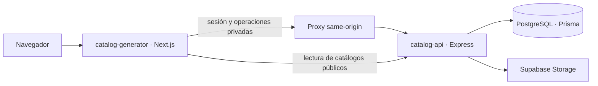

# Catalogo

Plataforma para que un negocio administre productos y comparta un catálogo público con pedidos que se pueden continuar por WhatsApp. El repositorio contiene dos aplicaciones desplegadas por separado.

## Arquitectura



- `catalog-generator/`: panel del vendedor, proxy same-origin y páginas públicas del catálogo.
- `catalog-api/`: API Express, validación Zod, autenticación, acceso a PostgreSQL con Prisma y almacenamiento de imágenes.
- `render.yaml`: servicio de API en Render. Vercel debe desplegar `catalog-generator/` como raíz del proyecto.
- Cada aplicación conserva su propio `package.json` y `package-lock.json` para instalar y desplegarse por separado.

## Requisitos

- Node.js compatible con Next.js 16 y npm.
- PostgreSQL accesible desde la API.
- Un proyecto Supabase para almacenamiento de imágenes.
- Google OAuth es opcional; solo se necesita si se habilita el inicio de sesión con Google.

## Desarrollo local

Configura primero `catalog-api/.env` a partir de `catalog-api/.env.example`. Define `DATABASE_URL`, `JWT_SECRET`, `SUPABASE_URL` y `SUPABASE_SECRET_KEY`; Google y CORS se describen en el README de la API.

En una terminal:

```bash
cd catalog-api
npm ci
npm run prisma:generate
npm run prisma:migrate
npm run dev
```

La API escucha en `http://localhost:3000`. En otra terminal, configura `catalog-generator/.env.local` desde su `.env.example` y ejecuta:

```bash
cd catalog-generator
npm ci
npm run dev
```

El frontend escucha en `http://localhost:3001`. Consulta los README de cada módulo para variables, configuración OAuth, pruebas y despliegue.

## Validaciones antes de publicar

```bash
cd catalog-api
npm run build
npm test

cd ../catalog-generator
npm run lint
npm run build
```

Para cambios de Prisma, valida el esquema, regenera el cliente y revisa la migración antes de aplicarla. No incluyas archivos `.env`, `.env.local`, credenciales ni claves en commits.

## Documentación del proyecto

- [API: desarrollo, despliegue y datos](catalog-api/README.md)
- [Frontend: desarrollo, variables y módulos](catalog-generator/README.md)
- [Proceso para añadir diseños de catálogo](catalog-generator/docs/agregar-disenos-de-catalogo.md)
