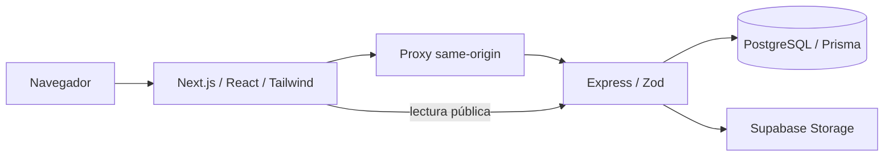

# Catalogo

Plataforma para que un negocio administre productos, publique un catálogo y reciba solicitudes de compra que puede atender por WhatsApp. El pedido se registra antes de abrir WhatsApp; precios y totales se calculan en el servidor. No procesa pagos ni reserva inventario.

## Funcionalidades

El repositorio implementa autenticación propia y Google Sign-In, catálogos y diseños, productos/categorías/imágenes, pedidos idempotentes, archivado sin destruir pedidos, SEO/Open Graph, cotizaciones PDF desacopladas de la compra e importación Excel con plantilla, vista previa y reporte por fila. Incluye las mejoras de formato del importador y Zod 4.6.6.

El responsable comunica esos bloques cerrados y desplegados. [Estado actual](docs/estado.md) distingue esa comunicación de lo implementado y de las verificaciones locales; no se infiere el estado remoto del código.

## Arquitectura resumida



Frontend en `catalog-generator/` y API en `catalog-api/`, cada uno con su manifiesto y lockfile. Vercel y Render son los destinos comunicados. El JWT queda en cookie HttpOnly; `catalogo-session` en localStorage solo aporta metadata visual y no autoriza. El PDF admite acceso por token. Consulta [arquitectura y flujo de compra](docs/arquitectura.md) y [decisiones](docs/decisiones.md).

## Arranque rápido

Requisitos: Node.js `24.x` según `engines.node`, npm, PostgreSQL de desarrollo aislado y configuración Storage. Configura tus archivos locales a partir de las plantillas de ejemplo siguiendo los [README de API](catalog-api/README.md#desarrollo-local) y [frontend](catalog-generator/README.md#desarrollo-local). No uses credenciales ni datos de producción.

En PowerShell, dentro de `catalog-api`, ejecuta cada comando por separado y detente si falla:

```powershell
npm.cmd ci
npm.cmd run prisma:generate
# Solo tras confirmar que DATABASE_URL apunta a desarrollo aislado:
npm.cmd run prisma:migrate
npm.cmd run dev
```

La API escucha por defecto en `http://localhost:3000`. En otra terminal, dentro de `catalog-generator`:

```powershell
npm.cmd ci
npm.cmd run dev
```

El frontend de desarrollo escucha en `http://localhost:3001`. Google OAuth es opcional. Para instalar versiones ya registradas usa `npm ci`; cambiar dependencias requiere otro trabajo y actualizar el lockfile deliberadamente.

## Despliegue

Orden coordinado: migración cuando sea necesaria → push autorizado → API → frontend. Las migraciones se aplican por separado del arranque. Render usa `catalog-api` como raíz y Vercel `catalog-generator`; la configuración efectiva depende del panel o del Blueprint que realmente gestione el servicio.

Los comandos exactos, variables de build, comprobación del commit publicado y recuperación están en [despliegue](docs/despliegue.md). Para cambios de esquema, seguir además [migraciones y respaldo](docs/migrations.md). Tener un health check correcto no acredita versión ni esquema actualizado.

## Comprobaciones

Consulta la [matriz de pruebas](docs/testing.md): reúne comandos por paquete, prerrequisitos y límites de las verificaciones con dobles, HTTP local, navegador o PostgreSQL real. Los builds incluyen TypeScript; no hay scripts independientes `typecheck`, y la API no tiene `lint`.

## Documentación

| Necesidad | Lectura |
|---|---|
| Retomar el proyecto | [Estado](docs/estado.md), [decisiones](docs/decisiones.md), [arquitectura](docs/arquitectura.md) |
| Publicar una versión | [Despliegue](docs/despliegue.md), [migraciones](docs/migrations.md) |
| Comprobar un cambio | [Matriz de pruebas](docs/testing.md), [workaround Windows de API](catalog-api/docs/testing.md) |
| Trabajar en un módulo | [API](catalog-api/README.md), [frontend](catalog-generator/README.md) |
| Pedidos y PDF | [Idempotencia](catalog-api/docs/order-idempotency.md), [cotizaciones](docs/quotations.md) |
| Verificación de correo y recuperación | [Contratos, límites, migración y configuración de correo](docs/accounts.md) |
| Rol de administración | [Protección API/frontend y promoción manual](docs/admin-role.md) |
| Importar Excel | [Contrato API](docs/product-import.md), [lector/plantilla](catalog-generator/docs/product-import-reader.md), [flujo UI](catalog-generator/docs/product-import-ui.md) |
| Publicación y diseños | [SEO/OG](catalog-generator/docs/public-seo.md), [añadir diseños](catalog-generator/docs/agregar-disenos-de-catalogo.md) |
| Consultar verificaciones anteriores | [Historial fechado](docs/historial/README.md), incluido el parche Zod |

La documentación generada OpenAPI tiene cobertura parcial; los contratos de importación y cotizaciones se describen en sus documentos funcionales. Las reglas de colaboración permanecen en [Agents.md](Agents.md).
