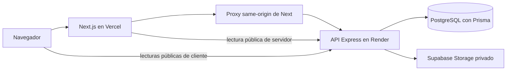

# Arquitectura y flujos de datos

Referencia del repositorio al 25 de octubre de 2026. El estado de despliegue comunicado se distingue de las comprobaciones locales en [estado](estado.md).

## Componentes

- [catalog-generator](../catalog-generator/README.md): React, TypeScript y Tailwind; panel, páginas públicas y proxy. Los catálogos y productos públicos usan lectura de servidor para SEO; carrito y reseñas conservan consultas cliente.
- [catalog-api](../catalog-api/README.md): rutas/controladores HTTP, validación Zod, servicios y repositorios Prisma. PostgreSQL conserva cuentas, catálogos, productos, pedidos e instantáneas de cotización.
- Storage conserva imágenes; la API entrega URLs firmadas. El PDF se genera al descargar y no se publica como objeto de Storage. OG obtiene imágenes permitidas o genera un fallback.
- Cada aplicación tiene su propio manifiesto y lockfile; se instala y despliega por separado. No hay workspaces compartidos.

## Recorrido de una compra

1. El comprador consulta un catálogo activo y no archivado, añade productos al carrito y confirma el envío de sus datos de entrega.
2. El cliente envía el POST público del pedido, con identificadores, cantidades y una clave idempotente opcional. Los precios del cliente no son autoridad.
3. La transacción principal comprueba el catálogo, recupera el pedido previo cuando corresponde y calcula precios con productos persistidos. Guarda el pedido `PENDING` y una instantánea de sus líneas. No reserva ni descuenta stock.
4. Después del commit se intenta emitir la cotización en una transacción separada. Se espera el intento; no se deja una tarea sin esperar. Si falla esa etapa, el POST conserva HTTP 201 y el pedido, con campos de cotización nulos.
5. La interfaz informa el pedido registrado. El comprador decide abrir WhatsApp; el mensaje puede incluir el enlace de cotización si existe. Abrir el enlace no demuestra que el mensaje se haya enviado.
6. El vendedor consulta y gestiona el pedido autenticado. La cotización es una solicitud sujeta a confirmación, no un pago ni una confirmación del vendedor.

Detalles: [idempotencia](../catalog-api/docs/order-idempotency.md), [cotizaciones](quotations.md) y [decisiones](decisiones.md).

## Fronteras de confianza

El JWT de sesión se conserva en una cookie `HttpOnly` del frontend; el proxy lo transmite a la API como autorización. Las mutaciones del proxy verifican Origin, rutas y tamaños. La API valida el JWT y limita los recursos privados al propietario autenticado. CORS, la visibilidad del panel y los identificadores enviados por el cliente no sustituyen esa autorización.

`catalogo-session` en localStorage contiene metadata visual del usuario (`id`, `email`, `name`). **Solo sirve a la interfaz y no autoriza ninguna operación.** No contiene el JWT; el parser rechaza registros que incluyan `token`. Modificar esa metadata no concede acceso: cookie, validación del servidor y filtro de propietario siguen siendo obligatorios. El código correspondiente está en [lib/api.ts](../catalog-generator/lib/api.ts).

Existen dos accesos distintos a datos personales persistidos del pedido:

| Acceso | Autorización y alcance |
|---|---|
| Vendedor | Sesión autenticada y pertenencia del pedido al catálogo del propietario. |
| Portador del enlace PDF | Token aleatorio de cotización más pedido y catálogo coincidentes; pedido no cancelado. No exige sesión de vendedor. |

El recibo del POST se entrega además al comprador que acaba de registrar el pedido. Los catálogos públicos no exponen listados de compradores. El token PDF es una credencial: no debe aparecer en logs, analítica o sitemap. Cancelar revoca descargas posteriores, pero no borra PDFs ya descargados. Véase [privacidad del PDF](quotations.md#descarga-y-privacidad).

## Importación y publicación

Excel se procesa en un worker local con límites ZIP/XML. Solo las filas válidas se envían como JSON. El servidor valida propiedad, reglas comerciales y emparejamiento; una vista previa firmada vincula el plan que el vendedor confirma. Los campos parciales rechazados se usan únicamente para el reporte. Referencias: [API](product-import.md), [lector](../catalog-generator/docs/product-import-reader.md) e [interfaz](../catalog-generator/docs/product-import-ui.md).

Las páginas públicas y OG comprueban publicación en cada lectura, sin caché persistente de aplicación. Las plataformas externas pueden conservar tarjetas propias. Véase [SEO público](../catalog-generator/docs/public-seo.md).

La API confía en un salto de proxy (`trust proxy = 1`). Next no reenvía la IP original del navegador: los límites por IP pueden agrupar tráfico de Vercel. Cambiar la topología exige revisar ese supuesto; no se debe ampliar la confianza sin verificar los saltos. Detalles en [proxy y límites](migrations.md#proxy-de-render-y-limitación-de-solicitudes).
