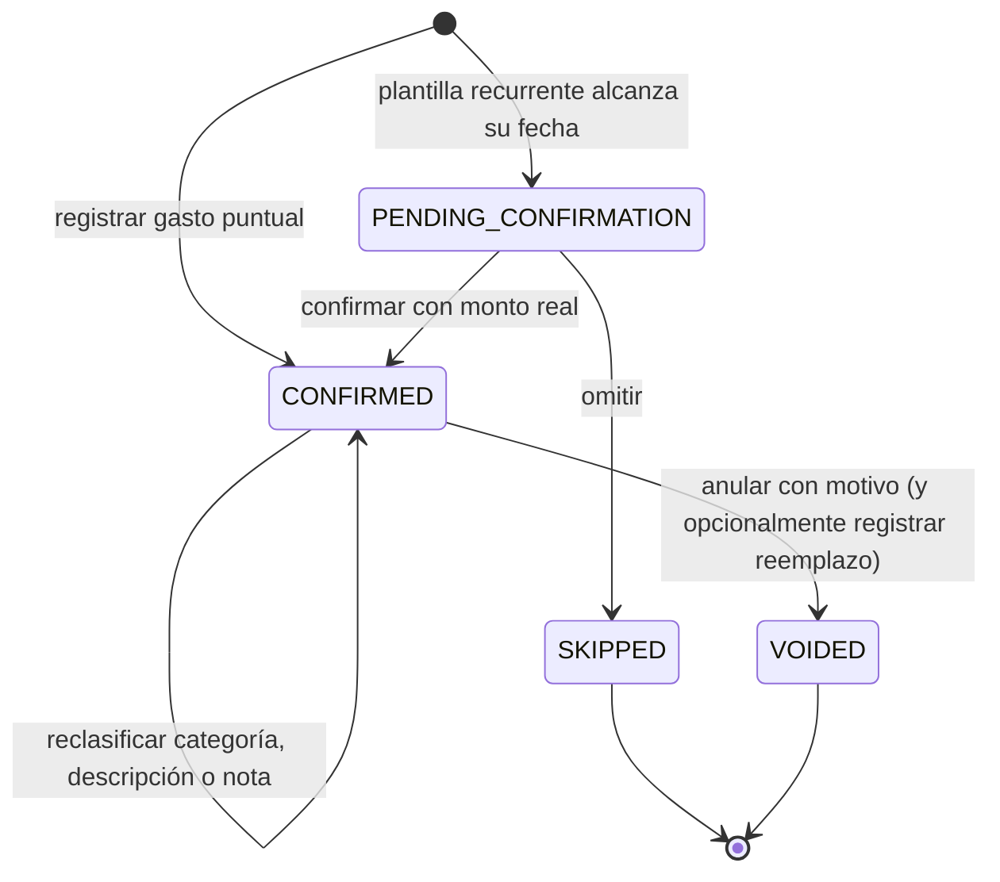
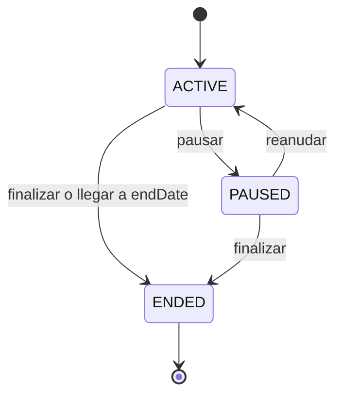

# Contrato de Gastos — F1 operativos de contado

Versión 1.2, 24 de noviembre de 2026. Cambio respecto a la 1.1: la reclasificación también puede cambiar la nota del medio de pago (`paymentMethodNote`); ver la [sección 17](#17-decisiones-tomadas).

**Estado:** aprobado para implementar **F1a** (categorías y gastos puntuales). Las decisiones del responsable están en la [sección 17](#17-decisiones-tomadas) y el plan de F1a en la [sección 18](#18-plan-de-implementación-de-f1a). F1b (gastos fijos y pagos programados) se rediseñó en la **[ampliación de F1b](expenses-f1b-contract.md)** (aprobada el 25/11/2026), que sustituye el diseño de F1b de este documento (ocurrencias `PENDING_CONFIRMATION` en `expenses`). Este documento no autoriza push, despliegues ni operaciones en producción.

## 1. Alcance y base existente

Gastos es un módulo privado por cuenta para registrar **gastos operativos de contado**: arriendo, servicios públicos, internet, transporte y domicilios, publicidad, mantenimiento, comisiones, nómina y honorarios, trámites y similares. Incluye categorías propias, gastos puntuales, gastos recurrentes que el dueño confirma u omite, reclasificación, anulación con motivo, historial y totales por periodo.

**Las compras de mercancía no son gastos.** Son entradas de inventario con costo real, previstas para F2 (decisión 19). El sistema no ofrece una categoría de compras, y la interfaz lo advierte al registrar un gasto (sección 13). Hoy `inventory_movements` no guarda costo y solo existe el costo de referencia de `item_commercial_terms` ([contrato de ventas](sales-contract.md#4-dinero-ficha-comercial-y-cálculo)).

Fuera de F1:
- gastos a crédito y la entidad Proveedor, y entradas de inventario con costo real (F2);
- avisos de gastos por confirmar (F3);
- exportación y utilidad (F5);
- caja y saldos por medio de pago (F6);
- fotos de soportes (F1c);
- cuentas por pagar, conciliación bancaria, impuestos o IVA, importación Excel/CSV, presupuestos y contabilidad.

Base inspeccionada: [esquema](../catalog-api/prisma/schema.prisma), [ventas v2.1](sales-contract.md), [estado](estado.md), el patrón de recibos e historial de compatibilidades y ventas, el bloqueo de cuenta abierta `lockInventoryOwner`, los workers en proceso de [server.ts](../catalog-api/src/server.ts) y la pantalla de Ventas (F0d-2).

## 2. Invariantes

1. El propietario sale de la sesión validada. Toda lectura y escritura filtra por `ownerId`. Un recurso ajeno o inexistente responde `404` sin distinguir ambos casos.
2. De un gasto **confirmado** solo se pueden reclasificar la categoría, la descripción y la nota del medio de pago (`paymentMethodNote`, que solo existe con `OTHER`). Cada cambio queda como evento `RECLASSIFIED` en `expense_events`, con los valores anterior y nuevo. Proveedor, referencia de pago, monto, fecha y medio de pago no se editan: se anula con motivo y se registra otro, y ambos quedan en el historial.
3. Un gasto recurrente **nunca se confirma solo**. La plantilla genera ocurrencias *por confirmar*, y solo una acción explícita del dueño las confirma (con el monto real) u omite.
4. Solo los gastos `CONFIRMED` cuentan en totales. Por confirmar, omitidos y anulados se muestran aparte.
5. Todo gasto tiene categoría, medio de pago, fecha del gasto, monto entero positivo en COP y descripción. `OTHER` exige una nota.
6. La fecha del gasto la elige el dueño, es una fecha de calendario de Colombia y no puede ser futura ni anterior a cinco años. La fecha de registro la pone el servidor.
7. Archivar una categoría no borra ni reclasifica gastos. Renombrarla no cambia la identidad con que se filtra.
8. Toda mutación lleva `operationId` y `requestId`, con la regla de idempotencia de Ventas v2.1 (sección 9).
9. Gastos no modifica inventario, ventas, pedidos ni catálogo, ni toma sus bloqueos.
10. Ningún gasto, categoría, plantilla, recibo ni evento se borra. Se conservan mientras exista la cuenta (decisión 12).
11. IVA y retenciones no se gestionan: `taxMode = NOT_MANAGED` y el monto es el total pagado.

## 3. Estados y transiciones

### Gasto

| Origen | Acción | Destino | Efecto |
| --- | --- | --- | --- |
| — | Registrar | `CONFIRMED` | Registrar un gasto puntual es la confirmación del dueño; no hay borrador. |
| — | Generar ocurrencia (F1b) | `PENDING_CONFIRMATION` | Copia los datos sugeridos de la plantilla. No cuenta en totales. |
| `PENDING_CONFIRMATION` | Confirmar (F1b) | `CONFIRMED` | El dueño envía monto real, fecha, categoría y medio de pago, que pueden diferir de lo sugerido. Se fijan `confirmedAt` y la instantánea de categoría. |
| `PENDING_CONFIRMATION` | Omitir (F1b) | `SKIPPED` | Motivo opcional. Es también la forma de descartar una ocurrencia creada por error. La ocurrencia no se vuelve a generar ni se reabre. |
| `CONFIRMED` | Reclasificar | `CONFIRMED` | Cambia `categoryId` (solo a una categoría activa), `description` o `paymentMethodNote` (solo si el medio es `OTHER`; no puede quedar vacía). Sube la versión y registra un evento `RECLASSIFIED` con los valores anterior y nuevo. No cambia proveedor, referencia, monto, fecha ni medio de pago. |
| `CONFIRMED` | Anular | `VOIDED` | Motivo obligatorio (3–300). Sale de los totales; conserva todos sus datos. Si llega un reemplazo, se crea en la misma transacción como `CONFIRMED`, vinculado mediante `replacesExpenseId`. |

No se permite:
- editar proveedor, referencia de pago, monto, fecha o medio de pago de un confirmado;
- anular un pendiente u omitido;
- reabrir un anulado o un omitido. Si una ocurrencia se omitió por error, se registra un gasto puntual;
- borrar nada.

Un gasto pendiente no se edita campo a campo: los datos definitivos llegan al confirmar.

### Plantilla recurrente (F1b)

Solo `ACTIVE` genera ocurrencias. Pausar o finalizar no toca las ocurrencias ya generadas: las pendientes siguen esperando decisión y las confirmadas no cambian. Editar una plantilla afecta solo a las ocurrencias futuras aún no generadas.

## 4. Dinero, fechas y medios de pago

- **Monto:** pesos COP enteros en `BIGINT`, mayor que cero y como máximo **1.000.000.000.000**. En JSON, cadena decimal sin separadores (`"1250000"`). En pantalla, con el formato de Ventas (`$ 1.250.000`). `currency = 'COP'`. En el cliente, solo cadena o `BigInt`, nunca `Number`.
- **Totales:** se suman en SQL como `numeric` y se devuelven como cadena, para que un periodo largo no desborde.
- **Fecha del gasto (`expenseDate`):** tipo `DATE`, sin hora, interpretada en `America/Bogota`. **No se admiten fechas futuras**, y el límite hacia atrás es **cinco años** (hoy en Bogotá menos cinco años). Se aplica al registrar, al confirmar una ocurrencia y al reemplazar un anulado. La base de datos solo impone un mínimo fijo (`2000-01-01`); la ventana móvil la valida el servidor.
- **Fecha de registro (`recordedAt`):** `timestamptz` del servidor. El cliente no la envía.
- **Periodos:** rango cerrado `[from, to]` sobre `expenseDate`. Por defecto, el mes en curso de Bogotá.
- **Medio de pago** (enum `ExpensePaymentMethod`). Códigos en inglés y etiquetas en español en la interfaz:

  | Código | Etiqueta |
  | --- | --- |
  | `CASH` | Efectivo |
  | `NEQUI` | Nequi |
  | `DAVIPLATA` | Daviplata |
  | `BANK_TRANSFER` | Transferencia |
  | `CARD` | Tarjeta |
  | `OTHER` | Otro |

  Con `OTHER` se exige `paymentMethodNote` (3–80 caracteres, por ejemplo «Bancolombia a la mano»); con los demás debe ser nula. En F1 todo gasto es de contado: se pagó en el momento con ese medio. El medio queda registrado para la caja (F6), pero F1 no calcula saldos.
- **Referencia de pago (`paymentReference`):** opcional, hasta 100 caracteres, con cualquier medio (por ejemplo, el número de transacción de Nequi). Es **privada**: no aparece en el listado ni en los totales, solo en el detalle; no se registra en logs ni en mensajes de error. Puede contener teléfonos.
- **Impuestos:** `taxMode = NOT_MANAGED`. El monto es el total pagado; no se desglosa ni se presenta un IVA cero como exención.

## 5. Modelo de datos lógico

Todas las tablas nuevas usan `@@map` en snake_case, IDs UUID en `TEXT`, `ownerId` → `users(id)` y FKs `RESTRICT`. La migración de F1a crea el modelo completo, incluida la tabla de plantillas que usará F1b (sección 18).

| Entidad (tabla) | Campos principales y reglas |
| --- | --- |
| `ExpenseCategory` (`expense_categories`) | `id`, `ownerId`, `name` (1–60), `normalizedKey` (NFC, trim, espacios colapsados, minúsculas), `seedKey?` (identifica una categoría sugerida), `position`, `archivedAt?`, `version`, `createdAt`, `updatedAt`. |
| `Expense` (`expenses`) | `id`, `ownerId`, `status` (`PENDING_CONFIRMATION`, `CONFIRMED`, `SKIPPED`, `VOIDED`), `source` (`MANUAL`, `RECURRING`), `templateId?`, `occurrenceDate?`, `expenseDate`, `amount?`, `suggestedAmount?`, `currency`, `taxMode` (`NOT_MANAGED`), `categoryId`, `categoryNameSnapshot?`, `paymentMethod`, `paymentMethodNote?`, `paymentReference?` (≤100), `description` (1–300), `supplierName?` (1–160, texto libre hasta F2), `replacesExpenseId?`, `recordedAt`, `confirmedAt?`, `skippedAt?`, `skipReason?` (≤300), `voidedAt?`, `voidReason?` (3–300), `version`, `updatedAt`. |
| `RecurringExpenseTemplate` (`recurring_expense_templates`) | `id`, `ownerId`, `status` (`ACTIVE`, `PAUSED`, `ENDED`), `description`, `categoryId`, `paymentMethod`, `paymentMethodNote?`, `supplierName?`, `estimatedAmount?`, `frequency` (`WEEKLY`, `MONTHLY`, `YEARLY`), `interval` (1–12), `anchorDate`, `endDate?`, `generatedThrough?` (última fecha materializada), `version`, `createdAt`, `updatedAt`, `endedAt?`. |
| `ExpenseOperation` (`expense_operations`) | `ownerId`, `operationId`, `requestId`, `kind`, `resourceId`, `requestHash`, `responseSnapshot`, `createdAt`. Recibo terminal de mutaciones exitosas. |
| `ExpenseEvent` (`expense_events`) | `id`, `ownerId`, `operationId?`, `entityKind` (`EXPENSE`, `CATEGORY`, `TEMPLATE`), `entityId`, `eventType` (`CREATED`, `RECLASSIFIED`, `VOIDED`, `REPLACED`, `CONFIRMED`, `SKIPPED`, `RENAMED`, `ARCHIVED`, `REACTIVATED`…), `before?`, `after`, `occurredAt`. Historial inmutable. El actor es el propietario y no se duplica. |

En `Expense`:
- `amount` es el monto real y solo existe en `CONFIRMED` y `VOIDED`.
- `suggestedAmount` es la copia de `estimatedAmount` al generar la ocurrencia; es informativo y nunca suma.
- `categoryNameSnapshot` es el nombre de la categoría al confirmar o reclasificar, para leer el historial aunque luego se renombre. Los filtros usan `categoryId`.

### Integridad e índices

- `UNIQUE (id, ownerId)` en categorías, gastos y plantillas. FKs compuestas `(categoryId, ownerId)`, `(templateId, ownerId)` y `(replacesExpenseId, ownerId)`, para que la base de datos impida mezclar cuentas aunque falle el servicio.
- Categorías: `UNIQUE (ownerId, normalizedKey)`, incluidas las archivadas: un nombre archivado se reactiva, no se duplica. `UNIQUE (ownerId, seedKey)` cuando `seedKey` no sea nulo.
- Ocurrencias: `UNIQUE (templateId, occurrenceDate)`, para que una fecha de plantilla no se genere dos veces.
- Reemplazos: `UNIQUE (replacesExpenseId)`, de modo que un anulado tenga como máximo un reemplazo.
- Recibos: PK `(ownerId, operationId)` y `UNIQUE (ownerId, requestId)`, como en Ventas. Eventos: FK al recibo cuando tengan `operationId`.
- CHECK:
  - Montos: `amount > 0` y `suggestedAmount > 0` cuando no son nulos; `amount <= 1000000000000`; `currency = 'COP'`; `taxMode = 'NOT_MANAGED'`.
  - Fecha: `expenseDate >= '2000-01-01'`.
  - Medio de pago: `paymentMethod = 'OTHER'` si y solo si `paymentMethodNote` no es nulo. `paymentReference` nulo o de 1 a 100 caracteres.
  - Coherencia de estado:
    - `CONFIRMED` exige `amount` y `confirmedAt`;
    - `VOIDED` exige además `voidedAt` y un `voidReason` de al menos 3 caracteres;
    - `PENDING_CONFIRMATION` exige `amount` nulo y `source = 'RECURRING'`;
    - `SKIPPED` exige `skippedAt`.
  - Origen: `source = 'RECURRING'` si y solo si `templateId` y `occurrenceDate` no son nulos.
  - Plantillas: `interval` entre 1 y 12; `endDate` nulo o ≥ `anchorDate`; `estimatedAmount` nulo o > 0.
- Triggers:
  - inmutabilidad de `expense_events` y `expense_operations` (sin UPDATE ni DELETE);
  - guardia en `expenses`: ningún gasto se borra. Un `CONFIRMED` solo puede:
    - seguir `CONFIRMED`, cambiando únicamente `categoryId`, `categoryNameSnapshot`, `description`, `paymentMethodNote`, `version` y `updatedAt` (reclasificar);
    - pasar a `VOIDED`, cambiando únicamente `status`, `voidedAt`, `voidReason`, `version` y `updatedAt`.

    Un `VOIDED` o `SKIPPED` no cambia.

  Prisma 6 no representa CHECK ni triggers: se documentan en el SQL de la migración.
- Índices de lectura:
  - `(ownerId, status, expenseDate, id)` para listado y totales;
  - `(ownerId, categoryId, expenseDate)`;
  - `(ownerId, paymentMethod, expenseDate)`;
  - `(ownerId, status, templateId)` para pendientes;
  - `(ownerId, entityKind, entityId, occurredAt)` en eventos.

  Medir con `EXPLAIN` y volumen representativo antes de añadir más.

## 6. Categorías

- **Semilla sugerida por cuenta**, con `seedKey` fijo:
  - Arriendo
  - Servicios públicos
  - Internet y telefonía
  - Transporte y domicilios
  - Publicidad y redes
  - Mantenimiento y reparaciones
  - Papelería e insumos
  - Comisiones bancarias y de plataformas
  - Impuestos y trámites
  - Nómina y honorarios
  - Otros gastos

  No incluye «Compras de mercancía». Para la categoría «Nómina y honorarios», la interfaz recuerda que no se escriban documentos ni datos sensibles de las personas en la descripción ni en la referencia.
- **Cómo se siembra:** no la siembra la migración (sin backfill sobre usuarios existentes). La interfaz llama a `POST /expense-categories/seed` la primera vez que el dueño abre Gastos. Inserta cada `seedKey` que falte, con `ON CONFLICT DO NOTHING`, bajo el bloqueo de la cuenta; repetirlo no duplica nada.
  - Una semilla renombrada o archivada conserva su `seedKey` y no se recrea.
  - Si el dueño ya tiene una categoría propia con el mismo nombre normalizado, esa semilla se omite.
- **Operaciones:** crear, renombrar, archivar, reactivar y reordenar, cada una con versión esperada y evento. No hay borrado.
- **Archivar:** la categoría desaparece de los selectores de registro, reclasificación, confirmación y plantillas, pero sigue en filtros (marcada «archivada»), en gastos históricos y en totales. Una plantilla con categoría archivada sigue generando ocurrencias; para confirmarlas hay que elegir una categoría activa.
- **Renombrar:** no cambia `categoryId`. Los gastos conservan `categoryNameSnapshot` como dato histórico, y los listados muestran el nombre vigente con el histórico si difieren.
- **Cuota:** como máximo 100 categorías por cuenta, incluidas las archivadas.

## 7. Gastos recurrentes (F1b)

> **Sustituida** por la [ampliación de F1b](expenses-f1b-contract.md): los pagos programados viven en una tabla propia y marcarlos pagados crea el gasto. Se conserva el texto como referencia histórica.

- **Fechas:** `frequency` (`WEEKLY`, `MONTHLY`, `YEARLY`) × `interval` (1–12) desde `anchorDate`. Quincenal es semanal cada 2. En mensual y anual se conserva el día del ancla; si el mes no tiene ese día (29–31), se usa el último día del mes, sin desplazar los siguientes.
- **Arranque en el pasado:** `anchorDate` puede ser anterior a hoy. En la primera materialización, de todas las fechas ya vencidas **solo se genera la más reciente**; las anteriores se registran, si hacen falta, como gastos puntuales. `generatedThrough` queda en esa fecha.
- **Materialización solo al abrir el módulo.** La interfaz llama a `POST /expenses/pending/refresh` al abrir Gastos. No hay worker ni avisos en F1: los avisos llegan en F3. En una transacción con el bloqueo de la cuenta, para cada plantilla `ACTIVE` se crean las ocurrencias con fecha posterior a `generatedThrough` y no posterior a hoy (Bogotá), y se avanza `generatedThrough`.
  - La unicidad `(templateId, occurrenceDate)` hace que dos llamadas simultáneas no dupliquen nada.
  - Se generan como máximo 24 ocurrencias por plantilla y llamada; el resto, en llamadas siguientes.
- **Qué se copia:** cada ocurrencia copia de la plantilla descripción, categoría, medio de pago, nota y proveedor, y `estimatedAmount` → `suggestedAmount`, con `expenseDate = occurrenceDate`. Los cambios posteriores en la plantilla no las alteran.
- **Pausa:** al reanudar **no se generan las fechas de la pausa**. `generatedThrough` pasa al día anterior a la reanudación, así que solo se generan fechas desde ese día. `endDate` finaliza la plantilla en su última ocurrencia.
- **Confirmar u omitir:** confirmar exige monto real y puede cambiar fecha (dentro de la ventana de cinco años), categoría (solo activa), medio de pago, referencia, descripción y proveedor. Omitir no pide monto. Una ocurrencia creada por error se **omite**; nunca se borra.

## 8. API

Rutas privadas bajo `/api`, con la autenticación vigente (cookie HttpOnly y proxy same-origin), `Cache-Control: private, no-store`, Zod estricto (rechaza campos desconocidos, `ownerId`, fechas de registro, `taxMode` y estados enviados por el cliente) y cuerpos de hasta 16 KiB. Para que ese límite sea efectivo, el router se monta antes del parser global de 32 KiB, como compatibilidades. Respuesta `{ success: true, result }`; error `{ success: false, error, message }`. Todas las mutaciones llevan `operationId` y `requestId` (sección 9).

| Fase | Método y ruta | Contrato |
| --- | --- | --- |
| F1a | `GET /expense-categories?status=active\|archived\|all` | Categorías propias ordenadas por `position`, con `version`. |
| F1a | `POST /expense-categories/seed` | `{operationId, requestId}`. Siembra idempotente (sección 6). Devuelve las categorías. |
| F1a | `POST /expense-categories` | `{operationId, requestId, name}`. `409 EXPENSE_CATEGORY_NAME_CONFLICT` si el nombre normalizado ya existe, aunque esté archivado; devuelve el ID existente para reactivarlo. |
| F1a | `PATCH /expense-categories/:id` | `{operationId, requestId, expectedVersion, name?, position?}`. |
| F1a | `POST /expense-categories/:id/archive`, `…/reactivate` | `{operationId, requestId, expectedVersion}`. |
| F1a | `GET /expenses?from&to&categoryId&paymentMethod&status&cursor` | 25 por página, orden `(expenseDate desc, recordedAt desc, id desc)` y cursor opaco validado del propietario. `status`: `CONFIRMED` (por defecto), `VOIDED`, `SKIPPED` o `all`. `from`/`to` son obligatorios, con un rango máximo de 366 días. No incluye `paymentReference`. |
| F1a | `GET /expenses/summary?from&to&categoryId&paymentMethod` | Para el periodo y los filtros: `confirmedTotal`, `confirmedCount`, `byCategory[]`, `byPaymentMethod[]`, `voidedCount`, `pendingCount` y `pendingSuggestedTotal`. Este último es informativo y nunca forma parte del total; en F1a vale 0. |
| F1a | `GET /expenses/:id` | Detalle con `paymentReference`, reemplazo o reemplazado vinculado y eventos paginados. |
| F1a | `POST /expenses` | `{operationId, requestId, expenseDate, amount, categoryId, paymentMethod, paymentMethodNote?, paymentReference?, description, supplierName?}`. Crea un `CONFIRMED`. `201`. |
| F1a | `PATCH /expenses/:id` | Reclasificar: `{operationId, requestId, expectedVersion, categoryId?, description?, paymentMethodNote?}`, con al menos uno. Solo `CONFIRMED` y categoría activa; `paymentMethodNote` solo si el medio es `OTHER` (3–80 caracteres). Cualquier otro campo da `400 INVALID_EXPENSE_INPUT`. |
| F1a | `POST /expenses/:id/void` | `{operationId, requestId, expectedVersion, reason, replacement?}`. `replacement` usa el cuerpo de `POST /expenses` sin `operationId` ni `requestId`. Anulación y reemplazo son atómicos; el resultado incluye ambos. |
| F1b | `GET /expenses/pending` | Ocurrencias por confirmar, de la más antigua a la más reciente, paginadas. |
| F1b | `POST /expenses/pending/refresh` | Sin cuerpo. Materializa ocurrencias (sección 7) y devuelve `{generated, pendingCount}`. Es idempotente por la unicidad de las ocurrencias y tiene limitador propio. |
| F1b | `POST /expenses/:id/confirm` | `{operationId, requestId, expectedVersion, amount, expenseDate, categoryId, paymentMethod, paymentMethodNote?, paymentReference?, description, supplierName?}`. |
| F1b | `POST /expenses/:id/skip` | `{operationId, requestId, expectedVersion, reason?}`. |
| F1b | `GET /recurring-expenses?status` | Plantillas propias con su próxima fecha calculada. |
| F1b | `POST /recurring-expenses` | `{operationId, requestId, description, categoryId, paymentMethod, paymentMethodNote?, supplierName?, estimatedAmount?, frequency, interval, anchorDate, endDate?}`. |
| F1b | `PATCH /recurring-expenses/:id` | `{operationId, requestId, expectedVersion, …}`. Solo `ACTIVE` o `PAUSED`; afecta solo a ocurrencias futuras. |
| F1b | `POST /recurring-expenses/:id/pause`, `…/resume`, `…/end` | `{operationId, requestId, expectedVersion}`. |

Errores:
- `400`: `INVALID_EXPENSE_INPUT` (Zod, incluida una fecha futura o de más de cinco años) y `EXPENSE_CATEGORY_ARCHIVED` al usar una categoría archivada.
- `401`: sin sesión o con la cuenta cerrada.
- `404`: `EXPENSE_NOT_FOUND`, `EXPENSE_CATEGORY_NOT_FOUND` y `RECURRING_EXPENSE_NOT_FOUND`, uniformes para ajenos e inexistentes.
- `409`: `VERSION_CONFLICT`, `INVALID_EXPENSE_TRANSITION`, `IDEMPOTENCY_CONFLICT`, `EXPENSE_CATEGORY_NAME_CONFLICT`, `EXPENSE_CATEGORY_QUOTA` y `RECURRING_EXPENSE_ENDED`.
- `429` del limitador vigente.
- `503 EXPENSE_RETRY_SAME_OPERATION` ante un fallo técnico, sin detalles internos.

Los mensajes se presentan legibles en español en la interfaz.

## 9. Idempotencia y recuperación

**Idéntica a Ventas v2.1** ([contrato](sales-contract.md#7-idempotencia-una-clave-por-llamada)):

- `operationId`: UUID de la intención, generado por el cliente. Se conserva ante doble clic, error de red y «Reintentar» mientras el contenido no cambie. El recibo se busca **solo** por `(ownerId, operationId)`.
- `requestId`: UUID nuevo en cada transmisión. Se guarda en el recibo con `UNIQUE (ownerId, requestId)`, pero **no forma parte del hash** ni identifica la operación.
- `requestHash`: SHA-256 del cuerpo validado **sin `requestId`**, junto con el tipo de operación y los IDs de la ruta.

| Situación | Resultado |
| --- | --- |
| Misma `operationId`, mismo contenido, cualquier `requestId` | Devuelve el recibo guardado (`responseSnapshot`) con `idempotent: true`, sin repetir efectos. Se comprueba tras los bloqueos de la sección 10 y **antes** de estado o versión. |
| Misma `operationId`, otro contenido, otro tipo de operación u otro recurso | `409 IDEMPOTENCY_CONFLICT` |
| `requestId` reutilizada en otra operación | `409 IDEMPOTENCY_CONFLICT` (por la unicidad) |
| `operationId` nueva sobre una versión superada | No es un reintento: `VERSION_CONFLICT` o `INVALID_EXPENSE_TRANSITION`. |

- Recibo, cambios de estado y eventos se escriben en el mismo commit. Si la transacción falla, no queda recibo y la misma clave puede reintentarse.
- El recibo describe el resultado original. Tras un reintento, la interfaz vuelve a leer con `GET` el estado actual.
- Dos `POST /expenses` con claves distintas son **dos gastos legítimos**: no se deduplica por parecido de monto, fecha o descripción. La interfaz advierte de un posible duplicado del mismo día y monto, sin bloquearlo.
- No hay purga automática de recibos.

## 10. Transacciones y bloqueos

Orden: `users` `FOR SHARE` comprobando `closedAt IS NULL` (mismo criterio que `lockInventoryOwner`) → `pg_advisory_xact_lock(hashtext('expenses-v1'), hashtext(ownerId))` → recibo → filas afectadas `FOR UPDATE` (gasto, plantilla o categoría) en orden por ID.

- El advisory lock por cuenta serializa las mutaciones de gastos: unicidad de nombres de categoría, siembra, materialización y cuotas. Es conservador; medir antes de granularizar. No reutiliza los locks de inventario, ventas ni catálogos.
- Gastos no toma locks de pedidos, catálogos, inventario ni ventas. El cierre de cuenta usa `Order → Catalog → User FOR UPDATE`; gastos solo toma `User FOR SHARE` y su propio namespace, así que no hay ciclo.
- Las lecturas de listado y totales usan una transacción `REPEATABLE READ` para que el listado y su resumen sean coherentes en la misma pantalla cuando se piden juntos.
- Timeout o deadlock: rollback y reintento explícito con la misma clave.

## 11. Aislamiento entre cuentas

- `ownerId` solo sale de la sesión; no se acepta en cuerpo ni query. Toda consulta filtra por `ownerId`, también los `include` y los filtros por `categoryId`.
- Las FKs compuestas impiden en la base de datos que un gasto de A use una categoría, plantilla o reemplazo de B.
- Una categoría o gasto ajeno responde `404` idéntico al inexistente. Los totales, los conteos y `hasMore` nunca incluyen filas ajenas. Un `categoryId` ajeno en un filtro devuelve `404`, no una lista vacía que confirme su existencia.
- Un `operationId` o `requestId` repetido en otra cuenta es independiente: recibos y unicidades van por propietario.
- Pruebas obligatorias con **dos cuentas** A y B (secciones 16 y 18): cada endpoint con IDs de la otra cuenta, filtros cruzados, reclasificar con una categoría ajena, la misma clave en ambas cuentas, siembra en ambas y totales que no se mezclan.

## 12. Cierre de cuenta, retención y privacidad

**Cierre de cuenta:**
- Cerrar la cuenta no borra ni transforma gastos, plantillas, categorías ni historial; las FKs `RESTRICT` lo impiden también en la base de datos.
- Tras el cierre, toda petición pendiente falla con `401` al comprobar `closedAt` dentro de la transacción.
- No se materializan ocurrencias de cuentas cerradas. Las pendientes quedan tal cual; no se omiten ni confirman automáticamente.
- **Los gastos, incluidos los pendientes, no bloquean el cierre de cuenta.** En F1 todo es de contado y no hay obligaciones con terceros. F2 (crédito con proveedores) revisará esa regla.

**Retención:** los datos de Gastos se conservan mientras exista la cuenta. La anonimización se revisará con la política general de retención del proyecto, que deberá resolver cómo aplicarla a un historial inmutable (`expense_events` guarda textos en `before`/`after`).

**Privacidad:**
- `description`, `supplierName`, `paymentMethodNote`, `paymentReference` y los motivos pueden contener datos personales (nombre de un arrendador o de un empleado, un número de Nequi). Se tratan como privados: no aparecen en logs técnicos ni en mensajes de error, no se publican en el catálogo y no entran en las métricas de administración.
- `paymentReference` solo se devuelve en el detalle, no en listados ni totales.
- La interfaz advierte que no se escriban números de documento, cuentas completas ni datos de salud.
- Las respuestas son `private, no-store`, y no se guardan borradores ni importes en `localStorage`/`sessionStorage`.

## 13. Interfaz

Nueva ruta privada `/dashboard/gastos`, enlazada en la cabecera del panel como «Gastos», junto a Inventario, Ventas y Cuenta. Mismo estilo y patrones que la pantalla de Ventas (F0d-2): tarjetas, etiquetas de estado con color, formato COP, `AlertDialog` de Radix para acciones importantes y envíos seguros (una `operationId` por intención, `requestId` nueva por envío, botones bloqueados en curso, «Reintentar» con la misma clave).

1. **Por confirmar (F1b).** Al abrir se llama a `refresh` y se listan las ocurrencias pendientes: plantilla, fecha y monto sugerido. Cada una ofrece «Confirmar» (formulario prellenado; el monto real es obligatorio aunque coincida con el sugerido) y «Omitir» (confirmación explícita, motivo opcional).
2. **Registrar gasto.**
   - Pide fecha del gasto (hoy por defecto, sin fechas futuras ni de más de cinco años), monto, categoría activa, medio de pago (con nota si es «Otro»), referencia opcional, descripción y proveedor opcional.
   - Aviso fijo: «Las compras de mercancía se registran como entrada de inventario, no como gasto».
   - Si ya existe un gasto del mismo día y monto, se avisa sin bloquear.
3. **Listado.**
   - Filtros por rango de fechas (por defecto el mes en curso, con accesos a «mes anterior» y «este año»), categoría (incluidas las archivadas, rotuladas), medio de pago y estado (confirmados por defecto; anulados y omitidos bajo demanda).
   - Paginación con «Más gastos».
   - Cada fila muestra fecha del gasto, categoría, descripción, medio, monto y su estado si no es confirmado.
4. **Totales del periodo.** Usan los mismos filtros del listado y se rotulan «Total confirmado del periodo con los filtros aplicados». Muestran desglose por categoría y por medio de pago, y aparte el número de anulados y de pendientes con su monto sugerido, que no suma.
5. **Detalle.**
   - Datos (incluida la referencia), fechas del gasto y de registro, historial de eventos y enlace al reemplazo o al anulado.
   - «Reclasificar» permite cambiar categoría, descripción y, si el medio es «Otro», la nota.
   - «Anular» pide motivo y ofrece «Anular y registrar el correcto» con el formulario prellenado, que es la vía para corregir monto, fecha o medio de pago.
6. **Categorías:** crear, renombrar, reordenar, archivar y reactivar. **Recurrentes (F1b):** crear, editar, pausar, reanudar y finalizar, mostrando la próxima fecha.
7. **Estados de pantalla:** carga, vacío («No hay gastos confirmados en este periodo»), error con acción, sesión expirada y éxito, con `aria-live`, etiquetas, teclado, foco visible y ancho móvil (320, 390, 1024 y 1440 px).
   - El formulario conserva el borrador y la clave mientras la respuesta sea incierta, y nunca reenvía solo.
   - Cambiar filtros o periodo descarta las respuestas tardías: una respuesta del periodo anterior no sobrescribe el actual.
   - La interfaz valida el DTO antes de habilitar acciones.

## 14. Casos límite

| Caso | Comportamiento |
| --- | --- |
| Gasto con fecha futura o de más de cinco años | `400 INVALID_EXPENSE_INPUT`; las fechas futuras solo existen como próxima ocurrencia de una plantilla. |
| Monto 0, negativo, decimal, con separadores o mayor que 1.000.000.000.000 | `400`. El monto llega como cadena de dígitos. |
| `OTHER` sin nota, o nota con otro medio | `400`. |
| `paymentReference` de más de 100 caracteres | `400`. |
| Categoría archivada en registro, reclasificación, confirmación o plantilla nueva | `400 EXPENSE_CATEGORY_ARCHIVED`; los históricos no cambian. |
| Reclasificar enviando proveedor, referencia, monto, fecha o medio de pago | `400 INVALID_EXPENSE_INPUT`; para esos campos hay que anular y reemplazar. |
| Reclasificar la nota de un gasto cuyo medio no es `OTHER` | `400 INVALID_EXPENSE_INPUT`; ese gasto no tiene nota. |
| Reclasificar un anulado | `409 INVALID_EXPENSE_TRANSITION`. |
| Categoría o gasto de otra cuenta | `404` uniforme, sin escrituras. |
| Doble clic al registrar | Misma clave: un solo gasto, y el segundo recibe el recibo. |
| Reintento con `requestId` nueva y mismo contenido | Recibo guardado, sin duplicar. |
| Dos pestañas confirman o reclasifican el mismo gasto | Una gana; la otra recibe `VERSION_CONFLICT` o `INVALID_EXPENSE_TRANSITION` y relee. |
| Anular dos veces | La misma clave devuelve el recibo; otra clave recibe `INVALID_EXPENSE_TRANSITION`. |
| Anular y reemplazar falla en el reemplazo | Rollback completo: el original sigue `CONFIRMED`. |
| Ocurrencia omitida por error (F1b) | No se reabre; se registra un gasto puntual. |
| Ocurrencia creada por error (F1b) | Se omite (`SKIPPED`); no se borra. |
| Plantilla con ancla hace tres meses (F1b) | Solo se genera la ocurrencia vencida más reciente. |
| Plantilla mensual con ancla el día 31 (F1b) | 31 ene → 28/29 feb → 31 mar. |
| Plantilla sin abrir el módulo en meses (F1b) | El siguiente `refresh` genera las fechas vencidas desde `generatedThrough`, como máximo 24 por plantilla; el resto, en llamadas siguientes. |
| Dos `refresh` simultáneos (F1b) | La unicidad `(templateId, occurrenceDate)` y el bloqueo de cuenta impiden duplicados. |
| Pausa y reanudación (F1b) | No se generan las fechas de la pausa. |
| Renombrar una categoría usada | Los filtros siguen funcionando por ID; los gastos conservan el nombre histórico. |
| Periodo sin gastos | Totales `"0"`, desgloses vacíos y mensaje de vacío. |
| Rango mayor de 366 días o `from > to` | `400`. |
| Cuenta cerrada a mitad de una operación | `401`; nada se escribe. |
| Cierre de cuenta con gastos pendientes | Permitido; los pendientes se conservan. |
| Registro de una compra de mercancía como gasto | El sistema no puede detectarlo; la interfaz avisa y no hay categoría de compras. Queda como riesgo de uso. |

## 15. Relación con otros módulos

- **Inventario y compras:** Gastos no crea movimientos ni toca costos. Las entradas de mercancía con costo real llegan en **F2**.
- **Ventas:** sin dependencia en F1. La pantalla de Gastos reutiliza los patrones de interfaz de Ventas.
- **Proveedores y crédito (F2):** la entidad Proveedor sustituirá a `supplierName` sin migrar ni reinterpretar los textos de F1. Los gastos a crédito tendrán estados de pago propios y no alterarán los de contado. La regla de cierre de cuenta se revisará entonces.
- **Avisos (F3):** avisos de gastos por confirmar. En F1 solo se generan al abrir el módulo.
- **Exportación y utilidad (F5):** exportación de gastos y cálculo de utilidad, con contrato propio. Se excluirán los gastos pendientes, omitidos y anulados. Ese contrato definirá la fórmula, la fecha base de ventas, las devoluciones y cancelaciones posteriores a la entrega y las líneas sin costo.

  **El costo de referencia de Ventas no es un costo contable real:** es el `unitCost` que la ficha comercial tenía al vender, puede ser nulo o estar desactualizado y no refleja lo pagado por la mercancía.
- **Caja por medio de pago (F6):** se apoyará en `paymentMethod` de los gastos confirmados y no anulados, y en los cobros de ventas, que aún no existen. F1 no calcula saldos.

## 16. Plan de fases y pruebas

### Incrementos

1. **F1a — Categorías y gastos puntuales** ([plan detallado](#18-plan-de-implementación-de-f1a)). Incluye la migración con el modelo completo, registro, reclasificación, anulación con reemplazo, listado, totales, historial y la pantalla.
2. **F1b — Recurrentes.** Plantillas, materialización al abrir el módulo, pendientes, confirmar y omitir. Usa las tablas de F1a; si hiciera falta un cambio de esquema, irá en una migración nueva. Salida: generación sin duplicados en carreras reales, ancla en el pasado (solo la más reciente), fechas de fin de mes, pausa y fin.
3. **F1c — Fotos de soportes**, con contrato propio (Storage, cuotas y limpieza).
4. **F2** proveedores, gastos a crédito y entradas de inventario con costo real; **F3** avisos; **F5** exportación y utilidad; **F6** caja por medio de pago. Cada una con contrato propio.

No empezar un incremento hasta revisar las pruebas del anterior.

### Pruebas comunes

- **Unitarias:**
  - validación Zod (montos y tope, fechas en Bogotá con la ventana de cinco años, `OTHER`, referencia, campos desconocidos y `ownerId` del cliente);
  - normalización de nombres;
  - hash sin `requestId`;
  - transiciones permitidas y prohibidas, incluida la reclasificación;
  - en F1b, cálculo de ocurrencias (semanal, mensual con días 29–31, anual con 29 de febrero, `interval`, `endDate`, ancla en el pasado y pausa).
- **Repositorio y servicio con dobles:**
  - filtro por propietario en cada consulta;
  - replay antes de la versión y con `requestId` nueva;
  - conflicto de clave y rollback ante un fallo del evento o del reemplazo;
  - siembra repetida;
  - cuota de categorías;
  - totales que excluyen pendientes, omitidos y anulados.
- **HTTP:**
  - autenticación real con cookie y proxy, y cuenta cerrada;
  - UUID, fechas y cuerpos inválidos;
  - cuerpo de 16 KiB;
  - `private, no-store`;
  - mensajes sin datos internos ni personales, y `paymentReference` ausente de listados.
- **Dos cuentas:** matriz de todos los endpoints con IDs cruzados → `404` sin escrituras, y totales independientes.
- **PostgreSQL aislado** (ensayo como `test:sales-postgres`): migración sobre datos sintéticos previos, CHECK, FKs compuestas, triggers, concurrencia, cierre de cuenta durante una mutación y `EXPLAIN` del listado y del resumen.
- **Navegador** (como `test:sales-browser`): flujos completos, doble clic, reintento tras fallo de red, errores, teclado, móvil y respuestas tardías.
- **Regresión:** suites completas de backend y frontend, builds, lint y `git diff --check`. Verificar que Gastos no altera inventario, ventas, pedidos ni catálogo público.

## 17. Decisiones tomadas

Decididas por el responsable el **2026-11-24**.

| # | Tema | Decisión |
| --- | --- | --- |
| 1 | Medio de pago | Códigos `CASH`, `NEQUI`, `DAVIPLATA`, `BANK_TRANSFER`, `CARD` y `OTHER`, con etiquetas en español en la interfaz. |
| 2 | Monto máximo | 1.000.000.000.000 COP por gasto. |
| 3 | Fecha del gasto | Sin fechas futuras; hasta cinco años hacia atrás. |
| 4 | Ocurrencia omitida | No se reabre; se registra un gasto puntual. |
| 5 | Reanudar plantilla | No se generan las fechas de la pausa. |
| 6 | Plantilla con inicio en el pasado | Permitida; solo genera la ocurrencia vencida más reciente. |
| 7 | Frecuencias | Semanal, mensual y anual, con intervalo de 1 a 12. |
| 8 | Categorías iniciales | Incluyen «Nómina y honorarios». |
| 9 | Referencia de pago | Campo opcional `paymentReference`, máximo 100 caracteres, privado. |
| 10 | Idempotencia | Idéntica a Ventas v2.1: el hash excluye `requestId`; misma clave y mismo contenido devuelve el resultado guardado; otro contenido da 409. |
| 11 | Generación de recurrentes | En F1, solo al abrir el módulo. Los avisos llegan en F3. |
| 12 | Retención | Se conservan mientras exista la cuenta; la anonimización se revisa con la política general. |
| 13 | Fotos de soportes | Fase F1c, fuera de F1a y F1b. |
| 14 | IVA y retenciones | No se gestionan (`taxMode = NOT_MANAGED`). |
| 15 | Reclasificar | Se pueden cambiar la categoría, la descripción y la nota (`paymentMethodNote`) de un gasto confirmado sin anularlo, con un evento `RECLASSIFIED` que guarda los valores anterior y nuevo. Proveedor, referencia, monto, fecha y medio de pago exigen anular y reemplazar. La nota se añadió en la v1.2 (2026-11-24). |
| 16 | Ocurrencia creada por error | Se omite (`SKIPPED`); nunca se borra. |
| 17 | Exportar | F5. |
| 18 | Utilidad | Se define en el contrato de F5. |
| 19 | Entradas de inventario con costo real | F2. |
| 20 | Caja por medio de pago | F6. |
| 21 | Cierre de cuenta | Los gastos pendientes no lo bloquean. |

Concreciones de este contrato que se derivan de esas decisiones:
- **Decisión 15:** «la nota» es `paymentMethodNote`, el único campo de nota del gasto, que solo existe con el medio `OTHER`. En los demás medios no hay nota que reclasificar.
- **Decisión 10:** se mantiene el formato de respuesta `{ success, result }` del resto de módulos nuevos. La decisión se refiere a la idempotencia; la interfaz de Ventas lee `result` en ambos formatos.

## 18. Plan de implementación de F1a

**Alcance:** categorías y gastos puntuales (registrar, listar, totales, detalle, reclasificar, anular y reemplazar). **Sin recurrentes:** sin plantillas, materialización, pendientes, confirmar ni omitir; las tablas se crean, pero no hay rutas ni pantalla para ellas. Rama `f1-expenses`, commits sin push hasta revisión.

### 1. Migración `20261125000000_operating_expenses`

- **Enums:** `ExpenseStatus` (`PENDING_CONFIRMATION`, `CONFIRMED`, `SKIPPED`, `VOIDED`), `ExpenseSource` (`MANUAL`, `RECURRING`), `ExpensePaymentMethod` (`CASH`, `NEQUI`, `DAVIPLATA`, `BANK_TRANSFER`, `CARD`, `OTHER`), `RecurringExpenseStatus` (`ACTIVE`, `PAUSED`, `ENDED`) y `ExpenseFrequency` (`WEEKLY`, `MONTHLY`, `YEARLY`). Se crean completos ya en F1a porque añadir valores después exige `ALTER TYPE` fuera del uso en la misma transacción.
- **Tablas:** `expense_categories`, `recurring_expense_templates`, `expenses`, `expense_operations` y `expense_events`, con los campos de la sección 5.
- **Restricciones:** FKs compuestas por propietario, unicidades, CHECK, índices y triggers de la sección 5 (inmutabilidad de recibos y eventos, y guardia de `expenses` con reclasificación y anulación).
- **Datos:** aditiva, dentro de `BEGIN`/`COMMIT`, sin backfill ni siembra; no toca tablas existentes.
- **Prisma:** modelos en `schema.prisma` con `@@map`, más un comentario que apunte al SQL de CHECK y triggers.
- **Consulta previa de solo lectura** `docs/sql/verify-expenses-preflight.sql`: que no existan objetos con esos nombres (tablas, tipos, funciones y triggers) y el estado de la migración en `_prisma_migrations`.

### 2. API (`catalog-api`)

- **Estructura:** `schemas/expense.schema.ts` (Zod estricto), `repositories/expense.repository.ts`, `services/expense.service.ts`, `controllers/expense.controller.ts` y `routes/expense.routes.ts`, montado en `app.ts` **antes** del parser global de 32 KiB, con su propio parser de 16 KiB.
- **Endpoints F1a** de la sección 8: categorías (`GET`, `seed`, `POST`, `PATCH`, `archive`, `reactivate`) y gastos (`GET` lista, `summary`, `GET :id`, `POST`, `PATCH` reclasificar y `void`).
- **Idempotencia:** helper compartido con la regla de `sale-operation-hash.ts` (hash sin `requestId`), reutilizado tal cual o extraído a un módulo común sin cambiar el comportamiento de Ventas.
- **Fechas:** «hoy» y la ventana de cinco años se calculan en `America/Bogota` en el servidor.
- **Errores:** mapeo de códigos a HTTP; `503 EXPENSE_RETRY_SAME_OPERATION` para fallos técnicos; nada de textos privados en logs.
- **OpenAPI:** regenerar solo la parte de Gastos. El desfase previo de cotización queda aparte.

### 3. Pantalla `/dashboard/gastos` (`catalog-generator`)

- **Cabecera:** enlace «Gastos», con `aria-current`, junto a Inventario, Ventas y Cuenta.
- **Lógica pura** en `lib/expenses-ui.mjs` (+ `.d.mts`):
  - etiquetas de medio de pago y estado;
  - validación de monto y tope, fecha en Bogotá con la ventana de cinco años, `OTHER` y referencia;
  - validación de DTO;
  - mensajes de error con acción;
  - reutiliza `formatCop` y `parseMoneyInput` de `lib/sales-ui.mjs`, sin duplicarlos.
- **Componentes** en `components/expenses/`: formulario de registro, filtros, listado paginado, totales, detalle con historial, diálogos de reclasificar y anular/reemplazar, y gestión de categorías. Mismas tarjetas, colores de estado, `AlertDialog` y `FailureNotice` que Ventas.
- **Envíos seguros:** el hook de Ventas (`useSaleCommand`) se generaliza a un hook común (`useSafeCommand`, con reexportación en la ruta antigua para no cambiar Ventas). Una `operationId` por intención, `requestId` nueva por envío, un solo envío en curso y «Reintentar» con la misma clave.
- **Al abrir:** una sola escritura, `POST /expense-categories/seed`. En F1a no se llama a `refresh`.
- **Avisos fijos:** compras de mercancía, totales que no son pagos y no escribir datos sensibles en descripción ni referencia.

### 4. Pruebas

- **Unitarias de API:**
  - esquemas, incluidos tope, fechas, `OTHER`, referencia y campos prohibidos en la reclasificación;
  - normalización de categorías;
  - hash sin `requestId`;
  - transiciones.
- **Servicio con doble transaccional** (como `sale-integrity.test.ts`):
  - siembra repetida y concurrente;
  - cuota de 100 categorías;
  - conflicto de nombre con archivadas;
  - registro;
  - reclasificar categoría, descripción y nota; a una categoría archivada, a una ajena, de un anulado y la nota de un medio que no es `OTHER`;
  - anular, y anular y reemplazar con fallo inyectado (rollback total);
  - replay con `requestId` nueva y conflicto con otro contenido;
  - totales que excluyen anulados.
- **Dos cuentas (A y B):**
  - cada endpoint de F1a con IDs de la otra cuenta → `404` sin escrituras;
  - filtro con `categoryId` ajeno → `404`;
  - reclasificar y reemplazar con categoría ajena;
  - misma `operationId` y `requestId` en ambas cuentas;
  - siembras y totales independientes.
- **HTTP:** autenticación real, cuenta cerrada, 16 KiB, `private, no-store` y ausencia de `paymentReference` en listados.
- **PostgreSQL aislado**, `src/scripts/verify-expenses-postgres.ts` y `npm run test:expenses-postgres`, con la cadena real de migraciones y sin cambios manuales:
  - la consulta previa;
  - la migración sobre datos sintéticos de los módulos anteriores;
  - CHECK, FKs compuestas y triggers (recibos y eventos inmutables, guardia de reclasificación y anulación, sin borrados);
  - siembra concurrente en dos cuentas;
  - dos reclasificaciones concurrentes;
  - anular y reemplazar con fallo;
  - cierre de cuenta durante una mutación;
  - `EXPLAIN` del listado y del resumen con volumen representativo;
  - conciliación de totales.
- **Frontend:** `scripts/verify-expenses-ui.mjs` en `npm test` (formato, validaciones y etiquetas) y `scripts/verify-expenses-browser.mjs` (`npm run test:expenses-browser`) con API simulada:
  - registrar, filtrar y ver totales, reclasificar, anular y reemplazar, y gestionar categorías;
  - doble clic y reintento tras fallo de red con la misma `operationId`;
  - errores 409 y 404;
  - respuestas tardías al cambiar de periodo;
  - teclado y foco visible, sin desplazamiento horizontal a 320, 390, 1024 y 1440 px.
- **Regresión:** suites de API y frontend, lint, builds y `git diff --check`. Repetir `test:sales-browser`, `test:sales-postgres` y las pruebas de navegador de inventario y clientes, porque la cabecera y el hook común cambian.

### 5. Documentación y despliegue

- **Contrato y estado:** esta versión 1.1 queda como referencia; `estado.md` registra F1a preparada.
- **Anexo de despliegue** `docs/despliegue-f1a-gastos.md`, con el procedimiento del runbook de noviembre:
  1. consulta previa de solo lectura;
  2. volcado manual obligatorio (Supabase Free);
  3. `migrate status` con **exactamente una** pendiente (`20261125000000_operating_expenses`) y `migrate deploy`;
  4. qué hacer ante P3018/P3009;
  5. `git merge --ff-only` y push;
  6. Render *Live* antes que Vercel;
  7. prueba de humo por la interfaz en la cuenta de prueba: abrir Gastos (siembra), registrar, filtrar y ver totales, reclasificar, anular y reemplazar, archivar una categoría y comprobar que no aparece en el registro, y que «Nómina y honorarios» existe.
- **Compatibilidad:** la migración es aditiva y el código actual la ignora. El código nuevo exige la migración aplicada, así que el orden es migración → push → API → frontend.

### 6. Criterio de salida de F1a

Pasan todas las pruebas anteriores, el ensayo PostgreSQL y las regresiones, y la consulta previa y el anexo de despliegue están listos. F1b no empieza hasta revisar F1a.
