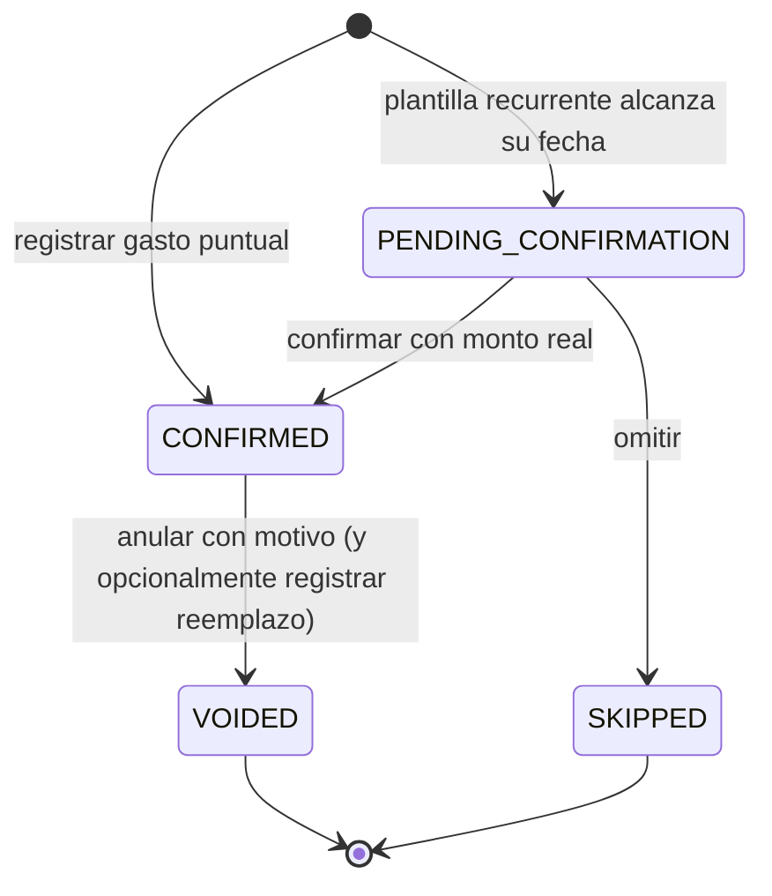
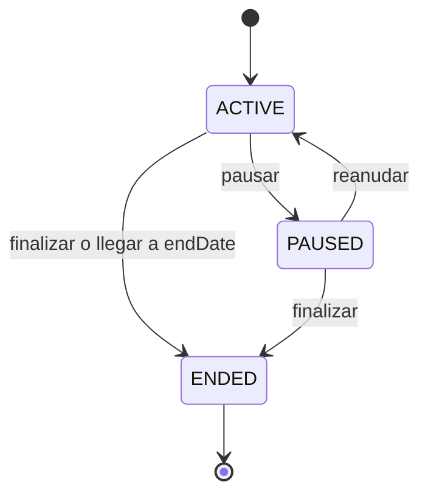

# Contrato de Gastos — F1 operativos de contado

Versión 1.0 para revisión, 24 de noviembre de 2026.

**Estado:** propuesta. Incorpora las decisiones funcionales del responsable. Es la especificación técnica previa a la implementación y debe revisarse antes de escribir código; los puntos abiertos están en la [sección 17](#17-decisiones-a-revisar). No modifica código, esquema ni migraciones, ni autoriza commits, push, despliegues u operaciones en producción.

## 1. Alcance y base existente

Gastos será un módulo privado por cuenta para registrar **gastos operativos de contado**: arriendo, servicios públicos, internet, transporte y domicilios, publicidad, mantenimiento, comisiones, trámites y similares. Incluye categorías propias, gastos puntuales, gastos recurrentes que el dueño confirma u omite, anulación con motivo, historial y totales por periodo.

**Las compras de mercancía no son gastos.** Son entradas de inventario con costo y pertenecen a otro módulo. El sistema no ofrece una categoría de compras, y la interfaz lo advierte al registrar un gasto (sección 13). Hoy `inventory_movements` no guarda costo y solo existe el costo de referencia de `item_commercial_terms` ([contrato de ventas](sales-contract.md#4-dinero-ficha-comercial-y-cálculo)); las entradas con costo quedan fuera de este contrato.

Excluye en F1: gastos a crédito y la entidad Proveedor (F2), cuentas por pagar, caja y saldos por medio de pago, conciliación bancaria, impuestos o IVA, adjuntos y fotos de soportes, importación Excel/CSV, presupuestos, contabilidad y el cálculo de utilidad (F5, ver sección 15).

Base inspeccionada: [esquema](../catalog-api/prisma/schema.prisma), [ventas](sales-contract.md), [estado](estado.md), el patrón de recibos e historial de compatibilidades (`compatibility_operations`, `compatibility_events`), el bloqueo de cuenta abierta `lockInventoryOwner` y los workers en proceso de [server.ts](../catalog-api/src/server.ts).

## 2. Invariantes

1. El propietario sale de la sesión validada. Toda lectura y escritura filtra por `ownerId`. Un recurso ajeno o inexistente responde `404` sin distinguir ambos casos.
2. Un gasto **confirmado** no se edita. Para corregirlo se anula con motivo y se registra otro; ambos quedan en el historial.
3. Un gasto recurrente **nunca se confirma solo**. La plantilla genera ocurrencias *por confirmar*, y solo una acción explícita del dueño las confirma (con el monto real) u omite.
4. Solo los gastos `CONFIRMED` cuentan en totales. Por confirmar, omitidos y anulados se muestran aparte.
5. Todo gasto tiene categoría, medio de pago, fecha del gasto, monto entero positivo en COP y descripción. `OTRO` exige una nota.
6. La fecha del gasto la elige el dueño y es una fecha de calendario de Colombia. La fecha de registro la pone el servidor. Son campos distintos.
7. Archivar una categoría no borra ni reclasifica gastos. Renombrarla no cambia la identidad con que se filtra.
8. Toda mutación lleva una clave de operación. Un reintento exacto no duplica efectos; la misma clave con otro contenido es un conflicto.
9. Gastos no modifica inventario, ventas, pedidos ni catálogo, ni toma sus bloqueos.
10. Cerrar la cuenta no borra gastos. La retención de doce meses sigue sin aprobarse y no se implementa aquí.

## 3. Estados y transiciones

### Gasto



| Origen | Acción | Destino | Efecto |
| --- | --- | --- | --- |
| — | Registrar | `CONFIRMED` | Registrar un gasto puntual es la confirmación del dueño; no hay borrador. |
| — | Generar ocurrencia | `PENDING_CONFIRMATION` | Copia los datos sugeridos de la plantilla. No cuenta en totales. |
| `PENDING_CONFIRMATION` | Confirmar | `CONFIRMED` | El dueño envía monto real, fecha, categoría y medio de pago, que pueden diferir de lo sugerido. Se fijan `confirmedAt` y la instantánea de categoría. |
| `PENDING_CONFIRMATION` | Omitir | `SKIPPED` | Motivo opcional. La ocurrencia no se vuelve a generar. |
| `CONFIRMED` | Anular | `VOIDED` | Motivo obligatorio (3–300). Sale de los totales; conserva todos sus datos. Si llega un reemplazo, se crea en la misma transacción como `CONFIRMED`, vinculado mediante `replacesExpenseId`. |

No se permite: editar un confirmado, anular un pendiente u omitido, reabrir un anulado ni confirmar un omitido (ver decisión 4). Un gasto pendiente no se edita campo a campo: los datos definitivos llegan al confirmar.

### Plantilla recurrente



Solo `ACTIVE` genera ocurrencias. Pausar o finalizar no toca las ocurrencias ya generadas: las pendientes siguen esperando decisión y las confirmadas no cambian. Editar una plantilla afecta solo a las ocurrencias futuras aún no generadas.

## 4. Dinero, fechas y medios de pago

- **Monto:** pesos COP enteros en `BIGINT`, mayor que cero; en JSON, cadena decimal sin separadores (`"1250000"`). Máximo propuesto por gasto: 1.000.000.000.000 (decisión 2). `currency = 'COP'`.
- **Totales:** se suman en SQL como `numeric` y se devuelven como cadena, para que un periodo largo no desborde.
- **Fecha del gasto (`expenseDate`):** tipo `DATE`, sin hora, interpretada en `America/Bogota`. En gastos puntuales no puede ser posterior a hoy en Bogotá; el límite hacia atrás está en la decisión 3.
- **Fecha de registro (`recordedAt`):** `timestamptz` del servidor. El cliente no la envía.
- **Periodos:** rango cerrado `[from, to]` sobre `expenseDate`. Por defecto, el mes en curso de Bogotá.
- **Medio de pago** (enum `ExpensePaymentMethod`): `EFECTIVO`, `NEQUI`, `DAVIPLATA`, `TRANSFERENCIA`, `TARJETA`, `OTRO`. Con `OTRO` se exige `paymentMethodNote` (3–80 caracteres, por ejemplo «Bancolombia a la mano»); con los demás debe ser nula. En F1 todo gasto es de contado: se pagó en el momento con ese medio. El medio queda registrado para la caja futura, pero F1 no calcula saldos por medio de pago.
- Sin impuestos: el monto es el total pagado. No se desglosa ni se presenta un IVA cero como exención.

## 5. Modelo de datos lógico

Especificación para una migración futura, no un cambio al esquema actual. Todas las tablas nuevas usan `@@map` en snake_case, IDs UUID en `TEXT`, `ownerId` → `users(id)` y FKs `RESTRICT`.

| Entidad (tabla) | Campos principales y reglas |
| --- | --- |
| `ExpenseCategory` (`expense_categories`) | `id`, `ownerId`, `name` (1–60), `normalizedKey` (NFC, trim, espacios colapsados, minúsculas), `seedKey?` (identifica una categoría sugerida), `position`, `archivedAt?`, `version`, `createdAt`, `updatedAt`. |
| `Expense` (`expenses`) | `id`, `ownerId`, `status` (`PENDING_CONFIRMATION`, `CONFIRMED`, `SKIPPED`, `VOIDED`), `source` (`MANUAL`, `RECURRING`), `templateId?`, `occurrenceDate?`, `expenseDate`, `amount?`, `suggestedAmount?`, `currency`, `categoryId`, `categoryNameSnapshot?`, `paymentMethod`, `paymentMethodNote?`, `description` (1–300), `supplierName?` (1–160, texto libre hasta F2), `replacesExpenseId?`, `recordedAt`, `confirmedAt?`, `skippedAt?`, `skipReason?` (≤300), `voidedAt?`, `voidReason?` (3–300), `version`, `updatedAt`. |
| `RecurringExpenseTemplate` (`recurring_expense_templates`) | `id`, `ownerId`, `status` (`ACTIVE`, `PAUSED`, `ENDED`), `description`, `categoryId`, `paymentMethod`, `paymentMethodNote?`, `supplierName?`, `estimatedAmount?`, `frequency` (`WEEKLY`, `MONTHLY`, `YEARLY`), `interval` (1–12), `anchorDate`, `endDate?`, `generatedThrough?` (última fecha materializada), `version`, `createdAt`, `updatedAt`, `endedAt?`. |
| `ExpenseOperation` (`expense_operations`) | `ownerId`, `operationId`, `kind`, `resourceId`, `requestHash`, `responseSnapshot`, `createdAt`. Recibo terminal de mutaciones exitosas. |
| `ExpenseEvent` (`expense_events`) | `id`, `ownerId`, `operationId?`, `entityKind` (`EXPENSE`, `CATEGORY`, `TEMPLATE`), `entityId`, `eventType`, `before?`, `after`, `occurredAt`. Historial inmutable. El actor es el propietario y no se duplica. |

En `Expense`, `amount` es el monto real y solo existe en `CONFIRMED` y `VOIDED`. `suggestedAmount` es la copia de `estimatedAmount` al generar la ocurrencia, es informativo y nunca suma. `categoryNameSnapshot` es el nombre de la categoría al confirmar, para leer el historial aunque luego se renombre; los filtros usan `categoryId`.

### Integridad e índices

- `UNIQUE (id, ownerId)` en categorías, gastos y plantillas. FKs compuestas `(categoryId, ownerId)`, `(templateId, ownerId)` y `(replacesExpenseId, ownerId)`, para que la base de datos impida mezclar cuentas aunque falle el servicio.
- Categorías: `UNIQUE (ownerId, normalizedKey)`, incluidas las archivadas: un nombre archivado se reactiva, no se duplica. `UNIQUE (ownerId, seedKey)` cuando `seedKey` no sea nulo.
- Ocurrencias: `UNIQUE (templateId, occurrenceDate)` para que una fecha de plantilla no se genere dos veces.
- Reemplazos: `UNIQUE (replacesExpenseId)`, de modo que un anulado tenga como máximo un reemplazo.
- Recibos: PK `(ownerId, operationId)`. Eventos: FK al recibo cuando tengan `operationId`.
- CHECK propuestos:
  - Montos: `amount > 0` y `suggestedAmount > 0` cuando no son nulos; `amount <= 1000000000000`; `currency = 'COP'`.
  - Medio de pago: `paymentMethod = 'OTRO'` si y solo si `paymentMethodNote` no es nulo.
  - Coherencia de estado:
    - `CONFIRMED` exige `amount` y `confirmedAt`;
    - `VOIDED` exige además `voidedAt` y un `voidReason` de al menos 3 caracteres;
    - `PENDING_CONFIRMATION` exige `amount` nulo y `source = 'RECURRING'`;
    - `SKIPPED` exige `skippedAt`.
  - Origen: `source = 'RECURRING'` si y solo si `templateId` y `occurrenceDate` no son nulos.
  - Plantillas: `interval` entre 1 y 12; `endDate` nulo o ≥ `anchorDate`; `estimatedAmount` nulo o > 0.
- Triggers:
  - inmutabilidad de `expense_events` y `expense_operations` (sin UPDATE ni DELETE);
  - guardia en `expenses`: un `CONFIRMED` solo puede pasar a `VOIDED`, cambiando únicamente `status`, `voidedAt`, `voidReason`, `version` y `updatedAt`; ningún gasto se borra.

  Prisma 6 no representa CHECK ni triggers: se documentan en el SQL de la migración.
- Índices de lectura:
  - `(ownerId, status, expenseDate, id)` para listado y totales;
  - `(ownerId, categoryId, expenseDate)`;
  - `(ownerId, paymentMethod, expenseDate)`;
  - `(ownerId, status, templateId)` para pendientes;
  - `(ownerId, entityKind, entityId, occurredAt)` en eventos.

  Medir con `EXPLAIN` y volumen representativo antes de añadir más.

## 6. Categorías

- **Semilla sugerida por cuenta**, con `seedKey` fijo:
  - Arriendo
  - Servicios públicos
  - Internet y telefonía
  - Transporte y domicilios
  - Publicidad y redes
  - Mantenimiento y reparaciones
  - Papelería e insumos
  - Comisiones bancarias y de plataformas
  - Impuestos y trámites
  - Personal y honorarios (decisión 8)
  - Otros gastos

  No incluye «Compras de mercancía».
- **Cómo se siembra:** no la siembra la migración (sin backfill sobre usuarios existentes). La interfaz llama a `POST /expense-categories/seed` la primera vez que el dueño abre Gastos. Inserta cada `seedKey` que falte, con `ON CONFLICT DO NOTHING`, bajo el bloqueo de la cuenta; repetirlo no duplica nada.
  - Una semilla renombrada o archivada conserva su `seedKey` y no se recrea.
  - Si el dueño ya tiene una categoría propia con el mismo nombre normalizado, esa semilla se omite.
- **Operaciones:** crear, renombrar, archivar, reactivar y reordenar, cada una con versión esperada. No hay borrado.
- **Archivar:** la categoría desaparece de los selectores de registro, confirmación y plantillas, pero sigue en filtros (marcada «archivada»), en gastos históricos y en totales. Una plantilla con categoría archivada sigue generando ocurrencias; para confirmarlas hay que elegir una categoría activa.
- **Renombrar:** no cambia `categoryId`. Los gastos ya confirmados conservan `categoryNameSnapshot` como dato histórico, y los listados muestran el nombre vigente con el histórico si difieren.
- **Cuota:** como máximo 100 categorías por cuenta, incluidas las archivadas.

## 7. Gastos recurrentes

- **Fechas:** `frequency` × `interval` desde `anchorDate`. En mensual y anual se conserva el día del ancla; si el mes no tiene ese día (29–31), se usa el último día del mes, sin desplazar los siguientes.
- **Primera ocurrencia:** es `anchorDate`, que no puede ser anterior a la fecha de creación en Bogotá (decisión 6). Los meses ya pasados se registran como gastos puntuales.
- **Materialización explícita y perezosa.** La instancia de Render puede estar dormida, así que no se confía en un worker. La interfaz llama a `POST /expenses/pending/refresh` al abrir Gastos. En una transacción con el bloqueo de la cuenta, para cada plantilla `ACTIVE` se crean las ocurrencias con fecha ≤ hoy (Bogotá) que aún no existan, y se avanza `generatedThrough`.
  - La unicidad `(templateId, occurrenceDate)` hace que dos llamadas simultáneas no dupliquen nada.
  - Se generan como máximo 24 ocurrencias por plantilla y llamada.
  - Un worker en proceso podrá añadirse después con la misma función.
- **Qué se copia:** cada ocurrencia copia de la plantilla descripción, categoría, medio de pago, proveedor y `estimatedAmount` → `suggestedAmount`, con `expenseDate = occurrenceDate`. Los cambios posteriores en la plantilla no las alteran.
- **Pausa y fin:** reanudar no genera las fechas de la pausa: el cursor salta a hoy (decisión 5). `endDate` finaliza la plantilla en su última ocurrencia.
- **Confirmar u omitir:** confirmar exige monto real y puede cambiar fecha, categoría (solo activa), medio de pago, descripción y proveedor. Omitir no pide monto.

## 8. API propuesta

Rutas privadas bajo `/api`, con la autenticación vigente (cookie HttpOnly y proxy same-origin), `Cache-Control: private, no-store`, Zod estricto (rechaza campos desconocidos, `ownerId`, fechas de registro y estados enviados por el cliente) y cuerpos de hasta 16 KiB. Para que ese límite sea efectivo, el router se monta antes del parser global de 32 KiB, como compatibilidades. Respuesta `{ success: true, result }`; error `{ success: false, error, message }` (decisión 10).

| Método y ruta | Contrato |
| --- | --- |
| `GET /expense-categories?status=active\|archived\|all` | Categorías propias ordenadas por `position`, con `version`. |
| `POST /expense-categories/seed` | `{operationId}`. Siembra idempotente (sección 6). Devuelve las categorías. |
| `POST /expense-categories` | `{operationId, name}`. `409 EXPENSE_CATEGORY_NAME_CONFLICT` si el nombre normalizado ya existe, aunque esté archivado; devuelve el ID existente para reactivarlo. |
| `PATCH /expense-categories/:id` | `{operationId, expectedVersion, name?, position?}`. |
| `POST /expense-categories/:id/archive`, `…/reactivate` | `{operationId, expectedVersion}`. |
| `GET /expenses?from&to&categoryId&paymentMethod&status&cursor` | 25 por página, orden `(expenseDate desc, recordedAt desc, id desc)` y cursor opaco validado del propietario. `status`: `CONFIRMED` (por defecto), `VOIDED`, `SKIPPED` o `all`. `from`/`to` son obligatorios, con un rango máximo de 366 días. |
| `GET /expenses/summary?from&to&categoryId&paymentMethod` | Para el periodo y los filtros: `confirmedTotal`, `confirmedCount`, `byCategory[]`, `byPaymentMethod[]`, `voidedCount`, `pendingCount` y `pendingSuggestedTotal`. Este último es informativo y nunca forma parte del total. |
| `GET /expenses/pending` | Ocurrencias por confirmar, de la más antigua a la más reciente, paginadas. |
| `POST /expenses/pending/refresh` | Sin cuerpo. Materializa ocurrencias (sección 7) y devuelve `{generated, pendingCount}`. Es idempotente por la unicidad de las ocurrencias y tiene limitador propio. |
| `GET /expenses/:id` | Detalle, reemplazo o reemplazado vinculado y eventos paginados. |
| `POST /expenses` | `{operationId, expenseDate, amount, categoryId, paymentMethod, paymentMethodNote?, description, supplierName?}`. Crea un `CONFIRMED`. `201`. |
| `POST /expenses/:id/confirm` | `{operationId, expectedVersion, amount, expenseDate, categoryId, paymentMethod, paymentMethodNote?, description, supplierName?}`. |
| `POST /expenses/:id/skip` | `{operationId, expectedVersion, reason?}`. |
| `POST /expenses/:id/void` | `{operationId, expectedVersion, reason, replacement?}`. `replacement` usa el cuerpo de `POST /expenses` sin `operationId`. Anulación y reemplazo son atómicos; el resultado incluye ambos. |
| `GET /recurring-expenses?status` | Plantillas propias con su próxima fecha calculada. |
| `POST /recurring-expenses` | `{operationId, description, categoryId, paymentMethod, paymentMethodNote?, supplierName?, estimatedAmount?, frequency, interval, anchorDate, endDate?}`. |
| `PATCH /recurring-expenses/:id` | `{operationId, expectedVersion, …}`. Solo `ACTIVE` o `PAUSED`; afecta solo a ocurrencias futuras. |
| `POST /recurring-expenses/:id/pause`, `…/resume`, `…/end` | `{operationId, expectedVersion}`. |

Errores:
- `400 INVALID_EXPENSE_INPUT` (Zod) y `EXPENSE_CATEGORY_ARCHIVED` al usar una categoría archivada.
- `401` sin sesión o con la cuenta cerrada.
- `404 EXPENSE_NOT_FOUND`, `EXPENSE_CATEGORY_NOT_FOUND` y `RECURRING_EXPENSE_NOT_FOUND`, uniformes para ajenos e inexistentes.
- `409 VERSION_CONFLICT`, `INVALID_EXPENSE_TRANSITION`, `IDEMPOTENCY_CONFLICT`, `EXPENSE_CATEGORY_NAME_CONFLICT`, `EXPENSE_CATEGORY_QUOTA` y `RECURRING_EXPENSE_ENDED`.
- `429` del limitador vigente.
- `503 EXPENSE_RETRY_SAME_OPERATION` ante un fallo técnico, sin detalles internos.

Los mensajes se presentan legibles en español, con `requestId`.

## 9. Idempotencia y recuperación

- Cada mutación lleva **un** `operationId` UUID generado por el cliente antes del primer envío, y lo conserva ante doble clic, error de red o recarga mientras el formulario no cambie. No hay `requestId` de negocio; la correlación de transmisiones usa el `requestId` HTTP existente.
- `requestHash` = SHA-256 de la serialización canónica de `{kind, ids de la ruta, cuerpo validado}`, sin metadatos de transporte. Es el patrón de compatibilidades, no el de ventas (decisión 10).
- En la transacción, tras los bloqueos de la sección 10 y **antes** de comprobar estado o versión, se busca el recibo `(ownerId, operationId)`:
  - con otro `kind`, otro recurso u otro hash: `409 IDEMPOTENCY_CONFLICT`;
  - si coincide: se devuelve `responseSnapshot` con `idempotent: true` (`200`), sin repetir efectos.
- Recibo, cambios de estado y eventos se escriben en el mismo commit. Si la transacción falla, no queda recibo y la misma clave puede reintentarse.
- El recibo describe el resultado original. Tras un reintento, la interfaz vuelve a leer con `GET` el estado actual (por ejemplo, un gasto confirmado y anulado después).
- Dos claves distintas no pueden confirmar la misma ocurrencia: la segunda encuentra el estado ya cambiado y recibe `INVALID_EXPENSE_TRANSITION`. Dos `POST /expenses` con claves distintas son **dos gastos legítimos**: no se deduplica por parecido de monto, fecha o descripción. La interfaz advierte de un posible duplicado del mismo día y monto, sin bloquearlo.
- No hay purga automática de recibos.

## 10. Transacciones y bloqueos

Orden: `users` `FOR SHARE` comprobando `closedAt IS NULL` (mismo criterio que `lockInventoryOwner`) → `pg_advisory_xact_lock(hashtext('expenses-v1'), hashtext(ownerId))` → recibo → filas afectadas `FOR UPDATE` (gasto, plantilla o categoría) en orden por ID.

- El advisory lock por cuenta serializa las mutaciones de gastos: unicidad de nombres de categoría, siembra, materialización y cuotas. Es conservador; medir antes de granularizar. No reutiliza los locks de inventario, ventas ni catálogos.
- Gastos no toma locks de pedidos, catálogos, inventario ni ventas. El cierre de cuenta usa `Order → Catalog → User FOR UPDATE`; gastos solo toma `User FOR SHARE` y su propio namespace, así que no hay ciclo.
- Las lecturas de listado y totales usan una transacción `REPEATABLE READ` para que el listado y su resumen sean coherentes en la misma pantalla cuando se piden juntos.
- Timeout o deadlock: rollback y reintento explícito con la misma clave.

## 11. Aislamiento entre cuentas

- `ownerId` solo sale de la sesión; no se acepta en cuerpo ni query. Toda consulta filtra por `ownerId`, también los `include` y los filtros por `categoryId`.
- Las FKs compuestas impiden en la base de datos que un gasto de A use una categoría, plantilla o reemplazo de B.
- Una categoría o gasto ajeno responde `404` idéntico al inexistente. Los totales, los conteos y `hasMore` nunca incluyen filas ajenas. Un `categoryId` ajeno en un filtro devuelve `404`, no una lista vacía que confirme su existencia.
- Un `operationId` repetido en otra cuenta es independiente: el recibo se busca por `(ownerId, operationId)`.
- Pruebas obligatorias con **dos cuentas** A y B (sección 16): cada endpoint con IDs de la otra cuenta, filtros cruzados, la misma clave en ambas cuentas, siembra en ambas, materialización simultánea y totales que no se mezclan.

## 12. Cierre de cuenta y privacidad

**Cierre de cuenta:**
- Cerrar la cuenta no borra ni transforma gastos, plantillas, categorías ni historial; las FKs `RESTRICT` lo impiden también en la base de datos.
- Tras el cierre, toda petición pendiente falla con `401` al comprobar `closedAt` dentro de la transacción.
- No se materializan ocurrencias de cuentas cerradas. Las pendientes quedan tal cual; no se omiten ni confirman automáticamente.
- Gastos no bloquea el cierre: en F1 todo es de contado y no hay obligaciones con terceros. F2 (crédito con proveedores) deberá revisar esa regla.

**Privacidad:**
- `description`, `supplierName`, `paymentMethodNote` y los motivos pueden contener datos personales (nombre de un arrendador, de un empleado, un número de Nequi). Se tratan como privados: no aparecen en logs técnicos ni en mensajes de error, no se publican en el catálogo y no entran en las métricas de administración.
- La interfaz advierte que no se escriban números de documento, cuentas ni datos de salud.
- El historial inmutable (`expense_events`) guarda esos textos en `before`/`after`. Una política futura de anonimización deberá resolver cómo hacerlo sin romper la inmutabilidad (decisión 12).
- Las respuestas son `private, no-store`, y no se guardan borradores ni importes en `localStorage`/`sessionStorage`.

## 13. Interfaz

Nueva ruta privada `/dashboard/gastos`, enlazada en la navegación del panel junto a Inventario y Ventas.

1. **Por confirmar.** Al abrir se llama a `refresh` y se listan las ocurrencias pendientes: plantilla, fecha y monto sugerido. Cada una ofrece «Confirmar» (formulario prellenado; el monto real es obligatorio aunque coincida con el sugerido) y «Omitir» (confirmación explícita, motivo opcional).
2. **Registrar gasto.** Pide fecha del gasto (hoy por defecto, sin fechas futuras), monto, categoría activa, medio de pago (con nota si es `OTRO`), descripción y proveedor opcional. Aviso fijo: «Las compras de mercancía se registran como entrada de inventario, no como gasto». Si ya existe un gasto del mismo día y monto, se avisa sin bloquear.
3. **Listado.** Filtros por rango de fechas (por defecto el mes en curso, con accesos a «mes anterior» y «este año»), categoría (incluidas las archivadas, rotuladas), medio de pago y estado (confirmados por defecto; anulados y omitidos bajo demanda). Paginación con «Más gastos». Cada fila muestra fecha del gasto, categoría, descripción, medio, monto y su estado si no es confirmado.
4. **Totales del periodo.** Usan los mismos filtros del listado y se rotulan «Total confirmado del periodo con los filtros aplicados». Muestran desglose por categoría y por medio de pago, y aparte el número de anulados y de pendientes con su monto sugerido, que no suma.
5. **Detalle.** Datos, fechas del gasto y de registro, historial de eventos y enlace al reemplazo o al anulado. «Anular» pide motivo y ofrece «Anular y registrar el correcto» con el formulario prellenado.
6. **Categorías:** crear, renombrar, reordenar, archivar y reactivar. **Recurrentes:** crear, editar, pausar, reanudar y finalizar, mostrando la próxima fecha.
7. **Estados de pantalla:** carga, vacío («No hay gastos confirmados en este periodo»), error con reintento, sesión expirada y éxito, con `aria-live`, etiquetas, teclado, foco visible y ancho móvil.
   - El formulario conserva el borrador y la clave mientras la respuesta sea incierta, y nunca reenvía solo.
   - Cambiar filtros o periodo descarta las respuestas tardías: una respuesta del periodo anterior no sobrescribe el actual.
   - La interfaz valida el DTO antes de habilitar acciones.

## 14. Casos límite

| Caso | Comportamiento |
| --- | --- |
| Gasto con fecha futura | `400`; las fechas futuras solo existen como próxima ocurrencia de una plantilla. |
| Monto 0, negativo, decimal o con separadores | `400`. El monto llega como cadena de dígitos o entero seguro. |
| `OTRO` sin nota, o nota con otro medio | `400`. |
| Categoría archivada en registro, confirmación o plantilla nueva | `400 EXPENSE_CATEGORY_ARCHIVED`; los históricos no cambian. |
| Categoría o gasto de otra cuenta | `404` uniforme, sin escrituras. |
| Doble clic al registrar | Misma clave: un solo gasto, y el segundo recibe el recibo. |
| Dos pestañas confirman la misma ocurrencia | Una gana; la otra recibe `INVALID_EXPENSE_TRANSITION` o `VERSION_CONFLICT` y relee. |
| Anular dos veces | La misma clave devuelve el recibo; otra clave recibe `INVALID_EXPENSE_TRANSITION`. |
| Anular y reemplazar falla en el reemplazo | Rollback completo: el original sigue `CONFIRMED`. |
| Plantilla mensual con ancla el día 31 | 31 ene → 28/29 feb → 31 mar. |
| Plantilla sin abrir el módulo en meses | El siguiente `refresh` genera las fechas vencidas, como máximo 24 por plantilla; el resto, en llamadas siguientes. |
| Dos `refresh` simultáneos | La unicidad `(templateId, occurrenceDate)` y el bloqueo de cuenta impiden duplicados. |
| Pausa y reanudación | No se generan las fechas de la pausa. |
| Renombrar una categoría usada | Los filtros siguen funcionando por ID; los gastos conservan el nombre histórico. |
| Periodo sin gastos | Totales `"0"`, desgloses vacíos y mensaje de vacío. |
| Rango mayor de 366 días o `from > to` | `400`. |
| Cuenta cerrada a mitad de una operación | `401`; nada se escribe. |
| Registro de una compra de mercancía como gasto | El sistema no puede detectarlo; la interfaz avisa y no hay categoría de compras. Queda como riesgo de uso. |

## 15. Relación con otros módulos y utilidad (F5)

- **Inventario y compras:** Gastos no crea movimientos ni toca costos. Las entradas de mercancía con costo pertenecen a Inventario, en una fase sin asignar (decisión 19).
- **Ventas:** sin dependencia en F1.
- **Proveedores y crédito (F2):** la entidad Proveedor sustituirá a `supplierName` sin migrar ni reinterpretar los textos de F1. Los gastos a crédito tendrán estados de pago propios y no alterarán los de contado. La regla de cierre de cuenta se revisará entonces.
- **Caja por medio de pago (futuro):** se apoyará en `paymentMethod` de los gastos confirmados y no anulados, y en los cobros de ventas, que aún no existen. F1 no calcula saldos.
- **Utilidad (F5),** prevista así:

  ```text
  utilidad del periodo = ventas entregadas netas
                       − costo de referencia de lo vendido
                       − gastos CONFIRMED con expenseDate en el periodo
  ```

  **El costo de referencia no es un costo contable real.** Es el `unitCost` que la ficha comercial tenía al vender (`"SaleLine".unitCost`). Puede ser nulo o estar desactualizado, y no refleja lo realmente pagado por la mercancía ni lotes, FIFO o promedio. La utilidad resultante es orientativa, no un estado de resultados.
  - Se excluyen los gastos pendientes, omitidos y anulados.
  - F5 deberá definir el tratamiento de devoluciones y cancelaciones posteriores a la entrega, de líneas sin costo y la fecha base de ventas (decisión 18).
  - Bloqueo vigente: hoy el esquema aplicado rechaza los movimientos de venta ([estado](estado.md#pendientes-vigentes)). F5 depende de corregirlo.

## 16. Plan de fases y pruebas

### Incrementos

1. **F1a — Categorías y gastos puntuales.** Migración `<timestamp>_operating_expenses` con todas las tablas, enums, CHECK, índices y triggers, aditiva y sin backfill ni siembra. Incluye categorías con siembra, registro, anulación con reemplazo, listado, totales, historial y la interfaz correspondiente. Salida:
   - aislamiento con dos cuentas;
   - idempotencia;
   - CHECK y triggers ensayados en PostgreSQL aislado;
   - regresión del resto del sistema.
2. **F1b — Recurrentes.** Plantillas, materialización, pendientes, confirmar y omitir. Las tablas ya existen desde F1a; si se decide separarlas, irán en una migración nueva. Salida: generación sin duplicados en carreras reales, fechas de fin de mes, pausa y fin.
3. **F2 — Proveedores y gastos a crédito**, con contrato propio.
4. **Caja por medio de pago** y **F5 — utilidad**, con contratos propios.

No empezar un incremento hasta revisar las pruebas del anterior.

### Pruebas

- **Unitarias:**
  - validación Zod (montos, fechas en Bogotá, `OTRO`, campos desconocidos y `ownerId` del cliente);
  - normalización de nombres;
  - cálculo de ocurrencias (semanal, mensual con días 29–31, anual con 29 de febrero, `interval`, `endDate`);
  - transiciones permitidas y prohibidas.
- **Repositorio y servicio con dobles:**
  - filtro por propietario en cada consulta;
  - replay antes de la versión;
  - conflicto de clave y rollback ante un fallo del evento o del reemplazo;
  - siembra repetida;
  - cuota de categorías;
  - totales que excluyen pendientes, omitidos y anulados.
- **HTTP:**
  - autenticación real con cookie y proxy, y cuenta cerrada;
  - UUID, fechas y cuerpos inválidos;
  - cuerpo de 16 KiB;
  - `private, no-store`;
  - mensajes sin datos internos ni personales.
- **Dos cuentas (obligatorias):**
  - matriz de todos los endpoints con IDs cruzados → `404` sin escrituras;
  - filtros con categoría ajena;
  - misma `operationId` en A y B;
  - totales y conteos independientes;
  - siembra y materialización simultáneas en ambas cuentas.
- **PostgreSQL aislado** (ensayo como `test:sales-postgres`):
  - migración sobre datos sintéticos previos;
  - CHECK, FKs compuestas y triggers de inmutabilidad;
  - dos confirmaciones de la misma ocurrencia;
  - dos `refresh` simultáneos;
  - anular y reemplazar con fallo inyectado;
  - siembra concurrente;
  - cierre de cuenta durante una mutación;
  - `EXPLAIN` del listado y del resumen con volumen representativo.
- **Navegador:**
  - registrar, confirmar, omitir, anular y reemplazar;
  - filtros y totales coherentes;
  - respuesta tardía al cambiar de periodo;
  - pérdida de respuesta y reintento con la misma clave;
  - teclado, móvil y sesión expirada;
  - cero escrituras al abrir, filtrar o cancelar, salvo `refresh` y `seed`.
- **Regresión:** suites completas de backend y frontend, builds, lint y `git diff --check`. Verificar que Gastos no altera inventario, ventas, pedidos ni catálogo público.

## 17. Decisiones a revisar

1. **Nombres de enums:** el medio de pago usa los valores en español acordados (`EFECTIVO`…); los demás enums del proyecto están en inglés. ¿Se mantienen en español o se usan códigos en inglés con etiquetas en español?
2. **Monto máximo por gasto:** se propone 1.000.000.000.000 COP para frenar errores de digitación. ¿Otro límite?
3. **Fechas permitidas:** ¿hasta qué antigüedad se puede registrar un gasto (por ejemplo, el año anterior)? ¿Se admiten fechas futuras, como un arriendo pagado por adelantado? Se propone no admitirlas.
4. **Omitir es definitivo:** ¿se permite reabrir una ocurrencia omitida por error, o se registra como gasto puntual?
5. **Pausa:** ¿al reanudar se generan las fechas de la pausa? Se propone que no.
6. **Ancla en el pasado:** ¿se permite crear una plantilla con fechas anteriores a hoy que generen pendientes atrasados?
7. **Frecuencias:** ¿bastan semanal, mensual y anual con intervalo 1–12 (quincenal = semanal cada 2), o hace falta «día hábil» o «último día del mes» explícitos?
8. **Categoría «Personal y honorarios»:** salarios y honorarios llevan datos personales y obligaciones laborales que este módulo no gestiona. ¿Se incluye en la semilla?
9. **Referencia de pago:** ¿añadir un campo opcional para el número de transacción de Nequi, Daviplata o transferencia? Puede contener teléfonos.
10. **Patrón de API:** se propone `{success, result}` y una sola `operationId` con hash sin transporte, como compatibilidades. Ventas usa `{result}` y `operationId` + `requestId` con hash que incluye `requestId`. ¿Se unifica el proyecto hacia un patrón?
11. **Materialización:** ¿basta con generar al abrir el módulo, o se quiere además un worker y un aviso (correo o panel) de gastos por confirmar?
12. **Retención y anonimización:** el historial inmutable conserva descripciones y proveedores. ¿Cuál será la política y cómo se compatibiliza con la inmutabilidad?
13. **Soportes:** ¿adjuntar foto del recibo o factura? Implica Storage, cuotas y limpieza; se propone dejarlo para después de F1.
14. **Impuestos:** ¿hace falta registrar IVA o retenciones en algún momento? F1 guarda solo el total pagado.
15. **Reclasificación:** cambiar la categoría de un gasto confirmado obliga a anular y registrar otro. ¿Se acepta para correcciones menores, o se prefiere una «reclasificación» auditada que no toque monto ni fecha?
16. **Edición o descarte de pendientes:** ¿se puede eliminar una ocurrencia pendiente creada por error de plantilla, además de omitirla?
17. **Exportación:** ¿se requiere CSV o Excel de gastos del periodo en F1?
18. **Utilidad (F5):** fecha base de ventas (`deliveredAt` o `confirmedAt`), devoluciones y cancelaciones después de entregar, y líneas sin costo de referencia.
19. **Entradas de inventario con costo:** ¿en qué fase se diseñan? Sin ellas, las compras de mercancía no tienen dónde registrarse con su costo real.
20. **Caja por medio de pago:** fase y alcance (saldos iniciales, traslados entre medios, cobros de ventas).
21. **Cierre de cuenta:** se propone que gastos no lo bloquee en F1. ¿Debe bloquearlo la existencia de pendientes?
