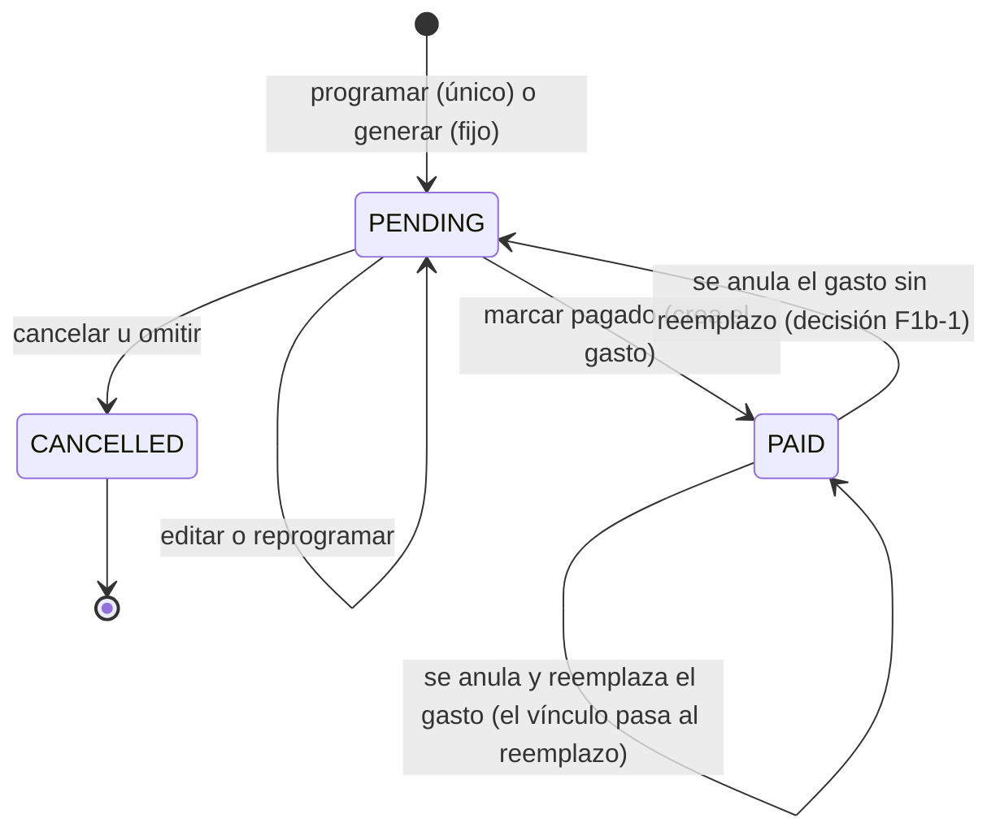

# Contrato de Gastos F1b — Gastos fijos y pagos programados

**Estado:** aprobado por el dueño el 25/11/2026, con las correcciones del planificador A, B y C ([sección 15](#15-correcciones-del-planificador)). Las decisiones están en la [sección 14](#14-decisiones-del-dueño). Ampliado el 26/11/2026 con los meses futuros y la proyección de gastos fijos ([sección 16](#16-meses-futuros-y-proyección-cierre-de-f1b)). Amplía el [contrato de Gastos v1.2](expenses-contract.md) y **sustituye su diseño de F1b**, que preveía ocurrencias `PENDING_CONFIRMATION` dentro de `expenses`. Este documento no incluye código ni migraciones, y no autoriza despliegues.

## 1. Decisiones del dueño que guían el diseño

1. **Un gasto es dinero que ya salió.** Su fecha nunca es futura; se mantiene la decisión 3 de v1.2.
2. Se pueden **programar pagos**: de una sola vez o recurrentes (gastos fijos). Un pago programado **no cuenta** en totales ni en la utilidad hasta que se marca como pagado.
3. **Marcar pagado crea el gasto real** (con su fecha y su medio de pago), vinculado al programado.
4. Los programados aparecen en «Próximos pagos» (Gastos) y en «Requiere tu atención» (Inicio) cuando están por vencer o vencidos.

## 2. Por qué cambia el diseño de F1b previsto en v1.2

v1.2 generaba las ocurrencias como filas de `expenses` en `PENDING_CONFIRMATION`, solo hasta hoy, y «confirmar» convertía esa misma fila en el gasto. Con las decisiones anteriores ese diseño no sirve:

- **Fechas futuras:** «Próximos pagos» necesita programados con vencimiento futuro, y en `expenses` no puede haber fechas futuras (decisión 1).
- **Gasto nuevo y vinculado:** el gasto real se crea aparte, enlazado al programado (decisión 3), no transformando la fila.
- **Volver a pagar tras anular:** si se anula el gasto creado y luego se paga otra vez, `UNIQUE (templateId, occurrenceDate)` de `expenses` impediría el segundo gasto, porque la fila anulada se conserva.

**Decisión:** los pagos programados viven en una **tabla nueva** y los gastos siguen siendo solo dinero que ya salió.

- En `expenses` quedan **sin uso** el estado `PENDING_CONFIRMATION` y `SKIPPED`, y las columnas `templateId`, `occurrenceDate` y `suggestedAmount`. No se borran: la migración `20261125000000_operating_expenses` ya está aplicada y no se modifica. El servicio no las escribe y la documentación las marca como obsoletas.
- **Se reutiliza `recurring_expense_templates`** como definición del gasto fijo: ya tiene descripción, categoría, medio de pago, nota, proveedor, `estimatedAmount`, `frequency`, `interval`, `anchorDate`, `endDate`, `generatedThrough`, estados `ACTIVE`/`PAUSED`/`ENDED`, versión y guardas. No necesita columnas nuevas.
- **Sustitución en v1.2:** las secciones 3 (ocurrencias), 7, las filas F1b de la sección 8, el punto 1 de la 13, los casos F1b de la 14 y las decisiones 4, 11 y 16 quedan sustituidos por este documento. Las decisiones 5, 6 y 7 se mantienen.

## 3. Entidades

| Entidad | Tabla | Papel |
| --- | --- | --- |
| Gasto fijo | `recurring_expense_templates` (existe) | Define una obligación que se repite: qué, cuánto aproximadamente, cada cuánto y desde cuándo. |
| Pago programado | `scheduled_expense_payments` (**nueva**) | Un pago concreto por hacer con fecha de vencimiento. Es una ocurrencia de un gasto fijo (`templateId` no nulo) o un pago de una sola vez (`templateId` nulo). |
| Gasto | `expenses` (existe) | Dinero que ya salió. Gana la columna `scheduledPaymentId` (nullable) si nació de marcar pagado un programado. |
| Recibos e historial | `expense_operations`, `expense_events` (existen) | Idempotencia e historial inmutable. `entityKind` y `eventType` son `VARCHAR`, así que admiten `SCHEDULED_PAYMENT` y los eventos nuevos sin migración. |

### Pago programado (`scheduled_expense_payments`)

| Campo | Regla |
| --- | --- |
| `id`, `ownerId` | UUID en `TEXT`; `UNIQUE (id, ownerId)`. |
| `status` | Enum nuevo `ScheduledExpenseStatus`: `PENDING`, `PAID` o `CANCELLED`. |
| `templateId?`, `occurrenceDate?` | O ambos nulos (pago único) o ambos presentes (ocurrencia). **Índice único parcial `(templateId, occurrenceDate) WHERE status <> 'CANCELLED'`**: una fecha de un gasto fijo no se genera dos veces; una ocurrencia cancelada al cambiar la regla no bloquea la nueva. FK compuesta `(templateId, ownerId)`. Se usa `occurrenceDate`, que no cambia, y no `dueDate`, que se puede reprogramar (sección 15, B). |
| `dueDate` | `DATE` de Bogotá. Puede ser futura. Al generarse es igual a `occurrenceDate` y se puede reprogramar mientras esté `PENDING`. |
| `plannedAmount?` | Monto previsto, de 1 a 1e12, o nulo si se desconoce (por ejemplo, servicios variables). Es informativo: **nunca suma** en los totales de gastos. |
| `description`, `categoryId`, `categoryNameSnapshot?`, `paymentMethod`, `paymentMethodNote?`, `supplierName?` | Las mismas reglas que un gasto. Son los valores sugeridos para el pago. FK compuesta `(categoryId, ownerId)`. |
| `customizedAt?` | Se fija cuando el dueño edita este pago concreto; a partir de ahí, editar el gasto fijo ya no lo cambia (sección 6). |
| `paidExpenseId?`, `paidAt?` | El gasto `CONFIRMED` vigente que lo pagó y el instante del pago. FK compuesta `(paidExpenseId, ownerId)`. |
| `cancelledAt?`, `cancelReason?` | Motivo opcional, hasta 300 caracteres. |
| `version`, `createdAt`, `updatedAt` | Como el resto del módulo. |

### Cambio en `expenses`

- Columna nueva `scheduledPaymentId?`, con FK compuesta `(scheduledPaymentId, ownerId)` → `scheduled_expense_payments`.
- Se escribe **solo al insertar**. `expense_transition_guard`, que ya rechaza cualquier columna fuera de su lista permitida, la mantiene inmutable sin cambios.
- **Índice único parcial** `(scheduledPaymentId) WHERE status = 'CONFIRMED'`: como máximo un gasto vigente por programado. Los anulados quedan como historial.
- `source` sigue siendo `MANUAL` para los gastos creados al pagar; su origen se reconoce por `scheduledPaymentId`. Esto evita añadir un valor al enum `ExpenseSource` y reescribir `expenses_source_check`. La interfaz los marca «Fijo» o «Programado».

## 4. Estados y transiciones del pago programado



| Desde | Acción | Hasta | Efecto |
| --- | --- | --- | --- |
| — | Programar un pago único | `PENDING` | Evento `CREATED`. |
| — | Generar una ocurrencia | `PENDING` | Copia los datos del gasto fijo y `estimatedAmount` → `plannedAmount`. Evento `GENERATED`. |
| `PENDING` | Editar (fecha, monto, datos sugeridos) | `PENDING` | Fija `customizedAt`. Evento `RESCHEDULED` o `EDITED` con los valores antes y después. |
| `PENDING` | Marcar pagado | `PAID` | En la misma transacción se crea el gasto `CONFIRMED` con `scheduledPaymentId` y se fijan `paidExpenseId` y `paidAt`. Eventos `PAID` (programado) y `CREATED` (gasto). |
| `PENDING` | Cancelar (pago único) u omitir (ocurrencia) | `CANCELLED` | Motivo opcional. Terminal: no se reabre (como la decisión 4 de v1.2). Para pagar algo cancelado se registra un gasto puntual. |
| `PAID` | Anular el gasto vinculado sin reemplazo | `PENDING` | `paidExpenseId` y `paidAt` pasan a nulos. Evento `REOPENED`. Es la decisión F1b-1. |
| `PAID` | Anular y reemplazar el gasto vinculado | `PAID` | El reemplazo hereda `scheduledPaymentId` y `paidExpenseId` apunta a él. Evento `PAYMENT_REPLACED`. |

**Nunca se borra** un programado ni su historial.

**Guardas en la base de datos (triggers y CHECK):**
- `id`, `ownerId`, `templateId`, `occurrenceDate` y `createdAt` son inmutables.
- No se puede borrar.
- `CANCELLED` es terminal.
- `PAID` exige `paidExpenseId` y `paidAt`; `PENDING` y `CANCELLED` los exigen nulos.
- `CANCELLED` exige `cancelledAt`.
- Un trigger de restricción **diferido** comprueba al confirmar la transacción que `PAID` ⇔ existe exactamente un gasto `CONFIRMED` del mismo dueño con ese `scheduledPaymentId`, y que es `paidExpenseId`.

## 5. Gastos fijos: frecuencias y generación

- **Frecuencias:** como v1.2 (decisión 7): `WEEKLY`, `MONTHLY` o `YEARLY`, con `interval` de 1 a 12, desde `anchorDate`. Así, quincenal es semanal cada 2, bimestral es mensual cada 2, trimestral mensual cada 3 y semestral mensual cada 6. «Dos días fijos al mes» (el 15 y el 30) no se admite: son dos gastos fijos mensuales (decisión F1b-4).
- **Fin de mes:** en mensual y anual se conserva el día del ancla y, si el mes no lo tiene, se usa el último día: 31 ene → 28 feb (29 en bisiesto) → 31 mar. Un ancla el 29 de febrero anual cae el 28 en los años no bisiestos.
- **Zona horaria:** todas las fechas son de calendario en `America/Bogota`. «Hoy» sale del reloj de la base convertido a Bogotá.
- **Ocurrencias persistidas, no calculadas al vuelo.** Cada ocurrencia es una fila de `scheduled_expense_payments`. Así se puede marcar pagada, reprogramar, omitir y conservar su historial, y las cifras se calculan con SQL sencillo.
- **Horizonte:** se generan las ocurrencias hasta `H = máx(último día del mes actual, hoy + 7 días)` (Bogotá). Cubre «n de m del mes» y «próximos 7 días» aunque crucen de mes. `generatedThrough` pasa a significar «última fecha generada» y puede ser futura.
- **Cuándo se genera** (corrección A: las lecturas nunca escriben):
  - **Al abrir Gastos o Inicio**, con la acción explícita `POST /api/expenses/scheduled/sync`, que la página llama antes de leer. Amplía la decisión 11 de v1.2, que solo lo hacía al abrir Gastos, porque Inicio también muestra los vencimientos. No hay trabajador en segundo plano; los avisos por WhatsApp son F3.
  - **Dentro de la misma transacción** al crear, editar o reanudar un gasto fijo.
  - Como máximo 24 ocurrencias por gasto fijo y llamada; el resto, en llamadas siguientes.
  - Inserción con `ON CONFLICT DO NOTHING` sobre el índice único parcial, dentro del bloqueo de la cuenta: dos pestañas, reintentos o llamadas a la vez no crean duplicados ni errores (corrección B).
- **Ancla en el pasado:** como en la decisión 6, de las fechas ya vencidas solo se genera la más reciente, que queda vencida. Después, las futuras hasta `H`.
- **Pausar (`PAUSED`):**
  - no se generan fechas nuevas;
  - las ocurrencias `PENDING` con `dueDate` posterior a hoy se **cancelan** con el motivo «Gasto fijo pausado»;
  - las de hoy o vencidas se mantienen;
  - al reanudar, no se generan las fechas de la pausa (decisión 5): `generatedThrough` pasa al día anterior a la reanudación.
- **Terminar (`ENDED`, terminal):** igual que pausar para las pendientes futuras, y se fija `endedAt`. Un `endDate` termina el gasto fijo automáticamente después de su última fecha.
- **Qué se copia:** descripción, categoría, medio, nota, proveedor y `estimatedAmount` → `plannedAmount`. Una categoría archivada se sigue copiando, pero al pagar hay que elegir una activa (como en v1.2).

## 6. Editar y cancelar sin tocar lo pagado

- **Editar un gasto fijo** cambia:
  - las ocurrencias que se generen después;
  - las `PENDING` con `dueDate` posterior a hoy que **no** tengan `customizedAt` (decisión F1b-5).

  Nunca cambia las `PAID` ni las `CANCELLED`, ni los gastos ya creados. Cambiar `frequency`, `interval` o `anchorDate` cancela las pendientes futuras no editadas y regenera desde hoy con la regla nueva.
- **Editar un pago programado:** solo en `PENDING`. Se pueden cambiar `dueDate` (dentro de la ventana de la sección 10), `plannedAmount`, la descripción, la categoría (solo activa), el medio, la nota y el proveedor. Fija `customizedAt`.
- **Cancelar un programado o terminar un gasto fijo** no toca los gastos ya pagados ni sus totales.
- **Vencido:** un `PENDING` cuya `dueDate` ya pasó **queda vencido** hasta que se paga, se reprograma o se omite. No se reprograma solo (decisión F1b-3).

## 7. Marcar pagado

`POST /expenses/scheduled/:id/pay` con:

```
{ operationId, requestId, expectedVersion, amount, expenseDate, paymentMethod, paymentMethodNote?,
  paymentReference?, categoryId?, description?, supplierName? }
```

- **`amount` es obligatorio**, aunque coincida con el previsto, y puede ser distinto de `plannedAmount`: lo que cuenta es lo pagado.
- **`expenseDate`** es la fecha real del pago: hoy o anterior, dentro de la ventana de cinco años (decisión 3). Se puede pagar antes del vencimiento; el gasto lleva la fecha del pago, no la del vencimiento.
- **Medio de pago:** obligatorio. Con `OTHER`, la nota es obligatoria (las reglas de F1a).
- **Valores por omisión:** categoría (que debe estar activa), descripción y proveedor se toman del programado si no se envían.
- **En una transacción:**
  1. bloqueo de la cuenta;
  2. recibo;
  3. el programado `FOR UPDATE`, que debe estar en `PENDING` y con la versión esperada;
  4. se crea el gasto `CONFIRMED` con `scheduledPaymentId`;
  5. el programado pasa a `PAID`;
  6. eventos.
- **Idempotencia:** como F1a y Ventas v2.1. El recibo se busca por `(ownerId, operationId)`, el hash excluye `requestId`, y la repetición se resuelve **antes** de comprobar estado y versión. Así, si se pierde la respuesta y se reintenta, el resultado es el mismo y no hay un segundo gasto. Un segundo intento con otra `operationId` sobre un programado ya `PAID` da `409 INVALID_SCHEDULED_TRANSITION`.
- **Si después se anula el gasto creado** (endpoint de F1a `POST /expenses/:id/void`, en la misma transacción):
  - sin reemplazo, el programado vuelve a `PENDING`, conservando su `dueDate`; puede quedar vencido;
  - con reemplazo, el vínculo pasa al reemplazo y sigue `PAID`.

  Reclasificar el gasto no afecta al programado.

## 8. Cifras

**Los programados nunca suman en `total`, `estimatedProfit` ni en ninguna cifra de gastos.** Solo cuenta el gasto `CONFIRMED` creado al pagar, en su `expenseDate`.

### `GET /api/expenses/overview?month=YYYY-MM` (página de Gastos)

Se añade el bloque `scheduled`:

```
scheduled: {
  fixed: { due: m, paid: n, paidTotal },           // ocurrencias de gastos fijos con dueDate en el mes (sin CANCELLED)
  upcoming: { count, plannedTotal, withoutAmount }, // PENDING con dueDate entre hoy y hoy + 7, en cualquier mes consultado (sección 16)
  overdue: { count, plannedTotal, withoutAmount },  // PENDING con dueDate < hoy, en cualquier mes consultado (sección 16)
  planned, projected                                // solo en meses futuros (sección 16); en otros meses, null y []
  variable: { total, count }                        // gastos CONFIRMED del mes sin scheduledPaymentId (tarjeta «Variables»)
}
```

| Cifra | Definición |
| --- | --- |
| **Fijos pagados «n de m»** | `m` = ocurrencias de gastos fijos con `dueDate` en el mes, en `PENDING` o `PAID`. `n` = las `PAID`. `paidTotal` = suma de los gastos `CONFIRMED` vinculados a ellas. |
| **Próximos pagos** | `PENDING` (únicos y fijos) con `dueDate` en `[hoy, hoy + 7]`. Se suma `plannedAmount` cuando existe y `withoutAmount` cuenta los que no lo tienen. |
| **Vencidos** | `PENDING` con `dueDate < hoy`, de cualquier mes. |

Todo se calcula en SQL, en la misma lectura de solo lectura de `overview`, con importes BigInt como texto. Los 7 días de aviso son la decisión F1b-2.

### `GET /api/dashboard/summary` (Inicio)

- `attention` gana `scheduledDueSoonCount` (`PENDING` en `[hoy, hoy + 7]`) y `scheduledOverdueCount` (`PENDING` vencidos).
- `modules` gana `scheduledExpenses: boolean`.
- En «Requiere tu atención» aparecen dos filas nuevas: «n pagos por vencer» y «n pagos vencidos», con «Ver» hacia `/dashboard/gastos`.
- Sigue siendo una lectura en una transacción `READ ONLY`. La interfaz llama antes a `sync`; si `sync` falla, se muestran los programados ya generados con un aviso discreto (corrección C).
- La utilidad no cambia: solo resta gastos `CONFIRMED`.

## 9. API (F1b)

Todos los endpoints son privados, con `Cache-Control: private, no-store`, validación Zod estricta (los campos desconocidos dan 400) y el propietario tomado siempre de la sesión. Los de escritura llevan `{operationId, requestId}` y siguen la idempotencia de F1a.

| Método y ruta | Uso |
| --- | --- |
| `GET /expenses/recurring?status` | Gastos fijos propios con su próxima fecha y el estado del pago del mes. |
| `POST /expenses/recurring` | `{description, categoryId, paymentMethod, paymentMethodNote?, supplierName?, estimatedAmount?, frequency, interval, anchorDate, endDate?}`. Genera hasta el horizonte. |
| `PATCH /expenses/recurring/:id` | `{expectedVersion, …}`. Solo `ACTIVE` o `PAUSED` (sección 6). |
| `POST /expenses/recurring/:id/pause`, `…/resume`, `…/end` | `{expectedVersion}`. |
| `GET /expenses/scheduled?status&from&to&cursor` | Programados por `dueDate` ascendente. `status`: `PENDING` (por defecto), `PAID`, `CANCELLED` o `all`. |
| `POST /expenses/scheduled` | Pago único: `{dueDate, plannedAmount?, description, categoryId, paymentMethod, paymentMethodNote?, supplierName?}`. |
| `PATCH /expenses/scheduled/:id` | `{expectedVersion, dueDate?, plannedAmount?, …}`. Solo `PENDING`. |
| `POST /expenses/scheduled/:id/pay` | Sección 7. |
| `POST /expenses/scheduled/:id/cancel` | `{expectedVersion, reason?}`. Solo `PENDING`. |
| `POST /api/expenses/scheduled/sync` | Sin cuerpo. Genera hasta el horizonte y devuelve `{generated, pendingCount}`. Idempotente y con limitador propio. |
| `POST /expenses/:id/void` (F1a, sin cambio de contrato) | Efecto nuevo sobre el programado vinculado (sección 7). |

**Retirados del diseño de v1.2, nunca implementados:** `GET /expenses/pending`, `POST /expenses/pending/refresh`, `POST /expenses/:id/confirm` y `POST /expenses/:id/skip`.

**Errores nuevos:**
- `SCHEDULED_EXPENSE_NOT_FOUND` (404);
- `INVALID_SCHEDULED_TRANSITION` (409);
- `RECURRING_EXPENSE_NOT_FOUND` (404);
- `INVALID_RECURRING_TRANSITION` (409);
- `RECURRING_EXPENSE_QUOTA` y `SCHEDULED_EXPENSE_QUOTA` (409);
- `VERSION_CONFLICT`, `EXPENSE_CATEGORY_ARCHIVED` y `INVALID_EXPENSE_INPUT`, como en F1a.

## 10. Transacciones, propietario, privacidad y límites

- **Orden de bloqueos (como F1a):**
  1. `users` `FOR SHARE`, comprobando que la cuenta no está cerrada;
  2. `pg_advisory_xact_lock(hashtext('expenses-v1'), hashtext(ownerId))`;
  3. recibo;
  4. filas `FOR UPDATE` en orden de ID: gasto fijo, programado, gasto y categoría.

  `sync` usa el mismo bloqueo de la cuenta.
- **Propietario:**
  - todas las consultas filtran por `ownerId` de la sesión;
  - las FKs compuestas impiden mezclar cuentas: programado ↔ gasto fijo, categoría y gasto;
  - el trigger diferido comprueba que el gasto vinculado sea del mismo dueño.
- **Privacidad:**
  - no se guardan datos personales nuevos; el proveedor sigue siendo texto libre, con el mismo aviso que en F1a;
  - nada de los programados va a los logs;
  - las cuentas cerradas no generan ocurrencias, y sus pendientes quedan tal cual (decisión 21: no bloquean el cierre).
- **Límites:**

| Concepto | Límite |
| --- | --- |
| Gastos fijos `ACTIVE` + `PAUSED` por cuenta | 100 |
| Programados únicos `PENDING` por cuenta | 500 |
| `dueDate` de un pago único | Entre hoy menos 5 años y hoy + 366 días |
| Monto | Hasta 1e12 |
| `interval` | De 1 a 12 |
| Ocurrencias por gasto fijo en cada `sync` | 24 |
| `cancelReason` | Hasta 300 caracteres |

## 11. Casos límite

| Caso | Resultado |
| --- | --- |
| Mensual con ancla el 31 | 31 ene → 28/29 feb → 31 mar → 30 abr. |
| Anual con ancla el 29 de febrero | 28 de febrero en los años no bisiestos. |
| Ancla hace tres meses | Solo la ocurrencia vencida más reciente, más las futuras hasta el horizonte. |
| No se abre la app en meses | El siguiente `sync` genera las fechas pendientes desde `generatedThrough`, 24 por llamada. Las de meses atrás quedan vencidas (decisión F1b-3). |
| Dos `sync` a la vez | La unicidad `(templateId, occurrenceDate)` y el bloqueo de la cuenta evitan duplicados. |
| Pagar dos veces (doble clic o reintento) | Misma `operationId`: el mismo resultado, un solo gasto. Otra `operationId` sobre un `PAID`: 409. |
| Pagar con un monto distinto del previsto | Permitido; suma lo pagado. |
| Pagar antes del vencimiento | Permitido; el gasto lleva la fecha del pago. |
| Pagar con fecha futura | 400 (decisión 1). |
| Anular el gasto creado | Sin reemplazo, el programado vuelve a `PENDING` (decisión F1b-1). Con reemplazo, sigue `PAID` y apunta al reemplazo. |
| Anular, volver a pagar y anular otra vez | Cada gasto anulado queda en el historial; el índice parcial garantiza un solo `CONFIRMED` vinculado. |
| Omitir una ocurrencia por error | No se reabre; se registra un gasto puntual (decisión 4 de v1.2). |
| Pausar con pagos futuros pendientes | Las pendientes futuras se cancelan («Gasto fijo pausado»); las de hoy y vencidas se mantienen. |
| Editar el gasto fijo con un pago del mes ya reprogramado | El pago reprogramado (`customizedAt`) no cambia. |
| Categoría archivada en el gasto fijo | Se siguen generando ocurrencias; al pagar hay que elegir una categoría activa. |
| Mes visto en el pasado | «Fijos pagados» de ese mes; «Próximos» y «Vencidos» se devuelven como `null`. |
| Cuenta cerrada | No se genera nada; nada se borra. |

## 12. Criterios de salida

- Migración aditiva ensayada sobre la cadena completa en PostgreSQL local desechable, con consulta previa de solo lectura. Ningún cambio en migraciones aplicadas.
- Matriz de dos cuentas: todas las rutas nuevas devuelven 404 o están vacías con datos ajenos, y las FKs compuestas rechazan mezclas.
- Generación sin duplicados en carreras reales, con ancla en el pasado, fin de mes, bisiesto, pausa, reanudación, fin y horizonte que cruza de mes.
- Pagar: idempotencia con la respuesta perdida, monto distinto, pago anticipado, rechazo de fechas futuras, y anulación con y sin reemplazo reflejada en el programado. El trigger diferido rechaza estados incoherentes.
- Cifras: «Fijos pagados n de m», «Próximos pagos» y «Vencidos» cuadran con un cálculo independiente en SQL. Los programados no cambian `total` ni la utilidad. EXPLAIN con volumen razonable.
- Interfaz: Gastos y Inicio con las cifras nuevas, «Marcar pagado» de principio a fin en el navegador, teclado, contraste, 375 y 1440 px.
- lint, test y build de los dos paquetes; runbook de despliegue con el orden migración → API → frontend.

## 13. Plan por fases

1. **F1b-1 Esquema.** Migración aditiva:
   - enum `ScheduledExpenseStatus` y tabla `scheduled_expense_payments`, con CHECK, FKs compuestas, índices `(ownerId, status, dueDate)` y `UNIQUE (templateId, occurrenceDate)`, y triggers de inmutabilidad y transición;
   - en `expenses`, columna `scheduledPaymentId` con su FK y el índice único parcial;
   - trigger diferido de coherencia `PAID` ⇔ gasto vigente.

   Incluye consulta previa y ensayo en PostgreSQL. No modifica la migración de F1a.
2. **F1b-2 API.** Gastos fijos (CRUD de estado), programados únicos, `sync`, pagar, cancelar u omitir, y efecto de la anulación. Pruebas unitarias y de ruta y matriz de dos cuentas.
3. **F1b-3 Cifras.** Bloque `scheduled` en `overview` y filas nuevas en el resumen de Inicio. Ensayo en PostgreSQL con bordes de mes y horizonte.
4. **F1b-4 Interfaz.**
   - **Gastos:**
     - tarjetas «Fijos pagados» (n de m con barra), «Próximos pagos» y, si se aprueba, «Variables»;
     - tarjeta «Gastos fijos» con «Administrar» y «Marcar pagado»;
     - chip «Fijos» y etiqueta «Fijo» en la lista;
     - acción «Programar pago».
   - **Inicio:** las filas de atención nuevas.
   - **Ambas:** llaman a `sync` al abrirse.
5. **F1b-5 Despliegue.** Runbook (consulta previa, volcado manual, migración, API y luego frontend, prueba de humo) y actualización de `estado.md`.

Recordatorios por WhatsApp (F3) y soportes (F1c) quedan fuera.

## 14. Decisiones del dueño

Tomadas el 25/11/2026 sobre las preguntas de la propuesta.

| # | Tema | Decisión |
| --- | --- | --- |
| F1b-1 | Anular el gasto creado al pagar | El programado vuelve a «Pendiente» y puede quedar vencido. Si se anula con reemplazo, sigue «Pagado» y apunta al reemplazo. |
| F1b-2 | Aviso de próximos pagos | 7 días: «Próximos pagos» (Gastos) y «pagos por vencer» (Inicio) muestran los `PENDING` con vencimiento entre hoy y hoy + 7. |
| F1b-3 | Pago vencido | Queda vencido hasta que se paga, se reprograma o se omite. Nada se mueve ni se omite solo. |
| F1b-4 | Frecuencias | Semanal, mensual o anual, cada 1 a 12 (cubre quincenal, bimestral, trimestral y semestral). «Dos días fijos al mes» se registra como dos gastos fijos mensuales. |
| F1b-5 | Editar un gasto fijo | Cambian los pagos pendientes con vencimiento posterior a hoy que no se hayan editado a mano (`customizedAt` nulo), además de las ocurrencias que se generen después. Los pagados, los cancelados y los editados a mano no cambian. |

La tarjeta «Variables» de la sección 8 queda aprobada: gastos vigentes del mes sin `scheduledPaymentId`. No hay frecuencia «quincenal»: la quincena (el 15 y el último día) son dos gastos fijos mensuales, con anclas el 15 y el 31.

## 15. Correcciones del planificador

Incorporadas el 25/11/2026. Prevalecen sobre cualquier texto anterior de este documento.

**A. Las lecturas nunca escriben.**
- `GET /api/expenses/overview` y `GET /api/dashboard/summary` siguen siendo de solo lectura; `summary` mantiene su transacción `READ ONLY`.
- La generación de ocurrencias es la acción explícita `POST /api/expenses/scheduled/sync`. Gastos e Inicio la llaman antes de leer, y también se ejecuta dentro de crear, editar y reanudar un gasto fijo.

**B. Generación idempotente y segura en paralelo.**
- La base de datos impone la unicidad de las ocurrencias con un índice único parcial `(templateId, occurrenceDate) WHERE status <> 'CANCELLED'`.
- La inserción ignora duplicados (`ON CONFLICT DO NOTHING`) y corre dentro del bloqueo de la cuenta: `users` `FOR SHARE` y `pg_advisory_xact_lock(hashtext('expenses-v1'), hashtext(ownerId))`.
- Dos pestañas o reintentos no crean pagos duplicados ni errores visibles.
- La clave es `occurrenceDate` y no `dueDate`. `dueDate` se puede reprogramar y `occurrenceDate` no: con la clave en `dueDate`, reprogramar un pago permitiría generar otra vez la fecha original.

**C. Si `sync` falla, la página no se bloquea.** Gastos e Inicio muestran lo que ya existe y un aviso discreto («No se pudieron actualizar los pagos programados»), y siguen leyendo con normalidad.

### Rutas finales (sustituyen las de la sección 9)

| Método y ruta | Uso |
| --- | --- |
| `POST /api/expenses/scheduled/sync` | Sin cuerpo. Genera las ocurrencias hasta el horizonte y devuelve `{generated, pendingCount}`. |
| `GET /api/expenses/scheduled?status&kind&from&to` | Programados por `dueDate` ascendente. `status`: `PENDING` (por defecto), `PAID`, `CANCELLED` o `all`. `kind`: `fixed`, `single` o `all`. |
| `POST /api/expenses/scheduled` | Pago único. |
| `PATCH /api/expenses/scheduled/:id` | Editar o reprogramar; solo `PENDING`. |
| `POST /api/expenses/scheduled/:id/pay` | Marcar pagado (sección 7). |
| `POST /api/expenses/scheduled/:id/cancel` | Omitir (ocurrencia) o cancelar (pago único); solo `PENDING`. |
| `GET /api/expenses/recurring?status` | Gastos fijos con su próxima fecha. |
| `POST /api/expenses/recurring` | Crear un gasto fijo; genera hasta el horizonte. |
| `PATCH /api/expenses/recurring/:id` | Editar (sección 6); solo `ACTIVE` o `PAUSED`. |
| `POST /api/expenses/recurring/:id/pause`, `…/resume`, `…/end` | Cambios de estado. |
| `GET /api/expenses?…&origin=fixed` (F1a, parámetro opcional nuevo) | Solo los gastos creados al pagar ocurrencias de gastos fijos (chip «Fijos»). La vista de cada gasto añade `scheduledPaymentId` y `fixed`. |

## 16. Meses futuros y proyección (cierre de F1b)

Añadido el 26/11/2026. Sin cambios de esquema ni migraciones. Prevalece sobre la sección 8 donde difiera.

**Navegación.** `overview` acepta meses desde `2000-01` hasta **12 meses después del mes actual** en Bogotá; más allá responde 400 `INVALID_EXPENSE_INPUT`. La página habilita «Mes siguiente» hasta ese límite.

**Mes futuro.** Ningún gasto puede tener fecha futura, así que `total`, `count`, `variable` y los días valen 0 y la respuesta trae `future: true`. La página muestra «$ 0 · Mes futuro» en «Gastos del mes», «Fijos pagados» y «Variables», y no pide la lista de gastos.

**Próximos pagos y vencidos.** Siempre son relativos a hoy, sea cual sea el mes consultado: ya no son `null` fuera del mes actual.

**Proyección.** Hasta qué fecha genera `sync`: hasta el horizonte, el mayor entre el fin del mes actual y hoy + 7, con un máximo de 24 fechas por fijo y llamada (sección 5). Las fechas posteriores de un mes futuro todavía no existen. `overview` las calcula **en memoria, dentro de su transacción de solo lectura**, sin guardar nada ni llamar a `sync`:
- solo gastos fijos `ACTIVE` del dueño de la sesión; los pausados y terminados no se proyectan;
- fechas del mes posteriores a `generatedThrough` (si nunca se generó, posteriores a ayer), con las mismas reglas de `syncPlan`: `endDate` incluido como límite y el día 31 en el último día de los meses cortos;
- se descartan las fechas que ya existen como ocurrencia no cancelada (`templateId`, `occurrenceDate`), como haría el índice único parcial.

```
future: true,
scheduled: {
  ...,
  planned: { count, plannedTotal, withoutAmount, projectedCount },  // generados PENDING del mes + proyectados
  projected: [{ templateId, dueDate, description, plannedAmount, categoryId, categoryName, paymentMethod, frequency, interval }]
}
```

| Campo | Definición |
| --- | --- |
| `planned.count` | Pagos `PENDING` (fijos y únicos) con `dueDate` en el mes, más las fechas proyectadas. |
| `planned.plannedTotal` | Suma de los montos previstos conocidos de ambos (BigInt, como texto). |
| `planned.withoutAmount` | Cuántos de ellos no tienen monto. |
| `projected` | Las fechas proyectadas, por fecha. Solo informan: no se pueden pagar, omitir ni editar. Se podrán pagar cuando `sync` las genere al acercarse. |

En meses que no son futuros, `planned` es `null` y `projected` es `[]`. Nada de esto suma en ninguna cifra de gastos.

**Gastos fijos terminados.** «Administrar» lista aparte, plegados y de solo lectura, los fijos `ENDED` (`GET /api/expenses/recurring?status=all`): nombre, frecuencia, monto, categoría y fecha en que terminaron (`endedAt`).

**Fuera de alcance:** pagar por adelantado una fecha proyectada.
