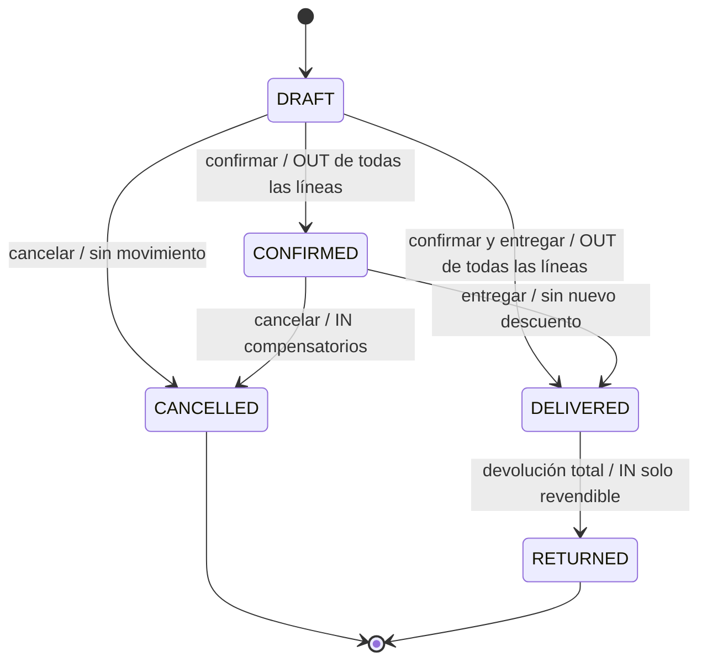

# Contrato de Ventas — MVP presencial

Versión 1.1 para revisión, 17 de noviembre de 2026. Actualiza dependencias por la ampliación de Inventario; conserva las decisiones funcionales aprobadas de Ventas.

**Estado:** incorpora las decisiones funcionales aprobadas por el responsable. Esta especificación técnica final todavía requiere revisión antes de implementar. No se modificaron código, esquema ni migraciones. No autoriza commits, push, despliegues ni operaciones en producción.

## 1. Alcance y base existente

**Dependencia previa:** completar y verificar la ampliación descrita en el [contrato de Inventario con hoja de cálculo](inventory-sheet-contract.md) antes de implementar Ventas. Esa fase incorpora edición masiva, XLSX/CSV, ficha comercial, versiones separadas y auditoría de lotes. No se considera ya implementada ni acreditada por los E2E anteriores. La planificación cambia de orden, sin añadir sincronización con Google Sheets ni integración automática con pedidos.

Ventas será un módulo privado para ventas presenciales, por cuenta y sobre su única bodega implícita. No requiere catálogo, pedido ni datos personales del comprador.

El esquema actual tiene `InventoryItem` y `InventoryMovement`, pero no precios ni costos de inventario. Los productos del catálogo y sus pedidos son entidades separadas; los pedidos actuales no reservan ni descuentan existencias. Se conserva ese comportamiento.

Referencias inspeccionadas: [esquema](../catalog-api/prisma/schema.prisma), [repositorio de inventario](../catalog-api/src/repositories/inventory.repository.ts), [validaciones](../catalog-api/src/schemas/inventory.schema.ts), [cálculo de existencias](../catalog-api/src/services/inventory-calculation.ts), [pedidos](../catalog-api/src/services/order.service.ts) y [cierre de cuenta](../catalog-api/src/services/account-closure.service.ts).

Incluye: borradores, ficha comercial propia, descuentos fijos por unidad, confirmación, entrega, cancelación total, devolución total, compensaciones e idempotencia persistida.

Excluye: pagos en línea, flujo de reembolso monetario, facturación electrónica, impuestos complejos, reservas, múltiples bodegas, cantidades fraccionarias, entregas/ventas/devoluciones parciales, FIFO, valorización contable e integración automática con catálogo o WhatsApp. No se añadirá por anticipado una tabla de reembolsos sin consumidor; las instantáneas permitirán diseñarla posteriormente.

## 2. Invariantes

1. El propietario se obtiene de la sesión validada. Cada lectura y escritura verifica pertenencia; IDs enviados por el cliente no conceden autorización.
2. La bodega es la colección de artículos de la cuenta. No se incorpora `Warehouse` ni un `warehouseId` ficticio.
3. Un borrador no reserva ni modifica stock.
4. Confirmar descuenta todas las líneas una sola vez, en una transacción. Sin confirmación parcial ni saldo negativo.
5. Entregar no vuelve a descontar. Confirmar y entregar es una única operación atómica.
6. El servidor calcula precios efectivos, descuentos, subtotales y totales desde datos validados y persistidos.
7. Después de confirmar no se modifican las líneas ni las instantáneas. Entrega, cancelación y devolución agregan eventos; no reescriben la venta original.
8. Las correcciones físicas se registran mediante movimientos compensatorios vinculados al origen.
9. Toda mutación de Ventas tiene una identidad recuperable, independiente de sus transmisiones HTTP.
10. No se elimina historial comercial como consecuencia de cerrar una cuenta. La retención de doce meses sigue sin aprobarse y no se implementa.

En este contrato, stock representa unidades disponibles para vender. Las unidades confirmadas pendientes de entrega ya no forman parte de ese saldo; los conteos y ajustes manuales deben considerar esa distinción.

## 3. Máquina de estados



| Origen | Acción | Destino | Efecto |
| --- | --- | --- | --- |
| `DRAFT` | Editar | `DRAFT` | Nueva versión y recálculo; sin stock. |
| `DRAFT` | Confirmar | `CONFIRMED` | Congelar líneas, registrar evento y salidas. |
| `DRAFT` | Confirmar y entregar | `DELIVERED` | Mismos efectos más entrega, en el mismo commit. |
| `DRAFT` | Cancelar | `CANCELLED` | Motivo obligatorio; sin entrada compensatoria. |
| `CONFIRMED` | Entregar | `DELIVERED` | Solo evento/fecha de entrega. |
| `CONFIRMED` | Cancelar | `CANCELLED` | Compensar íntegramente las salidas de confirmación. |
| `DELIVERED` | Devolver | `RETURNED` | Recepción total; reintegrar únicamente lo revendible. |

No se permite volver a borrador, confirmar canceladas, entregar canceladas ni cancelar entregadas. Una venta entregada se corrige por devolución. Para corregir cantidades o precios de una confirmada: cancelar y crear otra venta.

La acción combinada guarda `confirmedAt` y `deliveredAt`, y un recibo que acredita ambos efectos. No se ejecutan dos llamadas independientes con riesgo de quedar a medias.

## 4. Ficha comercial, dinero y descuentos

`ItemCommercialTerms` será una ficha privada uno a uno con el artículo de inventario, independiente del catálogo. Contendrá COP, precio unitario de venta, costo unitario de referencia opcional y versión comercial. Su creación e interfaces de edición/importación corresponden primero a Inventario ampliado; Ventas consumirá esa misma tabla y esas mismas validaciones, sin duplicar otra fuente de precio/costo.

- Los importes son pesos COP enteros, no números de punto flotante.
- Almacenamiento y cálculos monetarios: `BIGINT`/`bigint`; representación JSON: cadenas decimales canónicas, sin separadores ni notación exponencial.
- Rango monetario: de cero a 9223372036854775807; validar también sumas y multiplicaciones intermedias. Nunca convertir importes a `number` si eso pierde precisión.
- Cantidades: enteros de 1 a 2147483647; máximo técnico inicial de 100 artículos distintos por venta.
- Precio o costo negativo: inválido. Costo desconocido: `null`, nunca cero inventado.
- Sin ficha comercial no se puede confirmar ni tomar un precio implícito del catálogo.
- El vendedor solicita un descuento unitario en el borrador. El servidor valida `0 <= descuento <= precio`, lo persiste y calcula el resultado. No se añaden descuentos globales, porcentajes ni promociones programadas.
- Es posible un neto cero por descuento total; sigue descontando existencias y queda registrado. No se interpreta como un pago realizado.
- No se calcula ni desglosa fiscalidad: guardar `taxMode = NOT_MANAGED` y no presentar un impuesto cero como si fuera una exención. El importe de la ficha es el precio comercial final configurado por el negocio.

Por línea:

```text
importeBase = cantidad × precioUnitarioBase
descuentoLinea = cantidad × descuentoUnitario
precioUnitarioNeto = precioUnitarioBase − descuentoUnitario
subtotalNeto = importeBase − descuentoLinea
totalVenta = suma(subtotalNeto)
```

El borrador guarda cotizaciones provisionales calculadas en servidor y la versión de la ficha utilizada. Confirmar exige que la ficha siga vigente: si cambió precio o costo, devuelve conflicto y requiere refrescar/revisar el borrador. No cambia silenciosamente el total. Después de confirmar se utilizan exclusivamente las instantáneas históricas.

El costo es solo de referencia; no acredita costo real de lotes ni rentabilidad contable.

Una importación puede cambiar precio/costo con preview y confirmación propios, pero no modificar importes de ventas ya confirmadas. Solo cambios comerciales reales incrementan la versión de la ficha. Importar el mismo precio, cambiar el mínimo o mover stock no provoca por sí solo un conflicto de precio en un borrador de venta.

## 5. Modelo de datos lógico

Especificación para futuras migraciones, no un cambio al esquema actual.

| Entidad | Campos principales y reglas |
| --- | --- |
| `ItemCommercialTerms` | `itemId`, `userId`, `currency=COP`, `unitSalePrice`, `referenceUnitCost?`, `version`, fechas. Una ficha por artículo; mismo propietario que el artículo. |
| `Sale` | `id`, `userId`, `status`, `version`, `currency=COP`, `source=LOCAL`, totales, `createdAt`, `updatedAt`, `confirmedAt?`, `deliveredAt?`, `cancelledAt?`, `returnedAt?`. Sin comprador obligatorio ni FK de catálogo/pedido en el MVP. |
| `SaleLine` | `id`, `saleId`, `userId`, `inventoryItemId`, `quantity`, versión comercial y snapshots de nombre, SKU, moneda, precio base, descuento unitario, precio neto, costo opcional, importe base, descuento de línea y subtotal. Una línea por artículo. |
| `SaleOperation` | `id=operationId`, `userId`, `saleId`, `kind`, `expectedSaleVersion`, comando canónico validado, `requestHash`, estado, resultado HTTP/código de negocio, recibo, fechas y `completedByRequestId?`. Tipos: `CREATE`, `UPDATE_DRAFT`, `CONFIRM`, `DELIVER`, `CANCEL`, `RETURN`. La versión esperada es nullable solo para creación; la venta nace en versión 1. También actúa como registro de eventos exitosos. |
| `SaleReturn` | `id`, `saleId`, `userId`, `operationId`, motivo y fecha. Como máximo una devolución total por venta. |
| `SaleReturnLine` | `returnId`, `saleLineId`, `receivedQuantity`, `resellableQuantity`, `nonResellableQuantity`. Debe incluir exactamente todas las líneas vendidas. |
| Ampliación de `InventoryMovement` | Referencias opcionales a operación de venta, línea de venta y movimiento original compensado; conservar orígenes `MANUAL`/`INVENTORY_BATCH` y extender con `SALE_CONFIRMATION`, `SALE_CANCELLATION` o `SALE_RETURN`. Mantener `IN`, `OUT` y `ADJUSTMENT` existentes. |

Inventario ampliado añadirá `dataVersion` y `stockVersion` al artículo, además de delta firmado, actor y referencias de lote en el ledger. Ventas reutilizará esos campos y agregará sus referencias/orígenes, sin crear un ledger paralelo. Su `OUT` de confirmación y sus `IN` compensatorios incrementan `stockVersion` en la misma transacción; no cambian `dataVersion` ni la versión comercial. Las operaciones de lote y las de venta tienen recibos/identidades separados, siempre delimitados por propietario.

Las líneas son editables solamente en `DRAFT`; sus snapshots se vuelven definitivos en el commit de confirmación. Una fecha o recibo histórico terminal no se sobrescribe al reintentar.

### Integridad e índices

- FKs y claves compuestas de propietario donde corresponda para impedir relaciones entre cuentas incluso ante un error del servicio.
- Unicidad de operación por `(userId, operationId)`; las claves no autorizan acceso por sí mismas.
- Unicidad de línea por `(saleId, inventoryItemId)`.
- Unicidad de evento exitoso por venta y tipo para `CONFIRM`, `DELIVER`, `CANCEL` y `RETURN`. La confirmación combinada cuenta como una confirmación y una entrega; no habilita después otra entrega.
- Un movimiento por `(operationId, saleLineId, movementRole)`; una compensación referencia la salida real, no solo un texto.
- FKs `RESTRICT` para historial comercial y artículos referenciados: ningún borrado en cascada debe destruir ventas confirmadas ni sus movimientos.
- CHECK de moneda, cantidades, importes, ecuaciones monetarias y reparto de devolución; conservar los CHECK actuales de inventario.
- Listados paginados por propietario con orden estable `(createdAt, id)` e índices correspondientes. Listado de operaciones por venta y propietario.
- Reglas de inmutabilidad en base de datos para líneas confirmadas, recibos terminales y movimientos asociados a ventas; transiciones válidas protegidas también en servidor.

No hace falta un número fiscal ni una secuencia comercial especial para el MVP; `saleId` identifica la venta. Un folio visible podrá definirse sin reutilizar IDs ni alterar idempotencia.

## 6. API propuesta

Todas las rutas son privadas bajo `/api`, con el proxy same-origin existente, cookie HttpOnly y respuestas `private, no-store`. Los esquemas de entrada serán estrictos y no admitirán propietario, totales o snapshots impuestos por el cliente.

| Método y ruta | Contrato |
| --- | --- |
| `GET /inventory/items/:id/commercial-terms` | Consultar ficha propia. |
| `PUT /inventory/items/:id/commercial-terms` | Guardar ficha validada con versión esperada; devolver versión nueva. Si se pierde la respuesta, consultar la ficha antes de reenviar; una versión antigua no puede sobrescribir otra nueva. No utiliza una operación de venta. |
| `POST /sales` | Crear borrador vacío. `Idempotency-Key` contiene el UUID de creación. No crea movimientos. |
| `GET /sales` | Filtros de estado y fechas; búsqueda literal, cursor validado del propietario, 24 resultados por página y máximo 100. |
| `GET /sales/:saleId` | Estado actual, versión, líneas, cotización y operaciones recuperables. |
| `POST /sales/:saleId/operations` | Preparar comando validado con `kind`, versión esperada y contenido. Devuelve `operationId` persistido. No modifica stock. |
| `PATCH /sales/:saleId` | Ejecutar una operación preparada `UPDATE_DRAFT`. Reemplaza las líneas de forma atómica y recalcula en servidor. |
| `POST /sales/:saleId/confirm` | Ejecutar `CONFIRM`, con `deliverImmediately` fijado en el comando preparado. |
| `POST /sales/:saleId/deliver` | Ejecutar `DELIVER`. |
| `POST /sales/:saleId/cancel` | Ejecutar `CANCEL` con motivo obligatorio. |
| `POST /sales/:saleId/returns` | Ejecutar `RETURN` con recepción total y disposición de todas las líneas. |
| `GET /sale-operations/:operationId` | Recuperar comando/resultado propios tras una respuesta incierta. |
| `POST /sale-operations/:operationId/abandon` | Marcar una operación todavía preparada como abandonada; no borrar su registro ni modificar stock. |

Las acciones ejecutan el comando ya persistido, identificándolo con `operationId`; no aceptan otro juego de precios/cantidades en el momento de confirmar. Se comprobará la coincidencia de ruta, tipo y venta. No habrá endpoints de reembolso ni integración de pedidos en esta versión.

Errores públicos: `400 INVALID_INPUT`, `401 SESSION_REQUIRED`, `404 SALE_NOT_FOUND`/`ITEM_NOT_FOUND` para ausentes o ajenos; `409 VERSION_CONFLICT`, `PRICE_CHANGED`, `STOCK_INSUFFICIENT`, `INVALID_TRANSITION`, `IDEMPOTENCY_CONFLICT` y `OPERATION_IN_PROGRESS`; `503 RETRY_SAME_OPERATION` para fallos transitorios. Mensaje legible y `requestId`, sin SQL, stack, cookies ni credenciales. El limitador existente conserva su `429`.

## 7. Idempotencia y recuperación

### Identificadores separados

- `saleId`: UUID permanente de la venta, generado en servidor.
- `operationId`: UUID de una intención comercial persistida. Se conserva en doble clic, recargas y reintentos HTTP. Creación inicial: UUID generado antes de enviar la solicitud. Resto de operaciones: UUID devuelto por su preparación en servidor.
- `requestId`: UUID de una transmisión HTTP; cambia en cada envío, se valida/genera en servidor y sirve para correlación. Nunca sustituye al identificador comercial.

Los registros se delimitan por propietario. La misma clave en otra cuenta nunca recupera datos ajenos. No se deduplican ventas distintas por tener el mismo carrito: pueden ser operaciones legítimas separadas.

### Ciclo de la operación

```text
PREPARED -> SUCCEEDED
PREPARED -> REJECTED
PREPARED -> ABANDONED
```

La preparación valida y conserva un comando canónico. Para la misma venta, tipo, versión y hash, dos preparaciones simultáneas recuperan la misma operación preparada mediante una restricción única y recuperación del conflicto. Abandonar permite corregir una intención todavía no ejecutada. Los estados terminales, el comando y sus recibos son inmutables.

El hash se calcula en servidor sobre datos normalizados, excluyendo `requestId` y metadatos de transporte. Misma operación y contenido: recuperar el recibo; contenido distinto: `409`. El recibo describe el evento original; `GET /sales/:id` describe el estado actual, que puede haber pasado posteriormente a cancelada o devuelta.

Un rechazo de negocio se registra como `REJECTED`, con código/recibo, sin modificar líneas, estado o inventario. Reintentar ese ID devuelve el mismo rechazo; después de resolver la causa se prepara otro intento. Un error técnico que revierte la transacción conserva `PREPARED`: se consulta/reintenta el mismo ID, nunca se inventa otro para resolver una respuesta incierta.

Dos IDs distintos intentando confirmar una venta tampoco pueden duplicar la salida: estado bloqueado y unicidad de evento exitoso lo impiden. La segunda intención se rechaza sin nuevos movimientos y se permite consultar el evento ya realizado.

### Recarga y respuesta perdida

1. Antes del primer POST, la interfaz coloca el UUID de creación en una URL recuperable, sin datos sensibles.
2. Si se pierde la respuesta, esa URL permite consultar/reintentar la creación y recuperar `saleId` con sesión real.
3. Después se trabaja en una URL con `saleId`; las operaciones preparadas y completadas se recuperan desde el servidor.
4. Una recarga consulta el resultado antes de ofrecer otra acción. Si sigue preparado, muestra el comando para continuar o abandonar; no reenvía silenciosamente una intención distinta.
5. Si el commit ocurrió y se perdió la conexión, venta, movimientos y recibo existen conjuntamente: la consulta devuelve el resultado original sin repetir efectos.

No se guardan motivos, precios, costos, tokens ni formularios sensibles en localStorage/sessionStorage. Esto aplica a Ventas; no amplía la persistencia entre recargas de movimientos manuales de Inventario, cuyo alcance sigue pendiente.

No habrá purga automática de recibos ni un TTL que convierta silenciosamente un reintento antiguo en otra venta. Cualquier retención futura deberá mantener la protección comercial frente a reejecuciones y requerirá decisión específica.

## 8. Transacciones y bloqueos

Para operaciones sobre una venta: `User FOR SHARE` -> `Sale FOR UPDATE` -> `SaleOperation FOR UPDATE` -> artículos por ID ascendente. Las escrituras de ficha comercial tomarán también el bloqueo de su artículo antes de cambiar la versión. La lectura final de precios se realiza bajo esos bloqueos.

Confirmación:

1. Autenticar; bloquear propietario y comprobar cuenta abierta dentro de la transacción.
2. Bloquear venta y operación, verificar pertenencia y recuperar primero un recibo ya terminal.
3. Validar estado, versión y comando; agrupar cantidades por artículo y bloquear artículos en orden determinista.
4. Comprobar todos los saldos y versiones comerciales. Si cambió nombre/SKU frente a lo revisado, exigir refrescar el borrador. No usar `InventoryItem.updatedAt` como versión de precio: también cambia al mover stock.
5. Calcular y validar importes y snapshots completos.
6. Solo después de validar todas las líneas, actualizar saldos y crear salidas con origen `SALE_CONFIRMATION`.
7. Congelar líneas, registrar confirmación y opcionalmente entrega; incrementar la versión de venta.
8. Guardar recibo `SUCCEEDED` y confirmar todo en el mismo commit.

Si una línea falla antes de escribir, se puede confirmar únicamente el recibo de rechazo. Si falla una escritura o constraint, revertir todas las escrituras de esa transacción. Nunca se deja una venta parcialmente confirmada ni un recibo exitoso sin sus movimientos.

Se extraerá una operación interna de inventario que reciba `Prisma.TransactionClient`. No se llamará al endpoint manual por cada línea ni a `moveInventory` tal como está hoy, porque abre su propia transacción. El endpoint manual conservará su comportamiento y envolverá la misma lógica interna.

Con dos ventas sobre la última unidad, el bloqueo serializa la validación del saldo: una confirma y la otra recibe stock insuficiente. Los bloqueos, actualizaciones condicionadas y CHECK son defensas complementarias. Timeout/deadlock técnico implica rollback y reintento acotado de la misma operación, no una clave comercial nueva.

La confirmación no toma locks de pedidos ni catálogos. El cierre actual usa el orden `Order -> Catalog -> User`; no introducir un camino inverso `User -> Order/Catalog`. La integración futura necesitará revisar ese grafo de bloqueos.

La hoja y los lotes no tomarán locks de ventas. Si una venta modifica un artículo después de una preview de conteo, la aplicación del lote debe rechazar su `stockVersion` obsoleta y pedir nueva preview, no restaurar un saldo anterior. Si el lote se aplica primero, la venta valida el saldo resultante bajo lock. Un borrador de venta no congela disponibilidad: confirmar lee el saldo vigente, no exige que permanezca idéntico al mostrado al crear el borrador. Las actualizaciones de ficha desde lote participan en el bloqueo del artículo y en su versión comercial.

## 9. Compensaciones y devoluciones

Cancelar `DRAFT`: guardar evento/motivo, sin movimientos. Cancelar `CONFIRMED`: crear una entrada por cada salida original, por la cantidad íntegra y con referencia a la operación y salida compensadas. Conservar nombres, importes y salidas originales. La cancelación no revierte otros movimientos manuales posteriores.

Devolver exige `DELIVERED` y recibe todas las unidades de todas las líneas:

```text
receivedQuantity = cantidad vendida
resellableQuantity + nonResellableQuantity = receivedQuantity
0 <= cada cantidad <= cantidad vendida
```

Crear `IN` solo si `resellableQuantity > 0`. Las unidades dañadas o no revendibles quedan en el registro de devolución sin incrementar stock vendible; no se crea otra salida por ellas, pues ya salieron al vender. Una devolución totalmente dañada registra el evento aunque no genere ningún movimiento de entrada.

La devolución completa, sus líneas, las entradas permitidas, el estado `RETURNED` y el recibo se confirman juntos. No recalcular importes con el precio actual ni modificar el total histórico de venta. El recibo puede mostrar el valor comercial original de lo devuelto; no representa un reembolso pagado.

La máquina de estados y las restricciones de eventos impiden cancelar y devolver la misma venta o compensarla dos veces. Para una compensación que desborde el máximo de stock, devolver conflicto sin entradas parciales; requiere resolver la inconsistencia antes de reintentar.

## 10. Casos límite y ciclo de vida

| Caso | Comportamiento |
| --- | --- |
| Sin precio configurado | Rechazar, sin inventar precio cero ni consultar automáticamente el catálogo. |
| Precio/costo modificado durante el borrador | Conflicto y revisión explícita; no confirmar importes nuevos sin revisión. |
| Artículo inexistente o de otra cuenta | Rechazo sin revelar datos ajenos ni confirmar otras líneas. |
| Artículo repetido | Agrupar solo si coincide el descuento unitario; si difiere, rechazar y pedir una única línea. Validar cantidades acumuladas; nunca promediar descuentos silenciosamente. |
| Neto cero | Venta válida con sus salidas, sin afirmar cobro alguno. |
| Stock mínimo | Advertencia informativa; no reemplaza al control de stock insuficiente. |
| Edición concurrente de borrador | Versión esperada: una gana, la otra recibe conflicto. |
| Cambio de nombre/SKU | Exigir revisión antes de confirmar; conservar snapshots después de confirmar. |
| Archivado futuro de un artículo | Impedir ventas nuevas, pero permitir compensaciones vinculadas a ventas anteriores. No añadir ahora una interfaz de archivado. |
| Borrado físico futuro | Restringido por referencias comerciales/históricas; no eliminar en cascada. |
| Cancelar entregada | Rechazar; utilizar devolución. |
| Mercancía aún no recibida | No registrar una devolución completa ni reingresar existencias. |
| Cuenta cerrada o sesión expirada | Rechazar ejecución; no usar localStorage como autorización. Recuperación solo con sesión válida. |
| Reembolso monetario | Fuera de interfaz, endpoints y migración inicial; no inferirlo de cancelación/devolución. |

### Punto adicional para revisión: cierre con entregas pendientes

Recomendación: impedir cerrar una cuenta mientras tenga ventas `CONFIRMED` sin entregar/cancelar, para no dejar obligaciones físicas sin una cuenta capaz de gestionarlas. Las ventas `DELIVERED`, `CANCELLED` o `RETURNED` conservan su historial; el cierre no las transforma ni genera movimientos.

Este bloqueo de cierre es una regla adicional que debe revisarse antes del código. No se adopta la retención de doce meses, no se implementan anonimización ni borrados automáticos y no se ejecutan compensaciones al cerrar. Los borradores no descuentan stock y podrán quedar inaccesibles tras cerrar, sin fabricar cancelaciones o movimientos.

## 11. Catálogo y WhatsApp

El MVP solo crea ventas `LOCAL`, independientes del catálogo y sus pedidos. No se agregan FKs o columnas de conversión sin un flujo consumidor.

La integración posterior requerirá asociación explícita de productos a artículos del mismo dueño, nunca por coincidencia automática de SKU. Convertir un pedido a borrador tendrá identidad persistente y unicidad de conversión para impedir duplicados. Deberá definir qué precios históricos del pedido conserva y qué vuelve a revisar. Confirmar pedidos existentes no empezará a descontar stock como efecto colateral de este módulo.

## 12. Migraciones necesarias, todavía no creadas

Se crearán migraciones nuevas y aditivas, sin editar las 25 existentes:

| Bloque | Cambio previsto y comprobación |
| --- | --- |
| Base de Inventario ampliado | Prerrequisito: ficha comercial, versiones, actor/delta y operaciones de lote ya migrados y verificados conforme a su contrato. No crear esas tablas/campos otra vez desde Ventas. Artículos sin ficha siguen sin poder venderse; no copiar precios del catálogo ni inventar costos. |
| Ventas y líneas | Crear estados, tablas, versiones, snapshots, índices por propietario e integridad entre cuentas. No importar pedidos existentes como ventas. |
| Operaciones y eventos | Crear comandos/recibos persistidos, estados terminales, claves por propietario e índices únicos de preparación y efectos exitosos. |
| Devoluciones | Crear cabecera y líneas con reparto validado; ninguna columna de reembolso obligatorio. |
| Vínculo con ledger | Añadir referencias nullable y origen manual por defecto para movimientos existentes. FK/índices y guards de inmutabilidad para ventas; preservar aritmética y claves actuales. |
| Protección de historial | Revisar los `Cascade` actuales y añadir/reemplazar FKs mediante migración nueva cuando proceda. Comprobar referencias existentes antes de validar restricciones. Sin borrar datos. |

El código nuevo debe rechazar ventas sin ficha y funcionar con movimientos manuales anteriores sin referencias de venta. Los campos históricos solo serán obligatorios para las nuevas filas que realmente correspondan a ventas. Las restricciones que Prisma 6 no representa se documentarán y preservarán en SQL.

Antes de una publicación autorizada: ensayo completo y actualización sobre datos ficticios preexistentes, inspección de restricciones/índices, validación de integridad y presupuesto de bloqueos. Aplicar esquema compatible antes de desplegar API y frontend. Para rollback de aplicación, conservar tablas/datos/recibos; no revertir ventas con DROP ni deshacer movimientos automáticamente. No ejecutar nada de este procedimiento durante la revisión del contrato.

## 13. Plan de pruebas y aceptación

### Dominio y API

- Todas las transiciones permitidas/prohibidas; inmutabilidad después de confirmar.
- COP enteros, formatos JSON estrictos, valores negativos, descuento superior al precio, costo nullable, neto cero y límites de suma/multiplicación.
- Una línea sin ficha, ajena, sin stock o con precio cambiado impide confirmar toda la venta.
- Snapshots de nombre, SKU, precio, descuento, costo y subtotales preservados tras cambios posteriores.
- Propiedad de venta, artículo, operación, devolución y ficha; sesión revocada y cuerpo con campos no autorizados.

### PostgreSQL real

- Dos ventas por la última unidad; varias líneas bloqueadas en distinto orden de entrada sin saldos negativos.
- Confirmar frente a edición de borrador, precio, movimiento manual y cierre de cuenta.
- Confirmar frente a lote/hoja: un conteo con preview anterior a una salida recibe conflicto; un lote aplicado antes de confirmar se respeta; precios importados solo invalidan borradores si cambiaron realmente; no hay deadlocks por invertir artículo/venta ni ledger duplicado.
- Doble ejecución de una misma operación y dos operaciones distintas intentando el mismo efecto comercial.
- Falla inyectada después de actualizar un saldo: rollback de venta, líneas, todos los movimientos y recibo exitoso.
- Rechazo de negocio recuperable y separado de fallo técnico incierto.
- Cancelación repetida, carrera cancelar/entregar, devolución repetida y carrera de compensaciones.
- Devolución revendible, dañada y mixta; recepción incompleta rechazada; desbordamiento de entrada sin compensación parcial.
- Conciliación de saldo y ledger, claves/FKs/CHECK, inmutabilidad y preservación de historia previa a las migraciones.

### E2E real

- Registro/login real, dos cuentas y ventas independientes del catálogo.
- Borrador sin reserva; venta presencial con confirmar/entregar atómico y entrega posterior de confirmadas.
- Cancelación total, devolución total con disposición y errores visibles.
- Doble clic, reintentos, recarga antes/después de crear el borrador, caída después del commit y recuperación mediante URL/operación.
- Recibo original frente a estado actual después de una cancelación; ninguna recuperación repite salidas o compensaciones.
- Listados, filtros literales, paginación, teclado, foco y anchos móviles.
- Cierre con venta pendiente conforme a la regla que se apruebe.

Criterio de salida: pruebas específicas y suite existente, tipos, lint y builds correctos; ensayo de migraciones y E2E real en PostgreSQL aislado. Sin pruebas contra producción ni dependencias nuevas instaladas automáticamente.

## 14. Revisión previa a implementar

Las decisiones funcionales de descuento, estados, COP, snapshots, devoluciones totales, costo de referencia, transacción única e idempotencia están incorporadas. Reembolsos, integración automática, retención de doce meses y persistencia adicional de movimientos manuales permanecen fuera del alcance.

Revisar especialmente estas concreciones técnicas: API en dos pasos para preparar/ejecutar operaciones, recuperación inicial por UUID en URL, importes `BIGINT` como cadenas JSON, descuento total permitido y límite técnico de 100 artículos por venta. Revisar también el bloqueo adicional de cierre con ventas `CONFIRMED` pendientes.

Tras revisar ambos contratos, primero se implementará y verificará Inventario ampliado. Solo después se implementarán el esquema y operaciones propias de Ventas, sus endpoints/interfaz y pruebas, reutilizando ficha comercial, versiones y núcleo transaccional existentes. Este documento no inicia ninguna de esas modificaciones.
