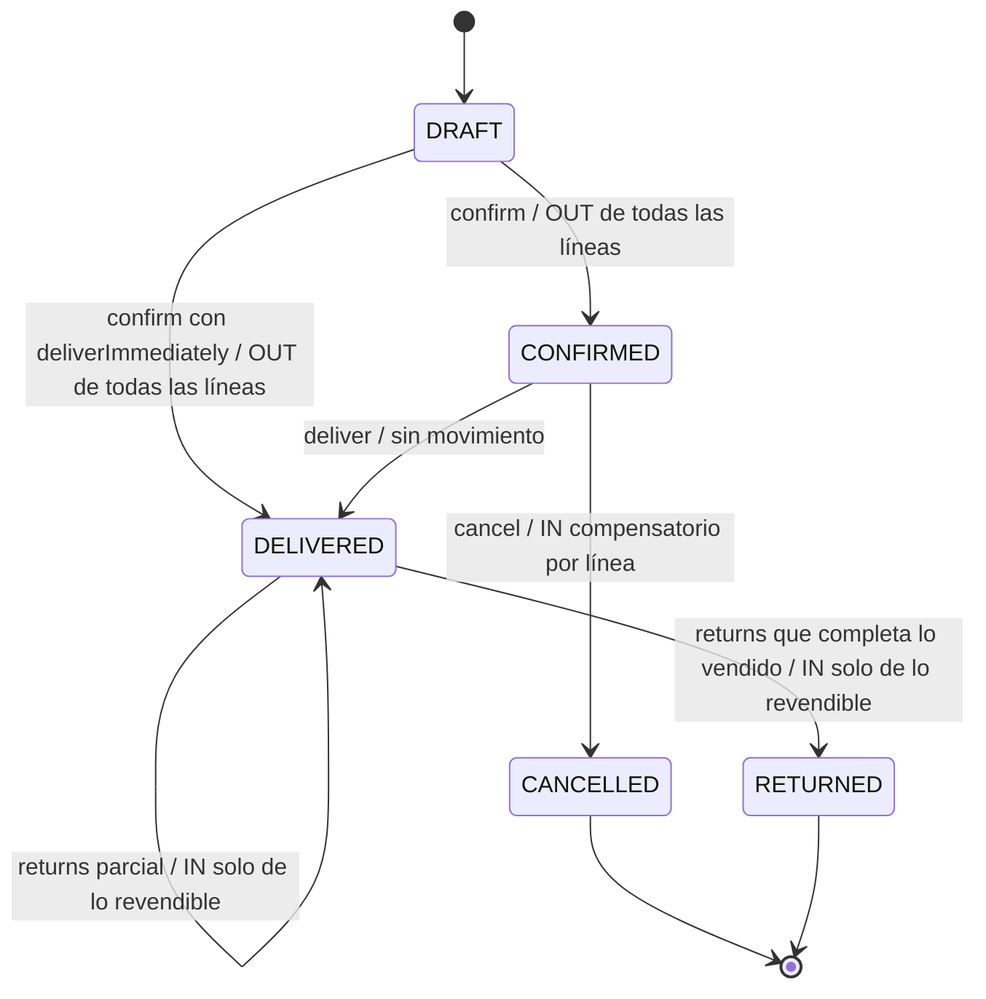

# Contrato de Ventas — implementación vigente

Versión 2.1, 24 de noviembre de 2026. Describe lo que hace el código del repositorio, no una propuesta. Donde el código y la versión 1.1 (17 de noviembre, diseño previo) difieren, manda el código; las diferencias están en la [sección 12](#12-diferencias-con-la-versión-11), y los cambios respecto a la 2.0 en la [sección 14](#14-cambios-de-la-versión-21). No autoriza migraciones, despliegues ni operaciones en producción.

Código: [rutas](../catalog-api/src/routes/sales.routes.ts), [servicio](../catalog-api/src/services/sale.service.ts), [borradores y clientes](../catalog-api/src/services/sale-customer.ts), [hash de operaciones](../catalog-api/src/services/sale-operation-hash.ts), [esquemas Zod](../catalog-api/src/schemas/sales.schema.ts), [conversión de pedidos](../catalog-api/src/controllers/order.controller.ts) y [Prisma](../catalog-api/prisma/schema.prisma).

## 1. Alcance

Módulo privado de ventas presenciales por cuenta, sobre la única bodega implícita (los artículos de inventario del propietario). Incluye borradores, ficha comercial, descuento fijo por unidad, confirmación (opcionalmente con entrega inmediata), entrega, cancelación de ventas confirmadas con compensación de stock, **devoluciones parciales y acumulativas** de ventas entregadas y conversión explícita de un pedido del catálogo en venta.

No incluye pagos, saldos ni cartera, reembolsos, facturación electrónica, impuestos (no hay `taxMode`), reservas, varias bodegas, cantidades fraccionarias, entregas parciales, FIFO ni valorización contable.

## 2. Invariantes que aplica el código

1. El propietario sale de la sesión. Toda lectura y escritura filtra por `userId`; un ID ajeno responde como inexistente.
2. Un borrador no reserva ni modifica stock.
3. Confirmar descuenta todas las líneas en una transacción. Si una línea no tiene stock o cambió su ficha comercial, no se escribe nada.
4. Entregar no descuenta otra vez. Confirmar con `deliverImmediately: true` hace ambas cosas en el mismo commit.
5. Precios, descuentos, subtotales y totales los calcula el servidor; el cliente solo envía cantidades y descuento unitario.
6. Después de confirmar no se editan líneas ni instantáneas. Entrega, cancelación y devolución cambian estado y añaden movimientos; no reescriben importes.
7. Las correcciones físicas son movimientos de inventario vinculados a la venta y su línea.
8. **Solo se cancela una venta `CONFIRMED`.** Una venta entregada se corrige únicamente con devoluciones.
9. Ninguna línea puede devolverse por encima de lo vendido, sumando todas sus devoluciones.
10. Toda mutación lleva `operationId` (identidad de la intención) y queda registrada en `"SaleOperation"`.
11. Cerrar la cuenta no borra ni transforma ventas.

## 3. Estados y transiciones



| Origen | Acción | Destino | Comprobaciones y efecto | Error si no procede |
| --- | --- | --- | --- | --- |
| `DRAFT` | `PATCH /sales/:id` | `DRAFT` | Reemplaza todas las líneas, recalcula y sube la versión. Sin stock. | `INVALID_TRANSITION` si no es borrador; `VERSION_CONFLICT` |
| `DRAFT` | `confirm` | `CONFIRMED` o `DELIVERED` | Stock suficiente y misma versión de ficha comercial en cada línea; `OUT` por línea. | `VERSION_CONFLICT`, `STOCK_INSUFFICIENT`, `PRICE_CHANGED` |
| `CONFIRMED` | `deliver` | `DELIVERED` | Solo fecha y versión. | `INVALID_TRANSITION` |
| `CONFIRMED` | `cancel` | `CANCELLED` | Motivo de 3 a 300 caracteres; `IN` por la cantidad íntegra de cada línea. | `INVALID_TRANSITION` (también si la venta está `DELIVERED`) |
| `DELIVERED` | `returns` | `DELIVERED` o `RETURNED` | Cualquier subconjunto de líneas y cantidades; nunca más de lo pendiente por línea. Pasa a `RETURNED` (con `returnedAt`) cuando todas las líneas quedan devueltas por completo. | `INVALID_TRANSITION`, `RETURN_EXCEEDS_SOLD`, `RETURN_LINE_DUPLICATE`, `RETURN_LINE_NOT_FOUND` |

Un borrador **no** se puede cancelar (`INVALID_TRANSITION`) y no hay acción para descartarlo. No existe vuelta a borrador.

La base de datos aplica la misma máquina de estados con el trigger `sale_status_transition_guard`: solo permite `DRAFT → CONFIRMED | DELIVERED`, `CONFIRMED → DELIVERED | CANCELLED` y `DELIVERED → RETURNED`. Solo actúa sobre cambios futuros; las ventas históricas no se reescriben (sección 13).

## 4. Dinero, ficha comercial y cálculo

- Pesos COP enteros en `BIGINT`; en JSON, cadenas decimales (`"200"`). `currency` siempre `COP`.
- La ficha comercial (`item_commercial_terms`) aporta precio de venta, costo de referencia opcional y versión. Sin ficha, el borrador responde `PRICE_REQUIRED`.
- El descuento unitario cumple `0 <= descuento <= precio` (`INVALID_DISCOUNT`). Un neto cero es válido y no implica cobro.

Por línea y por venta:

```text
lineTotal     = (unitPrice − unitDiscount) × quantity
subtotal      = Σ unitPrice × quantity
discountTotal = Σ unitDiscount × quantity
total         = subtotal − discountTotal
```

Confirmar compara la versión de la ficha guardada en cada línea (`commercialTermsVersion`) con la vigente; si cambió, `PRICE_CHANGED`. No compara nombre ni SKU. Tras confirmar solo cuentan las instantáneas de la línea (`itemName`, `sku`, `unitPrice`, `unitCost`, `unitDiscount`, `lineTotal`). Una devolución no recalcula importes de la venta.

### Restricciones en base de datos

| Migración | Tabla | Regla |
| --- | --- | --- |
| `20261124100000_sale_integrity_checks` | `"Sale"` | `currency = 'COP'`; `subtotal`, `discountTotal`, `total >= 0`; `discountTotal <= subtotal`; `subtotal − discountTotal = total` |
| | `"SaleLine"` | `quantity > 0`; `unitPrice`, `unitDiscount`, `lineTotal >= 0`; `unitCost` nulo o `>= 0`; `unitDiscount <= unitPrice`; `lineTotal = (unitPrice − unitDiscount) × quantity` |
| | `"SaleReturnLine"` | `receivedQuantity > 0`; `resellableQuantity`, `damagedQuantity >= 0`; `resellableQuantity + damagedQuantity = receivedQuantity` |
| `20261124200000_inventory_movements_allow_sale_origin` | `inventory_movements` | `origin` en `MANUAL`, `INVENTORY_BATCH`, `SALE`; `SALE` exige referencias de venta y actor, sin lote; los demás orígenes no admiten referencias de venta |
| `20261124210000_sale_partial_returns_and_movement_roles` | `inventory_movements` | `inventory_movements_sale_role_type_check`: `SALE_CONFIRMATION` = `OUT`; `SALE_CANCELLATION` y `SALE_RETURN_RESELLABLE` = `IN`; `SALE_RETURN_DAMAGED` no se admite |
| | `"SaleReturnLine"` | Trigger `sale_return_line_guard`: bloquea la línea vendida `FOR UPDATE` y rechaza que la suma devuelta supere lo vendido (`SALE_RETURN_EXCEEDS_SOLD`) o que la línea pertenezca a otra venta (`SALE_RETURN_LINE_SALE_MISMATCH`). Índice `SaleReturnLine_saleLineId_idx`. |
| | `"Sale"` | Trigger `sale_status_transition_guard` (sección 3) |

Siguen dependiendo del servicio: que `subtotal`/`discountTotal` coincidan con la suma de líneas y la inmutabilidad de líneas confirmadas. Antes de aplicar una migración, comprobar los datos con [la consulta de solo lectura](sql/verify-sale-integrity.sql), que también informa de las reglas entre tablas como diagnóstico.

## 5. Modelo de datos

| Tabla | Campos relevantes |
| --- | --- |
| `"Sale"` | `id`, `userId`, `status`, `version`, `currency`, `subtotal`, `discountTotal`, `total`, fechas `confirmedAt`/`deliveredAt`/`cancelledAt`/`returnedAt`. Cliente: `customerId?` (cliente del mismo propietario) e instantáneas `customerNameSnapshot`, `customerPhoneSnapshot`, `customerEmailSnapshot`; además `customerName`/`customerPhone` heredados. `sourceOrderId?` único: como máximo una venta por pedido. `returnedAt` solo se fija cuando la venta queda devuelta por completo. |
| `"SaleLine"` | `saleId`, `inventoryItemId`, `quantity`, instantáneas de nombre, SKU, precio, costo, descuento y total, `commercialTermsVersion`. Una línea por artículo (`UNIQUE (saleId, inventoryItemId)`). No tiene `userId`; la propiedad se hereda de la venta. |
| `"SaleOperation"` | `id` (= `operationId`), `requestId`, `saleId`, `userId`, `type` (texto: `CREATE`, `UPDATE_DRAFT`, `CONFIRM`, `DELIVER`, `CANCEL`, `RETURN`, `ORDER_CONVERSION`), `status`, `expectedSaleVersion`, `requestHash`, `responseSnapshot`, `completedAt`. `UNIQUE (userId, requestId)`. |
| `"SaleReturn"` | `saleId`, `userId`, `operationId` único, `reason`, `createdAt`. **Una por cada devolución**: una venta puede tener varias. |
| `"SaleReturnLine"` | `returnId`, `saleLineId`, `receivedQuantity`, `resellableQuantity`, `damagedQuantity`. Una fila por línea dentro de cada devolución (`UNIQUE (returnId, saleLineId)`); la misma línea vendida puede aparecer en varias devoluciones. |
| `inventory_movements` | Los movimientos de venta usan `origin = 'SALE'`, `saleId`, `saleLineId`, `saleMovementRole`, `key = operationId` y `actorUserId`. `SALE_RETURN_DAMAGED` existe en el enum pero no se escribe y el CHECK lo rechaza: lo dañado no genera movimiento. |

Ninguna restricción de unicidad limitaba las ventas a una sola devolución; lo impedía solo el servicio. La migración `20261124210000` no relaja ninguna unicidad: añade el índice por `saleLineId` y el trigger acumulativo. Todas las FKs de venta usan `RESTRICT`. No hay endpoint ni columna para borrar o archivar ventas.

## 6. API

Rutas privadas bajo `/api`, con cookie HttpOnly y proxy same-origin, `Cache-Control: private, no-store` y cuerpos JSON de hasta 32 KiB. Respuesta correcta: `{ "result": ... }` con importes como cadenas.

| Método y ruta | Cuerpo | Resultado |
| --- | --- | --- |
| `GET /sales` | — | Las **50** ventas más recientes (`createdAt`, `id` descendente), con líneas y cliente. Sin filtros ni paginación. |
| `GET /sales/:id` | — | Venta con líneas y cliente. |
| `POST /sales` | `operationId`, `requestId`, `customerId?` o `customerName?`/`customerPhone?` | Borrador vacío (versión 1). |
| `PATCH /sales/:id` | `operationId`, `expectedVersion`, `lines[1..100]` (`inventoryItemId`, `quantity`, `unitDiscount`), cliente opcional | Borrador recalculado. |
| `POST /sales/:id/confirm` | `operationId`, `requestId`, `expectedVersion`, `deliverImmediately` (por defecto `false`) | Venta confirmada o entregada, **con `lines` y `returns`**. |
| `POST /sales/:id/deliver` | `operationId`, `requestId`, `expectedVersion` | Venta entregada, con `lines` y `returns`. |
| `POST /sales/:id/cancel` | `operationId`, `requestId`, `expectedVersion`, `reason` | Venta cancelada, con `lines` y `returns`. |
| `POST /sales/:id/returns` | `operationId`, `requestId`, `expectedVersion`, `reason`, `lines[1..100]` (`saleLineId`, `receivedQuantity`, `resellableQuantity`, `damagedQuantity`) | Venta `DELIVERED` o `RETURNED`, con `lines` y todas sus `returns` (cada una con sus líneas, en orden de creación). |
| `POST /orders/:orderId/convert-to-sale` | Ver [sección 9](#9-conversión-de-pedidos) | `{ success, sale, idempotent }`; `sale` con `lines` y `returns`. |

Errores:
- `400`: `INVALID_SALE_INPUT` (Zod), `ITEM_NOT_FOUND`, `PRICE_REQUIRED`, `INVALID_DISCOUNT`, `RETURN_LINE_DUPLICATE` (la misma línea dos veces en una devolución) y `RETURN_LINE_NOT_FOUND` (línea que no es de la venta).
- `401`: sin sesión, o `AUTH_REQUIRED` con la cuenta cerrada.
- `404`: `NOT_FOUND` (venta ausente o ajena) y `CUSTOMER_NOT_FOUND`.
- `409`: `VERSION_CONFLICT`, `INVALID_TRANSITION`, `STOCK_INSUFFICIENT`, `PRICE_CHANGED`, `IDEMPOTENCY_CONFLICT`, `RETURN_EXCEEDS_SOLD` y `CUSTOMER_ARCHIVED`; en la conversión, además, `ORDER_ALREADY_CONVERTED`.
- `500 SALE_OPERATION_FAILED` para cualquier otro fallo.

En la mayoría de los `409` el mensaje es el propio código.

La interfaz (`/dashboard/ventas`, enlazada en la cabecera del panel) cubre el ciclo completo: listado con filtro por estado (incluida «Devuelta parcialmente», derivada de `returns`); detalle con líneas, totales del servidor, fechas e historial de devoluciones; editor de borrador con buscador de inventario y cliente; y confirmar, confirmar y entregar, entregar, cancelar y devoluciones parciales con un máximo de lo pendiente por línea. Las acciones importantes piden confirmación con el AlertDialog de Radix. Cada intención del usuario usa una `operationId`, que se conserva en doble clic y en «Reintentar», con una `requestId` nueva en cada envío. `GET /sales` y `GET /sales/:id` incluyen `returns` desde F0d-2.

## 7. Idempotencia: una clave por llamada

No hay preparación en dos pasos ni `GET /sale-operations`. Cada mutación lleva su propia identidad, generada por el cliente:

- `operationId`: UUID de la intención; se reutiliza al reintentar la misma acción. **El recibo se busca solo por `operationId`** del propietario.
- `requestId`: UUID de la transmisión. Se guarda en el recibo, pero **no forma parte del hash** ni identifica la operación. Un reintento puede usar una `requestId` nueva. En `PATCH /sales/:id` no se envía; el servidor usa `requestId = operationId`. Reutilizar una `requestId` en otra operación choca con `UNIQUE (userId, requestId)` y responde `409 IDEMPOTENCY_CONFLICT`, tanto en `/sales` como en la conversión.
- `requestHash`: SHA-256 de `JSON.stringify` del cuerpo validado **sin `requestId`** ([`sale-operation-hash.ts`](../catalog-api/src/services/sale-operation-hash.ts)). Para los recibos guardados antes de este cambio, cuyo hash incluía `requestId`, también se acepta un reintento exacto con la misma `requestId`.

| Situación | Resultado |
| --- | --- |
| Misma `operationId`, mismo contenido, cualquier `requestId` | Se devuelve el recibo guardado, sin repetir efectos. En `confirm`, `deliver`, `cancel` y `returns`, la comprobación se hace tras bloquear la venta y **antes** de comprobar estado o versión. |
| Misma `operationId`, otro contenido, otro tipo de operación u otra venta o pedido | `409 IDEMPOTENCY_CONFLICT` |
| `operationId` nueva sobre una versión superada | No es un reintento: `VERSION_CONFLICT` o `INVALID_TRANSITION`. |

En `confirm`, `deliver`, `cancel` y `returns` el recibo es `responseSnapshot`: el resultado original con líneas y devoluciones e importes como cadenas. Describe el resultado de entonces, no el estado actual. Los recibos guardados antes de la versión 2.1 no incluyen líneas. `POST /sales`, `PATCH /sales/:id` y `convert-to-sale` devuelven la venta actual.

El registro de la operación se crea dentro de la misma transacción que sus efectos. Si la transacción falla, no queda operación y el mismo `operationId` puede reintentarse. Los estados `REJECTED` y `ABANDONED` existen en el enum pero no se usan. La interfaz reutiliza las claves al reintentar la creación de borradores; para las devoluciones genera claves nuevas en cada clic.

## 8. Transacciones y bloqueos

Orden de bloqueo para `confirm`, `deliver`, `cancel` y `returns` (desde F2a-2a es el orden único de dinero y existencias de [Agents.md](../Agents.md) y del [contrato de pagos, 15.A](sales-payments-cartera-contract.md#15-correcciones-del-planificador)):

1. Bloqueo por cuenta y `users` `FOR SHARE` con `lockAccountForMoney`: `pg_advisory_xact_lock(hashtext('account-money-v1'), hashtext(ownerId))` y después la fila del propietario, comprobando que la cuenta no esté cerrada.
2. Fila de `"Sale"` `FOR UPDATE`. Dos llamadas sobre la misma venta se serializan, incluidas dos devoluciones: la segunda ve el estado y la versión ya cambiados.
3. Recibo previo (sección 7).
4. Estado, versión y, en devoluciones, cantidades ya devueltas por línea.
5. Artículos implicados con `SELECT … FROM inventory_items … ORDER BY id FOR UPDATE`, y después lectura de su saldo. Es el mismo orden que usan los lotes de inventario.
6. Validación de todas las líneas antes de escribir; luego saldos, movimientos, estado y recibo en el mismo commit. En devoluciones, el trigger `sale_return_line_guard` vuelve a comprobar cada línea bajo bloqueo de la línea vendida.

**Conversión de pedidos:** bloqueo por cuenta → `users` `FOR SHARE` → pedido `FOR UPDATE` → (venta nueva) → artículos `ORDER BY id FOR UPDATE`, solo en `CONFIRMED`/`DELIVERED`. El saldo, la ficha comercial y el costo se leen después de bloquear. Un borrador no bloquea artículos.

Con dos confirmaciones o conversiones por la última unidad, una confirma y la otra recibe `STOCK_INSUFFICIENT` sin dejar escrituras. Cada movimiento parte del saldo dejado por el anterior. `inventory_items` conserva `CHECK (stock >= 0)` como defensa adicional.

Otros flujos: `POST /sales` usa un advisory lock por propietario (`sale-create-v1`) y `PATCH /sales/:id` bloquea la venta `FOR UPDATE`. Los borradores no toman el bloqueo por cuenta. Ninguna operación de ventas toma locks de catálogo. El cierre de cuenta toma primero el mismo bloqueo por cuenta y después `Order → Catalog → User FOR UPDATE`, así que la conversión y el cierre se serializan y ya no se traban (antes de F2a-2a, PostgreSQL abortaba una de las dos con `40P01`).

## 9. Conversión de pedidos

`POST /api/orders/:orderId/convert-to-sale` crea una venta a partir de un pedido del catálogo propio.

- Cuerpo: `operationId`, `requestId` (deben ser distintos), `customerId?`, `mode` (`DRAFT` por defecto, `CONFIRMED` o `DELIVERED`) y `acceptPriceDifference` (por defecto `false`).
- El pedido debe ser del propietario (`ORDER_NOT_FOUND`), no haberse convertido ya (`409 ORDER_ALREADY_CONVERTED`) y estar `PENDING` o `CONFIRMED` (`ORDER_STATUS_NOT_CONVERTIBLE`). Cada línea necesita un producto vinculado a un artículo de inventario (`ORDER_ITEM_NOT_INVENTORY`) con ficha comercial (`PRICE_REQUIRED`).
- El precio de la venta es el **congelado en el pedido**, con descuento 0. Si difiere del precio vigente de la ficha (leído bajo bloqueo en `CONFIRMED`/`DELIVERED`), exige `acceptPriceDifference: true` (`PRICE_DIFFERENCE_REQUIRES_CONFIRMATION`).
- Las instantáneas del comprador salen del pedido. Un `customerId` explícito solo crea el vínculo operativo, nunca sustituye esas instantáneas. Un teléfono de más de 24 caracteres se rechaza sin recortarlo.
- `sourceOrderId` es único: un pedido produce como máximo una venta. Dos conversiones del mismo pedido con claves distintas se serializan por el bloqueo del pedido; la segunda recibe `ORDER_ALREADY_CONVERTED`. La conversión no modifica el pedido.
- En `CONFIRMED`/`DELIVERED` descuenta stock y registra `SALE_CONFIRMATION`, igual que `confirm`.

## 10. Devoluciones

- Solo para ventas `DELIVERED`. Se permiten **varias devoluciones** sobre la misma venta, cada una con cualquier subconjunto de líneas y cantidades. Cada devolución tiene su propio `operationId`, recibo, motivo, filas `"SaleReturnLine"` y movimientos.
- En cada línea enviada: `receivedQuantity > 0` y `resellableQuantity + damagedQuantity = receivedQuantity`. La línea debe ser de la venta (`RETURN_LINE_NOT_FOUND`) y no repetirse en la misma devolución (`RETURN_LINE_DUPLICATE`). Lo devuelto en total para esa línea no puede superar lo vendido (`RETURN_EXCEEDS_SOLD`): lo valida el servicio bajo el bloqueo de la venta y lo repite el trigger de la base de datos.
- Solo lo revendible vuelve al stock (`SALE_RETURN_RESELLABLE`); lo dañado queda registrado sin movimiento.
- La venta sigue `DELIVERED` mientras quede algo sin devolver y pasa a `RETURNED`, con `returnedAt`, en la devolución que completa todas las líneas. Después no admite más devoluciones.
- No se recalculan importes ni se registra reembolso.

## 11. Pruebas

- [`sale-integrity.test.ts`](../catalog-api/src/services/sale-integrity.test.ts): doble con bloqueos de fila, deshacer por transacción y réplica del trigger de devoluciones. Cubre:
  - carreras de confirmación, orden de bloqueo, y cancelación y devolución concurrentes;
  - reintentos, incluso con `requestId` nueva, y conflictos por contenido;
  - rechazo de cancelar una venta entregada;
  - devoluciones parciales hasta `RETURNED`, devolución de más, línea duplicada o ajena, y dos devoluciones concurrentes;
  - líneas en las respuestas.
- [`sale-conversion.test.ts`](../catalog-api/src/services/sale-conversion.test.ts): conversión, instantáneas, orden de bloqueo pedido → artículos con lectura del stock tras bloquear, reintento con `requestId` nueva y `ORDER_ALREADY_CONVERTED`.
- `sale-customer.test.ts` y `customer-sales.test.ts`: clientes e instantáneas.
- [`verify-sale-integrity-postgres.ts`](../catalog-api/src/scripts/verify-sale-integrity-postgres.ts): ensayo en PostgreSQL local (`catalogo_test`, esquema aleatorio) con la cadena real de migraciones y sin cambios manuales en el esquema. 24 etapas el 24/11/2026:
  - migraciones por etapas, incluida una venta legada entregada y cancelada antes de las reglas nuevas;
  - reglas en base de datos: rol frente a tipo, transiciones y devolución de más;
  - flujo completo con devolución parcial en dos pasos hasta `RETURNED`;
  - cancelar una entregada, devoluciones y conversiones concurrentes;
  - reintentos con `requestId` nueva;
  - conciliación del registro y consulta final.

  Ejecutar desde `catalog-api` tras `npm.cmd run build`: `'postgresql://<usuario>@127.0.0.1:<puerto>/catalogo_test' | npm.cmd run test:sales-postgres`.

## 12. Diferencias con la versión 1.1

| Versión 1.1 (diseño) | Código vigente |
| --- | --- |
| Preparar la operación (`POST /sales/:id/operations`) y ejecutarla; `GET /sale-operations/:id` y `abandon`. | Una clave por llamada (`operationId`, más `requestId` de transmisión); sin preparación ni consulta de operaciones. |
| Sin FK de pedido en el MVP. | `sourceOrderId` único y `convert-to-sale`. |
| `nonResellableQuantity`. | `damagedQuantity`. |
| Devolución total única por venta. | Devoluciones parciales y acumulativas. |
| Listado con filtros, cursor y 24 resultados. | Máximo 50, sin filtros ni paginación. |
| `DRAFT → CANCELLED` permitido. | Un borrador no se cancela. |
| Confirmar exige revisar cambios de nombre o SKU. | Solo compara la versión de la ficha comercial. |
| `SaleLine.userId`, `taxMode = NOT_MANAGED`, origen de movimiento por rol (`SALE_CONFIRMATION`…). | Sin `userId` en la línea ni `taxMode`; `origin = 'SALE'` más `saleMovementRole`. |
| Rechazos de negocio persistidos como `REJECTED`. | No se persisten; la transacción se revierte. |
| `503 RETRY_SAME_OPERATION`. | `500 SALE_OPERATION_FAILED`. |
| Bloqueo del cierre de cuenta con ventas `CONFIRMED` pendientes. | No implementado. |

## 13. Limitaciones y riesgos conocidos

- **Venta de prueba entregada y después cancelada (`29b2435…`).** Existe en producción por la regla anterior. No se corrige: la consulta previa la muestra como `DIAGNÓSTICO` (`Sale_cancelled_after_delivery`) y los triggers nuevos no la tocan porque solo actúan sobre cambios futuros. Su cancelación reingresó todo el stock sin recepción física.
- **Interfaz:** la conversión de pedidos sigue en el panel de pedidos del catálogo. El panel de Ventas no muestra el recibo original de una operación repetida, sino la venta actual tras recargar.
- **Cierre de cuenta frente a conversión:** resuelto en F2a-2a con el bloqueo único por cuenta (sección 8). Antes, el orden de bloqueo era inverso y PostgreSQL abortaba una de las dos transacciones (500, reintentable).
- **Recibos anteriores a la v2.1:** no incluyen líneas, y su hash incluía `requestId`. Un reintento de una operación antigua con una `requestId` distinta responde `IDEMPOTENCY_CONFLICT`.
- **Sin respaldo en base de datos:** las sumas de líneas frente a totales de la venta y la inmutabilidad de líneas confirmadas.

## 14. Cambios de la versión 2.1

Corrigen lo encontrado en la prueba en producción del 24/11/2026. Migración `20261124210000_sale_partial_returns_and_movement_roles`.

| Versión 2.0 | Versión 2.1 |
| --- | --- |
| Se podía cancelar una venta `DELIVERED`. | Solo `CONFIRMED`; `DELIVERED` responde `409 INVALID_TRANSITION` y la base de datos rechaza la transición. |
| El hash incluía `requestId`; el recibo se buscaba por `operationId` o `requestId`. | El hash excluye `requestId` y el recibo se busca solo por `operationId`. Una `requestId` nueva con el mismo contenido recupera el resultado. |
| Una sola devolución total por venta (`RETURN_MUST_BE_TOTAL`). | Varias devoluciones parciales; `RETURN_EXCEEDS_SOLD`, `RETURN_LINE_DUPLICATE` y `RETURN_LINE_NOT_FOUND`; trigger acumulativo. |
| La conversión descontaba stock sin bloquear artículos; una segunda clave del mismo pedido daba 500. | Bloquea artículos por id y lee el saldo tras bloquear; `409 ORDER_ALREADY_CONVERTED`. |
| Sin regla de rol frente a tipo de movimiento. | `inventory_movements_sale_role_type_check`. |
| Las respuestas de confirmar, entregar, cancelar y devolver no incluían líneas. | Incluyen `lines` y `returns`. |
