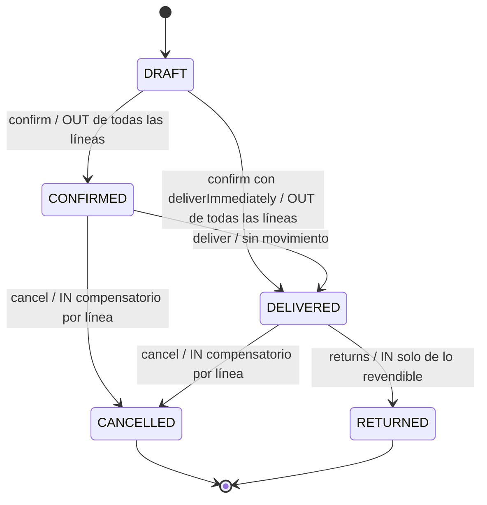

# Contrato de Ventas — implementación vigente

Versión 2.0, 24 de noviembre de 2026. Describe lo que hace el código del repositorio, no una propuesta. Donde el código y la versión 1.1 (17 de noviembre, diseño previo) difieren, manda el código; las diferencias se listan en la [sección 12](#12-diferencias-con-la-versión-11). No autoriza migraciones, despliegues ni operaciones en producción.

Código: [rutas](../catalog-api/src/routes/sales.routes.ts), [servicio](../catalog-api/src/services/sale.service.ts), [borradores y clientes](../catalog-api/src/services/sale-customer.ts), [esquemas Zod](../catalog-api/src/schemas/sales.schema.ts), [conversión de pedidos](../catalog-api/src/controllers/order.controller.ts) y [Prisma](../catalog-api/prisma/schema.prisma).

## 1. Alcance

Módulo privado de ventas presenciales por cuenta, sobre la única bodega implícita (los artículos de inventario del propietario). Incluye borradores, ficha comercial, descuento fijo por unidad, confirmación (opcionalmente con entrega inmediata), entrega, cancelación con compensación de stock, devolución total y conversión explícita de un pedido del catálogo en venta.

No incluye pagos, saldos ni cartera, reembolsos, facturación electrónica, impuestos (no hay `taxMode`), reservas, varias bodegas, cantidades fraccionarias, entregas o devoluciones parciales, FIFO ni valorización contable.

## 2. Invariantes que aplica el código

1. El propietario sale de la sesión. Toda lectura y escritura filtra por `userId`; un ID ajeno responde como inexistente.
2. Un borrador no reserva ni modifica stock.
3. Confirmar descuenta todas las líneas en una transacción. Si una línea no tiene stock o cambió su ficha comercial, no se escribe nada.
4. Entregar no descuenta otra vez. Confirmar con `deliverImmediately: true` hace ambas cosas en el mismo commit.
5. Precios, descuentos, subtotales y totales los calcula el servidor; el cliente solo envía cantidades y descuento unitario.
6. Después de confirmar no se editan líneas ni instantáneas. Entrega, cancelación y devolución cambian estado y añaden movimientos; no reescriben importes.
7. Las correcciones físicas son movimientos de inventario vinculados a la venta y su línea.
8. Toda mutación lleva `operationId` y `requestId` (UUID del cliente) y queda registrada en `"SaleOperation"`.
9. Cerrar la cuenta no borra ni transforma ventas.

## 3. Estados y transiciones



| Origen | Acción | Destino | Comprobaciones y efecto | Error si no procede |
| --- | --- | --- | --- | --- |
| `DRAFT` | `PATCH /sales/:id` | `DRAFT` | Reemplaza todas las líneas, recalcula y sube la versión. Sin stock. | `INVALID_TRANSITION` si no es borrador; `VERSION_CONFLICT` |
| `DRAFT` | `confirm` | `CONFIRMED` o `DELIVERED` | Stock suficiente y misma versión de ficha comercial en cada línea; `OUT` por línea. | `VERSION_CONFLICT`, `STOCK_INSUFFICIENT`, `PRICE_CHANGED` |
| `CONFIRMED` | `deliver` | `DELIVERED` | Solo fecha y versión. | `INVALID_TRANSITION` |
| `CONFIRMED` o `DELIVERED` | `cancel` | `CANCELLED` | Motivo de 3 a 300 caracteres; `IN` por la cantidad íntegra de cada línea. | `INVALID_TRANSITION` |
| `DELIVERED` | `returns` | `RETURNED` | Cada línea enviada debe existir y devolverse completa; `IN` solo por lo revendible. | `INVALID_TRANSITION`, `RETURN_MUST_BE_TOTAL` |

Un borrador **no** se puede cancelar (`INVALID_TRANSITION`) y no hay acción para descartarlo. No existe vuelta a borrador.

## 4. Dinero, ficha comercial y cálculo

- Pesos COP enteros en `BIGINT`; en JSON, cadenas decimales (`"200"`). `currency` siempre `COP`.
- La ficha comercial (`item_commercial_terms`) aporta precio de venta, costo de referencia opcional y versión. Sin ficha, el borrador responde `PRICE_REQUIRED`.
- El descuento unitario cumple `0 <= descuento <= precio` (`INVALID_DISCOUNT`). Un neto cero es válido y no implica cobro.

Por línea y por venta:

```text
lineTotal     = (unitPrice − unitDiscount) × quantity
subtotal      = Σ unitPrice × quantity
discountTotal = Σ unitDiscount × quantity
total         = subtotal − discountTotal
```

Confirmar compara la versión de la ficha guardada en cada línea (`commercialTermsVersion`) con la vigente; si cambió, `PRICE_CHANGED`. No compara nombre ni SKU. Tras confirmar solo cuentan las instantáneas de la línea (`itemName`, `sku`, `unitPrice`, `unitCost`, `unitDiscount`, `lineTotal`).

### Restricciones en base de datos

La migración `20261124100000_sale_integrity_checks` añade:

| Tabla | CHECK |
| --- | --- |
| `"Sale"` | `currency = 'COP'`; `subtotal`, `discountTotal`, `total >= 0`; `discountTotal <= subtotal`; `subtotal − discountTotal = total` |
| `"SaleLine"` | `quantity > 0`; `unitPrice`, `unitDiscount`, `lineTotal >= 0`; `unitCost` nulo o `>= 0`; `unitDiscount <= unitPrice`; `lineTotal = (unitPrice − unitDiscount) × quantity` |
| `"SaleReturnLine"` | `receivedQuantity > 0`; `resellableQuantity`, `damagedQuantity >= 0`; `resellableQuantity + damagedQuantity = receivedQuantity` |

No se imponen en base de datos (siguen dependiendo del servicio): que `subtotal`/`discountTotal` coincidan con la suma de líneas, que lo recibido iguale lo vendido y que una devolución cubra todas las líneas. Tampoco hay triggers de inmutabilidad. Antes de aplicar la migración, comprobar los datos con [la consulta de solo lectura](sql/verify-sale-integrity.sql), que también informa de esas tres reglas como diagnóstico.

## 5. Modelo de datos

| Tabla | Campos relevantes |
| --- | --- |
| `"Sale"` | `id`, `userId`, `status`, `version`, `currency`, `subtotal`, `discountTotal`, `total`, fechas `confirmedAt`/`deliveredAt`/`cancelledAt`/`returnedAt`. Cliente: `customerId?` (cliente del mismo propietario) e instantáneas `customerNameSnapshot`, `customerPhoneSnapshot`, `customerEmailSnapshot`; además `customerName`/`customerPhone` heredados. `sourceOrderId?` único: como máximo una venta por pedido. |
| `"SaleLine"` | `saleId`, `inventoryItemId`, `quantity`, instantáneas de nombre, SKU, precio, costo, descuento y total, `commercialTermsVersion`. Una línea por artículo (`UNIQUE (saleId, inventoryItemId)`). No tiene `userId`; la propiedad se hereda de la venta. |
| `"SaleOperation"` | `id` (= `operationId`), `requestId`, `saleId`, `userId`, `type` (texto: `CREATE`, `UPDATE_DRAFT`, `CONFIRM`, `DELIVER`, `CANCEL`, `RETURN`, `ORDER_CONVERSION`), `status`, `expectedSaleVersion`, `requestHash`, `responseSnapshot`, `completedAt`. `UNIQUE (userId, requestId)`. |
| `"SaleReturn"` | `saleId`, `userId`, `operationId` único, `reason`. |
| `"SaleReturnLine"` | `returnId`, `saleLineId`, `receivedQuantity`, `resellableQuantity`, `damagedQuantity`. |
| `inventory_movements` | Los movimientos de venta usan `origin = 'SALE'`, `saleId`, `saleLineId`, `saleMovementRole` (`SALE_CONFIRMATION`, `SALE_CANCELLATION`, `SALE_RETURN_RESELLABLE`), `key = operationId` y `actorUserId`. `SALE_RETURN_DAMAGED` existe en el enum pero no se escribe: lo dañado no genera movimiento. Desde `20261124200000_inventory_movements_allow_sale_origin`, `origin = 'SALE'` exige `saleId`, `saleLineId`, `saleMovementRole` y `actorUserId`, sin referencias de lote. `MANUAL` e `INVENTORY_BATCH` no admiten referencias de venta, y cualquier otro origen se rechaza. |

Todas las FKs de venta usan `RESTRICT`. No hay endpoint ni columna para borrar o archivar ventas.

## 6. API

Rutas privadas bajo `/api`, con cookie HttpOnly y proxy same-origin, `Cache-Control: private, no-store` y cuerpos JSON de hasta 32 KiB. Respuesta correcta: `{ "result": ... }` con importes como cadenas.

| Método y ruta | Cuerpo | Resultado |
| --- | --- | --- |
| `GET /sales` | — | Las **50** ventas más recientes (`createdAt`, `id` descendente), con líneas y cliente. Sin filtros ni paginación. |
| `GET /sales/:id` | — | Venta con líneas y cliente. |
| `POST /sales` | `operationId`, `requestId`, `customerId?` o `customerName?`/`customerPhone?` | Borrador vacío (versión 1). |
| `PATCH /sales/:id` | `operationId`, `expectedVersion`, `lines[1..100]` (`inventoryItemId`, `quantity`, `unitDiscount`), cliente opcional | Borrador recalculado. |
| `POST /sales/:id/confirm` | `operationId`, `requestId`, `expectedVersion`, `deliverImmediately` (por defecto `false`) | Venta confirmada o entregada. |
| `POST /sales/:id/deliver` | `operationId`, `requestId`, `expectedVersion` | Venta entregada. |
| `POST /sales/:id/cancel` | `operationId`, `requestId`, `expectedVersion`, `reason` | Venta cancelada. |
| `POST /sales/:id/returns` | `operationId`, `requestId`, `expectedVersion`, `reason`, `lines[1..100]` (`saleLineId`, `receivedQuantity`, `resellableQuantity`, `damagedQuantity`) | Venta devuelta. |
| `POST /orders/:orderId/convert-to-sale` | Ver [sección 9](#9-conversión-de-pedidos) | `{ success, sale, idempotent }` |

Errores: `400 INVALID_SALE_INPUT` (Zod), `400 ITEM_NOT_FOUND`/`PRICE_REQUIRED`/`INVALID_DISCOUNT`; `401` sin sesión o `AUTH_REQUIRED` con la cuenta cerrada; `404 NOT_FOUND` (venta ausente o ajena) y `CUSTOMER_NOT_FOUND`; `409 VERSION_CONFLICT`, `INVALID_TRANSITION`, `STOCK_INSUFFICIENT`, `PRICE_CHANGED`, `IDEMPOTENCY_CONFLICT`, `RETURN_MUST_BE_TOTAL`, `CUSTOMER_ARCHIVED`; `500 SALE_OPERATION_FAILED` para cualquier otro fallo. En la mayoría de los `409` el mensaje es el propio código.

La interfaz actual (`/dashboard/ventas`) crea borradores, muestra el historial por cliente y registra devoluciones. Confirmar, entregar y cancelar solo están disponibles por API.

## 7. Idempotencia: una clave por llamada

No hay preparación en dos pasos ni `GET /sale-operations`. Cada mutación lleva su propia identidad, generada por el cliente:

- `operationId`: UUID de la intención; se reutiliza al reintentar la misma acción.
- `requestId`: UUID que también forma parte del comando. Un reintento debe repetir **los dos** con el mismo cuerpo. En `PATCH /sales/:id` no se envía; el servidor usa `requestId = operationId`.
- `requestHash`: SHA-256 de `JSON.stringify` del cuerpo validado, incluido `requestId`.

| Operación | Si la clave ya existe |
| --- | --- |
| `confirm`, `deliver`, `cancel`, `returns` | Tras bloquear la venta y **antes** de comprobar estado o versión: si la operación previa es de otro tipo, de otra venta o con otro hash, `409 IDEMPOTENCY_CONFLICT`; si tuvo éxito, devuelve el recibo guardado (`responseSnapshot`, importes como cadenas) sin repetir movimientos. El recibo describe el resultado original, no el estado actual. |
| `POST /sales` | Mismo tipo y hash: devuelve la venta actual; si no, conflicto. |
| `PATCH /sales/:id` | Mismo tipo y hash: devuelve la venta actual sin recalcular; si no, conflicto. |
| `convert-to-sale` | Mismo tipo, pedido y hash: devuelve la venta actual con `idempotent: true`; si no, conflicto. |

El registro de la operación se crea dentro de la misma transacción que sus efectos. Si la transacción falla, no queda operación y el mismo `operationId` puede reintentarse. Los estados `REJECTED` y `ABANDONED` existen en el enum pero no se usan; no hay rechazos recuperables persistidos.

Una clave nueva sobre una versión ya superada no se trata como reintento: `confirm` responde `VERSION_CONFLICT` y las demás, `INVALID_TRANSITION`. La interfaz reutiliza las claves al reintentar la creación de borradores; para las devoluciones genera claves nuevas en cada clic.

## 8. Transacciones y bloqueos

Orden de bloqueo, igual para `confirm`, `deliver`, `cancel` y `returns`:

1. `users` `FOR SHARE` del propietario, comprobando que la cuenta no esté cerrada (`lockInventoryOwner`).
2. Fila de `"Sale"` `FOR UPDATE`. Dos llamadas sobre la misma venta se serializan; la segunda ve el estado ya cambiado.
3. Recibo previo (sección 7).
4. Estado y versión.
5. Artículos implicados con `SELECT … FROM inventory_items … ORDER BY id FOR UPDATE`, y después lectura de su saldo. El orden fijo evita bloqueos cruzados entre ventas con los mismos artículos en distinto orden, y es el mismo que usan los lotes de inventario.
6. Validación de todas las líneas antes de escribir; luego saldos, movimientos, estado y recibo en el mismo commit.

Con dos confirmaciones de la última unidad, una confirma y la otra recibe `STOCK_INSUFFICIENT` sin dejar escrituras. Cada movimiento parte del saldo dejado por el anterior. `inventory_items` conserva `CHECK (stock >= 0)` como defensa adicional.

Otros flujos: `POST /sales` usa un advisory lock por propietario (`sale-create-v1`); `PATCH /sales/:id` bloquea la venta `FOR UPDATE`; `convert-to-sale` bloquea el pedido `FOR UPDATE` pero **no** bloquea los artículos antes de descontar (ver [sección 13](#13-limitaciones-y-riesgos-conocidos)). Ninguna operación de ventas toma locks de catálogo; el cierre de cuenta usa `Order → Catalog → User`.

## 9. Conversión de pedidos

`POST /api/orders/:orderId/convert-to-sale` crea una venta a partir de un pedido del catálogo propio.

- Cuerpo: `operationId`, `requestId` (deben ser distintos), `customerId?`, `mode` (`DRAFT` por defecto, `CONFIRMED` o `DELIVERED`) y `acceptPriceDifference` (por defecto `false`).
- El pedido debe ser del propietario (`ORDER_NOT_FOUND`) y estar `PENDING` o `CONFIRMED` (`ORDER_STATUS_NOT_CONVERTIBLE`). Cada línea necesita un producto vinculado a un artículo de inventario (`ORDER_ITEM_NOT_INVENTORY`) con ficha comercial (`PRICE_REQUIRED`).
- El precio de la venta es el **congelado en el pedido**, con descuento 0. Si difiere del precio vigente de la ficha, exige `acceptPriceDifference: true` (`PRICE_DIFFERENCE_REQUIRES_CONFIRMATION`).
- Las instantáneas del comprador salen del pedido. Un `customerId` explícito solo crea el vínculo operativo, nunca sustituye esas instantáneas. Un teléfono de más de 24 caracteres se rechaza sin recortarlo.
- `sourceOrderId` es único: un pedido produce como máximo una venta. La conversión no modifica el pedido.
- En `CONFIRMED`/`DELIVERED` descuenta stock y registra `SALE_CONFIRMATION`, igual que `confirm`.

## 10. Devoluciones

Solo para ventas `DELIVERED`. Cada línea enviada debe existir en la venta y tener `receivedQuantity` igual a lo vendido; `resellableQuantity + damagedQuantity = receivedQuantity`. Solo lo revendible vuelve al stock (`SALE_RETURN_RESELLABLE`). La devolución, sus líneas, los movimientos, el estado `RETURNED` y el recibo se confirman juntos. No se recalculan importes ni se registra reembolso.

## 11. Pruebas

- [`sale-integrity.test.ts`](../catalog-api/src/services/sale-integrity.test.ts): doble con bloqueos de fila y deshacer por transacción. Cubre carreras de confirmación, orden de bloqueo, cancelación y devolución concurrentes, y reintentos.
- `sale-customer.test.ts`, `sale-conversion.test.ts` y `customer-sales.test.ts`: clientes, instantáneas y conversión.
- [`verify-sale-integrity-postgres.ts`](../catalog-api/src/scripts/verify-sale-integrity-postgres.ts): ensayo en PostgreSQL local (`catalogo_test`, esquema aleatorio) con la cadena real de migraciones y sin cambios manuales. Cubre el bloqueo previo, la consulta de verificación, el fallo atómico y la recuperación de P3009, las reglas de origen y los CHECK. Recorre el flujo completo (confirmar, entregar, confirmar y entregar, cancelar, devolver revendible y dañado, convertir pedidos en borrador, confirmado y entregado), comprobando stock y movimiento en cada paso. Termina con la conciliación del registro, las carreras reales y los reintentos. Ejecutar desde `catalog-api` tras `npm.cmd run build`: `'postgresql://<usuario>@127.0.0.1:<puerto>/catalogo_test' | npm.cmd run test:sales-postgres`.

## 12. Diferencias con la versión 1.1

| Versión 1.1 (diseño) | Código vigente |
| --- | --- |
| Preparar la operación (`POST /sales/:id/operations`) y ejecutarla; `GET /sale-operations/:id` y `abandon`. | Una clave por llamada (`operationId` + `requestId`); sin preparación ni consulta de operaciones. |
| El hash excluye `requestId`. | El hash incluye `requestId`. |
| Sin FK de pedido en el MVP. | `sourceOrderId` único y `convert-to-sale`. |
| `nonResellableQuantity`. | `damagedQuantity`. |
| Listado con filtros, cursor y 24 resultados. | Máximo 50, sin filtros ni paginación. |
| `DRAFT → CANCELLED` permitido; cancelar una entregada, prohibido. | Un borrador no se cancela; una venta `DELIVERED` sí puede cancelarse. |
| Confirmar exige revisar cambios de nombre o SKU. | Solo compara la versión de la ficha comercial. |
| `SaleLine.userId`, `taxMode = NOT_MANAGED`, origen de movimiento por rol (`SALE_CONFIRMATION`…). | Sin `userId` en la línea ni `taxMode`; `origin = 'SALE'` más `saleMovementRole`. |
| Rechazos de negocio persistidos como `REJECTED`. | No se persisten; la transacción se revierte. |
| `503 RETRY_SAME_OPERATION`. | `500 SALE_OPERATION_FAILED`. |
| Bloqueo del cierre de cuenta con ventas `CONFIRMED` pendientes. | No implementado. |

## 13. Limitaciones y riesgos conocidos

- **Origen de movimiento rechazado por el esquema aplicado (bloqueante hasta aplicar `20261124200000_inventory_movements_allow_sale_origin`).**
  - `inventory_movements_origin_check` y `inventory_movements_batch_check` (migración `20261119000000_inventory_batches`) solo admiten `MANUAL` e `INVENTORY_BATCH`, y los movimientos de venta usan `SALE`.
  - Mientras no se aplique la migración correctora, fallan con `500`: confirmar, convertir en `CONFIRMED`/`DELIVERED`, cancelar una venta confirmada y devolver unidades revendibles.
  - La migración está preparada y ensayada, pero no aplicada. Procedimiento: [runbook](despliegue-2026-11-ventas.md).
- La conversión de pedidos descuenta stock sin bloquear los artículos en orden; dos conversiones o una conversión y una venta simultáneas pueden dejar `previousStock` obsoletos en el historial. El saldo no baja de cero gracias al CHECK.
- Una devolución no exige incluir todas las líneas de la venta; la venta pasa a `RETURNED` aunque falte alguna.
- Cancelar una venta `DELIVERED` reingresa todo el stock sin registrar recepción física.
- Las reglas entre tablas (sumas de líneas, devolución completa) no tienen respaldo en base de datos.
